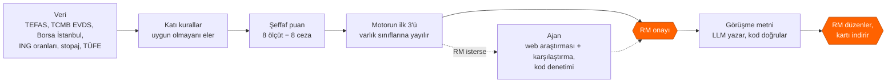
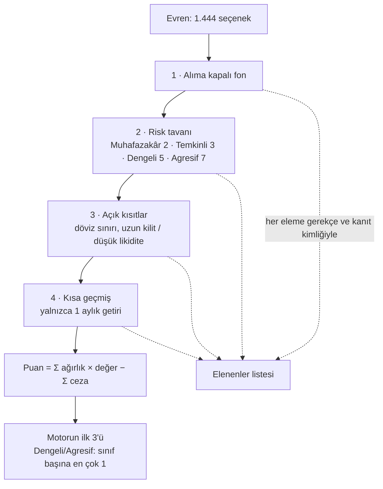
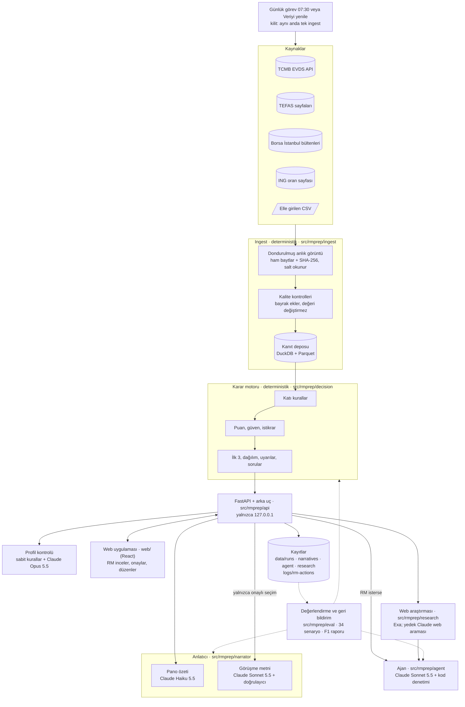
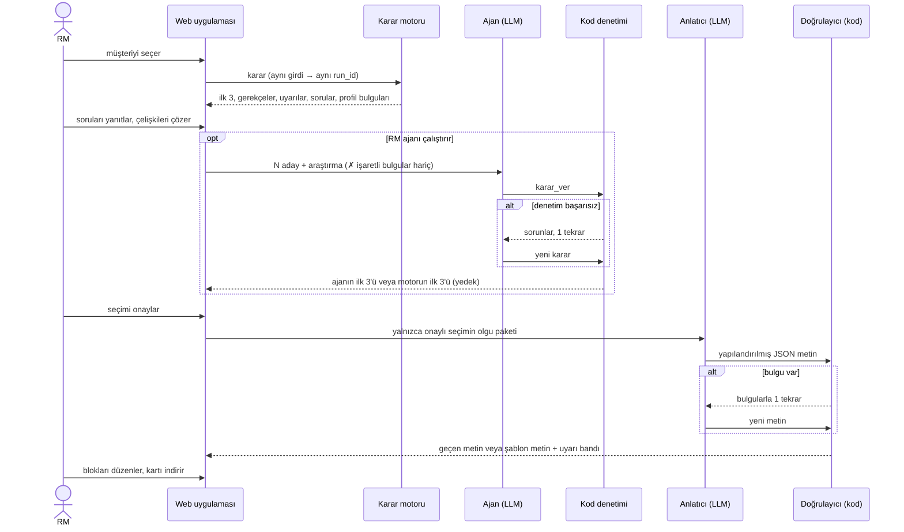
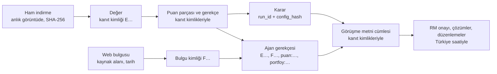

# RM Görüşme Hazırlığı — kanıta dayalı yatırım karar desteği

ING Agentic AI Hackathon · Private Banking RM Yatırım Karar Destek Çözümü

Private Banking RM'i bir müşteri görüşmesine hazırlanırken bu araç, 1.444
yatırım seçeneğini (TEFAS fonları, BYF'ler, Borsa İstanbul payları, ING
mevduatı) müşterinin profiline ve kısıtlarına göre eler, şeffaf bir puanla
sıralar, önerilen ilk 3'ü gerekçesiyle gösterir ve RM onayından sonra görüşme
metnini yazar. İsteğe bağlı bir ajan, motorun en iyi adaylarını web
araştırmasıyla karşılaştırıp kendi ilk 3'ünü önerir; her adımı kodla denetlenir.
Her sayı kaynağı, tarihi ve kanıt kimliğiyle izlenebilir.
**Araç yatırım tavsiyesi vermez; kararı ve müşteri iletişimini RM yapar.**


*P02 (ihracatçı, Dengeli) panosu, 17.10.2026 verisi. Üstte profil ve AI
kontrolünün alıntılı "Sorulacak" bulguları; ortada kodun yazdığı piyasa notu
(her değer "K" ile kanıta bağlı); en altta RM'in onay çubuğu.*

Hızlı başlangıç (Windows, Python 3.11+, Node yalnızca web derlemesi için):

```powershell
python -m venv .venv; .venv\Scripts\Activate.ps1
pip install -e ".[dev,web,narrator]"
cd web; npm ci; npm run build; cd ..
python -m rmprep ingest          # veriyi çeker (yaklaşık 16 dk), yeni anlık görüntü
python -m rmprep serve           # http://127.0.0.1:8600
pytest -q                        # 150 dosyada 3.053 test, ağ erişimi yok
python -m rmprep eval --no-llm   # değerlendirme paketi, ücretsiz geçiş
python -m rmprep feedback        # RM işlem kaydından geri bildirim raporu
```

`.env` dosyasında `EVDS_API_KEY` (TCMB EVDS), `ANTHROPIC_API_KEY` (görüşme
metni, ajan, profil kontrolü) ve `EXA_API_KEY` (web araştırması) gerekir.
Anahtar yoksa ilgili parça kapanır; karar motoru yine çalışır.

| Brief teslimatı | Bu belgede | Ayrıntı |
|---|---|---|
| 1 · Çalışan demo | Hızlı başlangıç, bölüm 4–6 | `python -m rmprep serve` |
| 2 · Problem tanımı | bölüm 1 | [`docs/teslim/01-problem-tanimi.md`](docs/teslim/01-problem-tanimi.md) |
| 3 · Analitik çözüm | bölüm 2–3, 6 | [`docs/decision.md`](docs/decision.md), [`config/decision.yaml`](config/decision.yaml) |
| 4 · Çözüm tasarımı | bölüm 4–6 | [`docs/agent.md`](docs/agent.md), [`docs/narrator.md`](docs/narrator.md), [`docs/web-ui.md`](docs/web-ui.md) |
| 5 · Test ve öğrenimler | bölüm 7 | [`docs/eval.md`](docs/eval.md), [`docs/found-and-fixed.md`](docs/found-and-fixed.md) |
| 6 · Kanıt kaydı örneği | bölüm 8 | [`docs/teslim/06-kanit-kaydi-ornegi.md`](docs/teslim/06-kanit-kaydi-ornegi.md) |

---

## 1. Problem tanımı ve çözüm yaklaşımı

**Problem.** RM her görüşmeden önce yüzlerce ürünü dağınık kaynaklardan elle
karşılaştırıyor. Bu iş yavaş; metin müşteriye yeterince uyarlanmıyor; açık bir
kısıt kaçabiliyor; önerinin hangi veriye, varsayıma ve gerekçeye dayandığı
sonradan gösterilemiyor.

Verimizden üç örnek (anlık görüntü `20261017-110343-d12a`, 17.10.2026):

| Gözlem | Sayı |
|---|---|
| Muhafazakâr bir müşteri (P01) için evren | **1.444** seçenek (815 fon, 37 BYF, 590 pay, 2 ING mevduatı); kurallar **1.301**'ini eler, **143**'ü kalır |
| ING Turuncu Hesap %23 faiz, stopaj ve yıllık TÜFE (%29,73) sonrası | **reel −%8,3** |
| P01'in risk sınırı içindeki 37 para piyasası fonu, son 1 yıl reel | medyan **+%6,6**, en iyisi **+%9,6** |

Nominal faiz tek başına yanıltır: müşteri mevduatta değer kaybettiğini
görmeyebilir. 143 seçeneği elle reel, vergi sonrası ve risk uyumuyla sıralamak
bir hazırlık süresine sığmaz.

**Beklenen iş etkisi.**

| Gösterge | Bugün | Çözümle (ölçüldü) |
|---|---|---|
| Hazırlık süresi | **[VARSAYIM]** görüşme başına ~60 dk | analiz ort. 1,18 sn, görüşme metni ort. 24,9 sn; geri kalan RM'in okuması ve onayı |
| Kısıt ihlali | elle kontrol | 34 senaryo, 39 çalıştırmada **0** |
| Tutarlılık | kişiye bağlı | aynı girdi → aynı sonuç ve aynı metin (5/5 tekrar) |
| Uyarlama | genel metin | 5 personada 5 farklı öneri seti; gerekçe müşterinin önceliklerine bağlı |
| İzlenebilirlik | dağınık | her sayı kaynak, değer tarihi, alınma zamanı ve kanıt kimliğiyle |

**Yaklaşım.** Kararı kod verir; ajan ve LLM yalnızca kodun sınırları içinde
önerir ve yazar; çıktılarını yine kod denetler; son sözü RM söyler.



Kapsam: görüşme **öncesi** hazırlık. Getiri tahmini, otomatik işlem, müşteriyle
doğrudan iletişim ve müşteriye açık bir sohbet botu kapsam dışıdır.

## 2. Kullanılan veri kaynakları ve temel sinyaller

| Kaynak | Ne verir | Nasıl okunur |
|---|---|---|
| **TCMB EVDS** (resmî API) | politika faizi, USD/TRY, TCMB fonlama maliyeti, 3 aya kadar mevduat faizi, TÜFE endeksi (→ yıllık TÜFE), BIST 100 | API anahtarıyla; 900 günden uzun pencereler parça parça |
| **TEFAS fon getirileri sayfası** | ~2.100 fon ve BYF'ler: 1 ay–5 yıl getiri, SPK risk değeri (1–7) | tek kamuya açık HTML sayfası; robots.txt'nin yasakladığı `/api/` hiç çağrılmaz |
| **TEFAS fon detay sayfaları** | fiyat, büyüklük, yatırımcı sayısı, alış/satış valörü, ücretler, alım durumu, **portföy dağılımı** | fon başına bir sayfa, en az 1 sn arayla |
| **Borsa İstanbul gün sonu bültenleri** | 628 pay: kapanış, 1 ay–5 yıl getiri, 1 ve 5 yıllık oynaklık, işlem hacmi, BIST 100 üyeliği | ücretsiz günlük ZIP dosyaları, sn'de en çok 1 istek; dosyalar SHA-256 ile önbellekte |
| **ING oran sayfası** | Turuncu Hesap ve e-Vadeli Mevduat oranları (dört ürün okunur, ikisi kullanılır) | ING'nin kamuya açık formu, istekler arası 2 sn; hata olursa önceki anlık görüntü, sonra elle girilen CSV |
| **Elle girilen CSV** | stopaj oranları (geçerlilik sonu 31.12.2026), yıllık TÜFE (çapraz kontrol), ING oranları (yedek) | her satır kaynak bağlantısı ve tarihiyle; kaynaksız satır reddedilir |
| **Fon yöneticisi belgeleri** | izahname ve yatırımcı bilgi formu bağlantıları | RM fon kartını açınca, yöneticinin kendi sitesinden; yalnızca bağlantı |
| **Web araştırması (Exa)** | önerilen ürünler ve şirketleri için son 90 günün haberleri ve öne çıkanlar | yalnızca ürün ve şirket adı gider; etiket "web kaynağı, doğrulanmamış" |

**KAP neden yok?** kap.org.tr botları engeller; ayna siteler kendi koşullarında
otomatik okumayı yasaklar; KAP verisinin yeniden dağıtımı lisans ister (brief
kuralı 8). Bu nedenle fon belgeleri için yöneticinin kendi sayfasına bağlantı
veririz; şirket haberleri için web araştırmasını kullanırız; kap.org.tr
araştırmada da dışarıda tutulur.

Evren: 815 TEFAS fonu, 37 BYF, 590 pay ve 2 ING mevduatı (Turuncu Hesap
karşılaştırma tabanıdır). "Serbest" fonlar (yalnızca nitelikli yatırımcı),
W ve S pazarlarındaki paylar, varant ve sertifikalar evrene girmez. Diğer
bankaların mevduat oranları (İş Bankası, Ziraat) okunur, ama puana girmez ve
ekranda gösterilmez.

**Ürün sinyalleri:** stopaj ve TÜFE sonrası reel getiri · SPK risk değeri
(paylarda oynaklık bandı; yoksa varlık sınıfından tahmin) · satış valörü
(paraya erişim) · fon büyüklüğü ve yatırımcı sayısı (paylarda işlem hacmi) ·
alım durumu · giriş/çıkış ücreti · portföy dağılımı (çok varlıklı fonların
varlık sınıfı) · piyasa mevduat ortalaması.

**Müşteri sinyalleri** (persona dosyasının alanları):

| Alan | Kararda nasıl kullanılır |
|---|---|
| Risk profili | risk tavanı (katı kural), risk bandı ve risk iştahı (puan) |
| Yatırım ufku | hangi dönemin getirisine bakılır; ufuk ≥ 3 yılsa getiri ağırlığı artar |
| Likidite, gelir, anapara koruma | Düşük 0 · Orta 0,5 · Yüksek 1 → ilgili ölçütün ağırlığı ve ceza şiddeti |
| Döviz maruziyeti | döviz cezasının şiddeti; açık kısıtsa katı kural |
| Öncelikler | eşleşen her öncelik ilgili ölçüt ağırlığına +1 |
| Açık kısıtlar | katı kural (ör. döviz sınırı, uzun kilit) |
| Durum, amaç, RM notu | mevcut portföy dağılımının tahmini (D27) ve metindeki uyarlama |
| Yaş | puana girmez; metinde ve profil tutarlılık kontrolünde kullanılır |

**Neden bu sinyaller?** Brief'in 6.1'deki müşteri ve ürün özelliklerinin her
biri bir ölçüte, bir cezaya veya bir katı kurala karşılık gelir. Getiri
**reel ve stopaj sonrası** ölçülür, çünkü %30 enflasyonda nominal getiri
yanlış bir sıra verir. **Yaş neden puanda yok?** Uygunluğu risk profili zaten
belirler; yaşı ayrıca puanlamak aynı bilgiyi iki kez sayar ve tek başına bir
yaş-risk kuralının kamuya açık bir dayanağı yoktur. Yaş metinde kullanılır;
profil kontrolü de yaşla çelişen bir notu (ör. `yas` 62, notta "45 yaşında")
RM'e gösterir.

## 3. Karşılaştırma / sıralama veya karar mantığı

Karar katmanı deterministik bir kural ve puanlama motorudur
([`docs/decision.md`](docs/decision.md); tüm tablolar
[`config/decision.yaml`](config/decision.yaml) içinde). Aynı girdi her zaman
aynı sonucu ve aynı `run_id`'yi verir.

**Neden kural + şeffaf puan?** Etiketli geçmiş öneri verisi yok, bu yüzden
denetimli bir model eğitilemez. Kural 5 (uygun olmayan ürün listeye girmez)
olasılıkla değil, kesin olarak uygulanmalıdır. Her puan parçası RM'e ve jüriye
gösterilebilir ve tekrar üretilebilir. LLM'in güçlü olduğu yerler (dil,
araştırma özeti, adaylar arasında nitel karşılaştırma) ayrıdır (bölüm 5).



Ekranda aynı huni "Bu öneriler nasıl seçildi?" bloğundadır: müşterinin kriter
ağırlıkları, kural başına elenen sayısı ve istikrar sonucu.


Bilinmeyen risk değeri bir eleme nedeni değildir: aynı sınıftaki bilinen
risklerin üst çeyreğiyle tahmin edilir, güveni düşürür ve RM'e uyarı verir.

**Puan.** Her ölçüt 0–1 arası bir değer alır; değer ağırlıkla çarpılır,
toplanır, cezalar çıkarılır. Ağırlıklar müşteriden gelir ve toplamı 1'dir.

| Ölçüt | Ne ölçer | Ham ağırlık |
|---|---|---|
| Getiri | stopaj, ücret ve TÜFE sonrası reel getirinin adaylar içindeki sırası | 2 + 2 × risk iştahı (+1, ufuk ≥ 3 yıl) |
| Risk uyumu | risk değeri müşterinin bandında mı (bandın altındaki her seviye −0,5) | 2 |
| Likidite | satış valörü (aynı gün 1,0 … 10 günden uzun 0,2) | 2 × likidite ihtiyacı |
| Gelir | ürün türünün düzenli gelire uygunluğu | 2 × gelir ihtiyacı |
| Anapara | anaparanın korunması (mevduat 1; fon riskle azalır) | 2 × anapara koruma tercihi |
| Sadelik | ürün yapısının sadeliği | yalnızca "sade ürün yapısı" önceliğiyle |
| Kalite | fon büyüklüğü ve yatırımcı sayısı (pay: işlem hacmi) | 0,5 |
| Portföy açığı | müşterinin mevcut dağılımının model banttan uzaklığı (D27) | 1 × kaynak katsayısı; yalnızca RM'in girdiği, RM'in onayladığı veya müşteri dosyasından gelen dağılımla |

Cezalar: anapara riski, yavaş erişim, döviz maruziyeti, bilinmeyen risk,
reel kayıp, piyasa altı getiri (en çok 0,3); geçmiş eksikliği (0,2); küçük fon
(0,1). Ceza = üst sınır × müşterinin önem derecesi × ürünün ihlal derecesi.

**Neden bu ağırlıklar?** MiFID II ve SPK yerindelik kuralları sayısal bir
ağırlık vermez; bu yüzden ağırlıkları biz seçtik ve açıkça gösteriyoruz
**[VARSAYIM]**. Bu seçimin etkisini iki yolla ölçüyoruz: istikrar testi her
ağırlığı ±%20 değiştirir (bölüm 6) ve değerlendirme paketi persona
değişikliklerinin sonucu beklenen yönde değiştirdiğini kontrol eder (bölüm 7).

**Önerilen ilk 3 (D19).** Muhafazakâr ve Temkinli müşteride puan sırasının ilk
üçü. Dengeli ve Agresif müşteride, ya da çeşitlendirme isteyen her müşteride,
motor listeyi puan sırasıyla dolaşır ve **her varlık sınıfından en çok bir**
seçenek alır (nakit benzeri en çok bir; pay en çok bir); son bir yıl reel
getirisi negatif olanı almaz. Çok varlıklı fonların sınıfı **gerçek portföy
dağılımından** gelir (≥ %50 olan sınıf; yoksa "dengeli").

Örnek P02 (Dengeli, 1–3 yıl, "erişilebilir likidite" önceliği; 17.10.2026):
ağırlıklar getiri 0,339 · risk uyumu 0,203 · likidite 0,203 · gelir 0,102 ·
anapara 0,102 · kalite 0,051.

| Seçenek | Sınıf | Reel getiri (1 yıl) | Puan | Neden |
|---|---|---|---|---|
| **EIL** Astra Para Piyasası | nakit benzeri | +%7,7 | 0,783 | en iyi nakit benzeri; aynı gün erişim |
| **NJR** Nurol Borçlanma Araçları | borçlanma | +%8,1 | 0,743 | en iyi borçlanma fonu |
| **KDE** Kuveyt Türk Dengeli Katılım | dengeli | +%9,5 | 0,741 | en iyi dengeli; risk bandın içinde |
| ING e-Vadeli Mevduat | nakit benzeri | +%2,1 | 0,434 | sıralanır, ama nakit benzeri yeri EIL'de |
| ING Turuncu Hesap (karşılaştırma) | nakit benzeri | −%8,3 | 0,185 | reel kayıp ve piyasa altı cezaları |

Fon kartı ("Neden bu öneri?") her puan parçasını gerekçesiyle, geçtiği katı
kuralları kanıt kimlikleriyle ve en yakın alternatifle farkını gösterir
(ekranda puanlar ×100):


RPP (0,775) KDE'den yüksek puan alır, ama tek nakit benzeri yeri EIL doldurur.
P02'nin döviz kısıtı 15 döviz fonunu eler; RM bu kısıtı gerekçe yazarak
kaldırabilir. Aynı gün beş personanın ilk 3'ü:

| Persona | Kalan / evren | Motorun ilk 3'ü |
|---|---|---|
| P01 Emekli girişimci, Muhafazakâr | 143 / 1.444 | PPN · OSD · AIS |
| P02 İhracatçı, Dengeli | 306 / 1.444 | EIL · NJR · KDE |
| P03 Teknoloji kurucusu, Agresif | 1.250 / 1.444 | ASELS (pay) · TE3 · OKT |
| P04 Aile ofisi, Dengeli | 312 / 1.444 | OKT · RPP · TCF |
| P05 Hekim, Temkinli | 180 / 1.444 | EIL · GBL · KSK |

**Dağılım görünümü** ayrıca risk profiline göre model bantları (Ata Yatırım,
28.04.2026), müşterinin mevcut dağılımını ve her sınıfın en iyi seçeneğini
gösterir. P02'nin dosyasında dağılım yok: değerler "tahmini senaryo"dur ve RM
"Tahmini onayla" veya "Düzenle" diyene kadar sıralamayı etkilemez.


## 4. Genel çözüm mimarisi ve veri akışı



| Modül | Sorumluluk | Klasör |
|---|---|---|
| Ingest | kaynak adaptörleri, anlık görüntü, kalite kontrolleri, kanıt deposu, günlük görev ve kilit | `src/rmprep/ingest/`, `config/sources.yaml` |
| Karar motoru | evren, katı kurallar, puan, güven, istikrar, ilk 3, dağılım bantları, mevcut dağılım, uyarılar | `src/rmprep/decision/`, `config/decision.yaml` |
| Ajan | adaylar, veri paketi, araçlar, kod denetimi, yedek | `src/rmprep/agent/`, `config/agent.yaml` |
| Web araştırması | Exa ve Claude sağlayıcıları, soru kontrolü, biçimlendirme, önbellek, günlük sınır | `src/rmprep/research/`, `config/research.yaml` |
| Anlatıcı | olgu paketi, LLM çağrısı, doğrulayıcı, tekrar, şablon metin, piyasa notu, maliyet defteri | `src/rmprep/narrator/`, `config/narrator.yaml` |
| API ve arka uç | çalıştırma, profil kontrolü, onay, kayıt, işlem kaydı, veri güncelliği | `src/rmprep/api/`, `src/rmprep/backend.py` |
| Web uygulaması | pano, öneriler, ajan kutusu, araştırma paneli, fon kartı, kanıt penceresi, görüşme metni, sunum görünümü | `web/` |
| Değerlendirme | senaryolar, kural kontrolleri, LLM hakemi, ajan A/B, geri bildirim raporu | `src/rmprep/eval/`, `config/eval.yaml` |

Sözleşmeler (veri tipleri) `src/rmprep/contracts.py` içindedir. Tasarım
belgeleri: [`docs/ingest.md`](docs/ingest.md), [`docs/decision.md`](docs/decision.md),
[`docs/agent.md`](docs/agent.md), [`docs/research.md`](docs/research.md),
[`docs/narrator.md`](docs/narrator.md), [`docs/web-ui.md`](docs/web-ui.md),
[`docs/eval.md`](docs/eval.md).

## 5. AI/Agentic bileşenler ve görev/karar akışı

İlke: **LLM hiçbir ürünü elemez ve hiçbir katı kuralı aşamaz.** Eleme ve puan
koddadır. LLM dil, araştırma ve nitel karşılaştırma için kullanılır; her
çıktısını kod denetler; denetimden geçmeyen çıktı yerine deterministik bir
yedek gelir.

| Bileşen | Model | Görev | Güvence | Maliyet |
|---|---|---|---|---|
| Ajan ilk 3 | Claude Sonnet 5.5 | motorun en iyi 10 adayı (RM 20'ye kadar seçer) arasından kendi ilk 3'ünü seçer | kod denetimi; 1 tekrar; sonra motorun ilk 3'ü | karar başına ~0,05–0,10 $, günlük 3 $ |
| Web araştırması | Exa (yedek: Claude Haiku 5.5 web araması) | ilk 3 ve şirketleri için haberler ve öne çıkanlar | soru kontrolü (müşteri bilgisi gitmez); kaynaksız bulgu atılır; "doğrulanmamış" etiketi | ürün başına ~0,02 $, günlük 5 $ |
| Profil kontrolü | Claude Opus 5.5 | profilin tamamında çelişki arar | her bulgu iki tarafı da kelimesi kelimesine alıntılar; sunucu alıntıyı alanda arar | profil başına ~0,015 $, önbellekte |
| Görüşme metni | Claude Sonnet 5.5 | onaylı seçimi bölümlü Türkçe metne çevirir | doğrulayıcı; 1 tekrar; sonra şablon metin | metin başına 0,034 $, ort. 24,9 sn |
| Pano özeti | Claude Haiku 5.5 | RM'e 1–2 cümlelik özet | doğrulayıcı; hata → düz cümle | ~0,003 $ |
| Değerlendirme hakemi | Claude Haiku 5.5 | metnin uyarlanmış, açık, dengeli olup olmadığını notlar; ajan ile motoru kör A/B karşılaştırır | yalnızca kodun ölçemediği şeyler | paket başına < 0,01 $ |

**Ajan nasıl çalışır?** Ajan yalnızca RM "Ajanı çalıştır" deyince başlar.
Girdisi tek bir JSON veri paketidir: müşteri, mevcut dağılım, adayların puan
parçaları, olguları ve uyarıları, ve araştırma bulguları (veri olarak, talimat
olarak değil). Üç aracı vardır:

- `karsilastir(a, b, amac)`: iki adayı kodla karşılaştırır (en çok 4 kez).
- `arastir(option_id, soru, amac)`: bir aday için tek bir web sorusu sorar (en çok 2 kez).
- `karar_ver(secimler, cikanlar, ozet)`: kararı önerir.

Kod şunları denetler: 3 farklı aday; en çok 1 pay; varlık sınıfı kuralı; her
gerekçe bir kanıta (E…), bulguya (F…), puan parçasına veya portföy satırına
atıf yapar; her sayı ve tarih atıf yapılan veride vardır; yasak ifade yoktur;
motorun çıkarılan her seçeneği için bir gerekçe vardır. Denetim başarısız
olursa ajan sorunları alır ve bir kez düzeltir; ikinci hata, süre aşımı
(90 sn) veya günlük sınır motorun ilk 3'ünü getirir. RM ajanın beş adımını
(Adaylar, Ajan araştırması, Ajan analizi, Kontrol, Karar) zaman, maliyet ve
notlarıyla görür; ham model düşüncesi saklanmaz ve gösterilmez.


*P01 için ajan motorun AIS'ini çıkarıp ZBJ'yi aldı. Her gerekçe bir puan
parçasına veya kanıt kimliğine bağlıdır; tahmini dağılıma dayanan cümle
"(tahmini dağılıma göre)" etiketini kodla alır.*

Ajanın ve RM'in gördüğü web araştırması. RM her bulguyu ✓ veya ✗ ile
işaretler; ✗ işaretli bulgu "ajana verilmez":




**Doğrulayıcı** şunları reddeder: olgu paketinde olmayan sayı veya tarih;
elenen veya listede olmayan ürün adı; yasak ifade ("garanti", "risksiz",
"kesin getiri"); kaynaksız öneri cümlesi; ING ürün adının yanında ING'ye ait
olmayan oran; tahmini dağılımın sayısı; eksik bölüm veya eksik "yatırım
tavsiyesi değildir" cümlesi. Piyasa notu (politika faizi, USD/TRY, fonlama
maliyeti) LLM'e hiç yazdırılmaz: kod yazar, her değer kanıt kimliğiyle.

Metin yazılırken RM anlatıcının adımlarını ve her adımın girdisini görür:


Görüşme metni tek sayfadır. Beyaz alan müşteriye gösterilecek sunumdur; sarı
kutular yalnızca RM içindir ve "Sunum görünümü"nde ve çıktıda yer almaz. Her
kaynak numarası sağdaki "Kaynaklar" listesinde kanıt kimliğine bağlanır:


**Neden bu ayrım?** Ajan, tek bir puanın gösteremediği şeyleri tartar:
güncel haberler, iki adayın nitel farkı, müşterinin mevcut dağılımı. Ama
kararı kodun sınırları içinde verir ve RM motorun ilk 3'ünü her zaman yan
yana görür. Görüşme metni ise tek çağrıdır (en çok bir tekrar): maliyet, süre
ve davranış öngörülebilir kalır. **Geliştirmede** de çoklu ajan kullandık: bir
lider ve modül başına bir işçi Claude Code oturumu, ayrı git çalışma
ağaçlarında, dondurulmuş sözleşmelerle ve her adımda yeşil testlerle
([`docs/workflow.md`](docs/workflow.md)).

## 6. Varsayımlar, belirsizlikler ve insan onay noktaları

**Varsayımlar** (ekranda ve kayıtta görünür; `[VARSAYIM]` olanlar mentorlarla teyit edilecek):

- Fon getirileri geçmiş getirilerdir; bir tahmin değildir. 1 yıldan kısa dönem getirileri yıllığa çevrilmez.
- Getiriler stopaj sonrası ve yıllık TÜFE'ye (%29,73) göre reeldir.
- Yatırım tutarı bilinmez; mevduatta 100.000–249.999 TL diliminin standart oranı kullanılır.
- Risk bantları (Muhafazakâr 1–2, Temkinli 2–3, Dengeli 3–5, Agresif 4–7) ve ağırlıklar bir yargıdır **[VARSAYIM]**.
- Payların risk değeri oynaklık bandından gelir, en az 6'dır; BYF stopajı %17,5'tir **[VARSAYIM]**.
- Dağılım bantları tek bir kamuya açık kaynaktan gelir; Temkinli bandı bizim çıkarımımızdır **[VARSAYIM]**.
- Mevcut dağılım müşteri dosyasında yoksa meslek tablosu veya ulusal ortalama (TCMB FİR 2026-I) ile tahmin edilir. Tahmin sıralamayı **değiştirmez**; RM onaylayınca değiştirir **[VARSAYIM]**.

**Belirsizlik yönetimi:**

| Araç | Ne yapar |
|---|---|
| Veri güveni (0–1) | kullanılan en zayıf veri satırı × tahmin katsayıları (elle girilen 0,9 · doğrulanmamış seri 0,8 · eski 0,7 · çelişen 0,6 · tahmini risk × 0,7 · kısa geçmiş × 0,8 · reel getiri hesaplanamadı × 0,8) |
| İstikrar (0–1) | her ağırlık ve ceza üst sınırı ×0,8 ve ×1,2 ile değiştirilir (30–32 yeniden sıralama); önerilen seçenek için "öneri yine çıkıyor mu" oranı ([ayrıntı](docs/kararlilik-veri-guveni.md)) |
| Tahmin yerine soru | risk profili veya kısıt tanınmazsa sıralama durur ve RM'e soru açılır; diğer bilinmeyenlerde güvenli düzey + "Teyit edin" maddesi |
| Profil çelişkileri | 8 sabit kural ve AI kontrolü (ör. "Muhafazakâr" ile büyüme önceliği; `durum`'da gelecek yıl ev peşinatı ile likidite "Düşük") |
| Uyarılar (yalnızca RM) | düşük istikrar, tahmini risk, döviz fonu, tek pay, payda sert düşüş, ING oranı piyasanın altında, süresi geçmiş stopaj veya eski TÜFE |

Ekranda belirsizlik "Teyit edin" listesine dönüşür. Motorun okuyamadığı bir
alan güvenli düzeyle devam eder ve RM'e yanıt seçenekleriyle bir soru açar:


**İnsan onay noktaları:**

```mermaid
flowchart LR
    Q{{"İ1 · RM soruları yanıtlar,<br/>Teyit edin maddelerini kontrol eder,<br/>mevcut dağılımı onaylar"}} --> P{{"İ2 · RM her profil çelişkisini<br/>gerekçeyle çözer"}}
    P --> G{{"İ3 · RM ajanı çalıştırır (isteğe bağlı),<br/>bulguları ✓/✗ işaretler"}}
    G --> A{{"İ4 · RM ilk 3'ü onaylar<br/>veya not yazıp reddeder"}}
    A --> T["Görüşme metni üretilir<br/>(yalnızca onaylı seçim)"]
    T --> B{{"İ5 · RM blokları düzenler,<br/>kartı indirir"}}
    B --> C["Kart ve kayıt<br/>onay zamanı, çözümler, düzenlemeler"]
    classDef human fill:#FF6200,color:#fff,stroke:#B34400
    class Q,P,G,A,B human
```



- Çözülmemiş bir profil çelişkisi varken onay verilemez (API 422 "Çözülmemiş çelişki var"). Yapılmamış bir AI kontrolü onayı engellemez.
- Açık bir kural bulgusu varken kart indirilemez ve yazdırılamaz.
- Ajan kendiliğinden başlamaz. Yalnızca RM bir kez başlattıysa, yeni bir dağılım veya yanıt sonrası yeni çalıştırmada aynı N ile yeniden başlar.
- ✗ işaretli bir bulgu ajana verilmez; ✓ işaretli bulgu "(web, RM doğruladı)" etiketini alır.
- "Sunum görünümü" RM'e özel kutuları, notları ve kaynak numaralarını gizler. RM'e özel notlar müşteri metnine girmez.

Sistemin müşteriye bir iletim kanalı yoktur: uygulama yalnızca yerelde
(`127.0.0.1`) çalışır. Düzenlenmiş veya yüklenmiş bir profil açıkça
işaretlenir ve kartta "Düzenlenmiş profil ile hazırlandı" yazar.

## 7. Test yaklaşımı, sonuçlar, hata analizi ve yapılan iyileştirmeler

Dört katman:

| Katman | Soru | Kapsam |
|---|---|---|
| Birim ve sözleşme testleri | Her kural tek başına doğru mu? | `pytest`: 150 dosyada 3.053 test; web: 451 test; ağ erişimi yok, LLM yerine sahte model |
| Senaryo değerlendirmesi | Sistem uçtan uca, jürinin değiştirebileceği girdilerle doğru mu? | 34 senaryo, 39 çalıştırma, dondurulmuş veri: temel personalar, persona değişiklikleri, kısıtlar, kaynak erişilemez, hatalı veri, regresyonlar |
| Ajan değerlendirmesi | Ajan kurallara uyuyor mu, motordan iyi mi? | 8 karar: kod denetimi, yedek oranı, tekrar, kör A/B hakemi, RM işaretleri |
| Canlı kontrol ve geri bildirim | RM için kullanışlı mı? | ekran incelemesi, ücretli canlı kontroller, RM işlem kaydı üzerinden F1 raporu |

**Neden bu göstergeler?** Brief'in kesin kuralları (kısıt ihlali yok, uydurma
veri yok, kaynak atfı, yasak ifade yok) **%100** hedeflidir, çünkü tek bir
ihlal kabul edilemez. Metin kalitesi ise yalnızca yön göstergesidir: hakem bir
LLM'dir ve notu kod kontrolleri kadar güvenilir değildir.

Son tam değerlendirme (`data/eval/20261017-160939-n12-client-page`, dondurulmuş
anlık görüntü `20261014-233110-1565`, istem n12):

| Gösterge | Sonuç | Hedef |
|---|---|---|
| Kural kontrolleri (15 kontrol) | %100 | %100 |
| Kısıt ihlali (kural 5) · risk tavanı aşımı | 0 (37/37) · 0 (37/37) | 0 |
| Uydurma veri yok · kaynak atfı | 39/39 · 39/39 | %100 |
| Tahmin yerine soru · eksik veri gösteriliyor | 2/2 · 7/7 | %100 |
| Persona değişikliği sonucu beklenen yönde değiştiriyor | 21/21 | %100 |
| Doğrulayıcı (LLM metni, şablona düşmeden) | 24/25 (%96) | ≥ %95 |
| Yasak ifade | 0 | 0 |
| Tekrar tutarlılığı | 5/5 | %100 |
| Süre: karar · görüşme metni | 1,18 sn · 24,9 sn (ort.) | rapor |
| Maliyet | 0,866 $ paket · 0,034 $ metin başına | ≤ 5 $ |
| LLM hakemi: uyarlanmış / açık / dengeli | %50 / %50 / %58 | yön göstergesi |

Ajan değerlendirmesi (`20261015-182316`, 8 karar): kod denetimi 8/8, yedek 0;
önbellekten tekrar 8/8 aynı; önbelleksiz tekrar 5/8 aynı. Kör A/B hakemi
(Claude Haiku, "Hangisi müşteriye daha uygun ve neden?") ilk turda ajan 5,
motor 0, eşit 1 dedi. Ama ajanın 3 kazancı P03'teydi: motorun seçtiği IDY ve
OKT ajanın aday listesinde yoktu, bu yüzden hakem onların verisini göremedi.
Adaylar motorun ilk 3'üyle başlayacak biçimde düzeltildi; P03 yeniden
çalıştırıldı: motor 2, ajan 0. Adil karşılaştırmalar toplamda ajan 3 (P01,
olumsuz haber senaryosu, RM işaretleri), motor 2, eşit 1. Ajanın
üstünlüğü kanıtlanmış değildir. Bu yüzden RM iki listeyi yan yana görür ve
kararı RM verir.

**Hata analizleri ve iyileştirmeler** (tam liste: [`docs/found-and-fixed.md`](docs/found-and-fixed.md)):

| Bulgu | Nasıl bulduk, kök neden | İyileştirme | Ölçülen sonuç |
|---|---|---|---|
| Kurallar %100 geçerken 5 personanın 4'ü yalnızca risk 1 nakit benzeri fon aldı | değerlendirme paketi; geçmiş getiri baskındı, risk bütçesi ölçütü yoktu | D19: risk uyumu bandı, varlık sınıfı, sınıf kuralı | 5 personada 5 farklı set |
| Profil kendisiyle çelişebiliyordu ve hiçbir şey bunu göstermiyordu | 5 personaya çelişki yerleştirerek canlı kontrol; motor yalnızca sabit değerleri okuyordu | sabit kurallar + alıntılı AI kontrolü + onaydan önce RM gerekçesi | sabit kurallar 0/5, AI kontrolü 5/5; P01, P03, P05'te yanlış alarm yok |
| İlk sayfa ~33 sn, her müşteri geçişi ~6 sn sürüyordu | adım adım zamanlama ve cProfile; bir sorgu her çağrıda ~30.000 satırı tarıyordu | varlığa göre dizin, SDK ilk kullanımda, anlık görüntü arka planda | karar 2,86 sn → 1,18 sn; sunucu açılışı 8,7 sn → 2,3 sn; aynı ilk 3 |
| Stopaj ve TÜFE yokken fon güveni 1,00 kaldı | "eksik veri" senaryosu; eski bayrak açığı gizliyordu | D24: reel getiri hesaplanamazsa güven × 0,8 | eksik veri gösteriliyor 5/7 → 7/7 |
| ING oranları elle kopyalanmıştı ve eskimişti | ING sayfasını elle dosyayla karşılaştırdık: 28 e-Vadeli oranı değişmişti | ING'nin kamuya açık oran sayfası için adaptör; elle dosya yedek | motor %35,00 yerine güncel %34,50'yi kullanıyor |
| Pay geçmişinde sıçramalar vardı | bilinen bölünmelerin etrafında fiyatlar; bültendeki önceki kapanış düzeltilmemiş | sıçrama tespiti ve gün limitine kırpma | 5 yıllık düzeltilmiş pay getirileri |
| 5 yıllık geçmiş 15.02.2023'te kesiliyordu | 8–14.02.2023 "okunamaz" işaretlenmişti: deprem sonrası borsa kapalıydı | 0 kapanışlı geçerli bülten = işlem olmayan gün | tam 5 yıllık geçmiş |
| Bir metin şablona düştü ("Garanti Portföy GZP" → yasak ifade "garanti") | değerlendirmenin hata listesi cümleyi ve bulguyu verdi | doğrulayıcı adlandırılmış fonun kurucu adını yasak ifade taramasından önce çıkarır; başka yerde "garanti" hâlâ bulgudur | testler iki yönde geçiyor; canlı yeniden çalıştırma önbellekteki eski metni okudu, açık iş |

Açık işler: TEFAS bazı günlerde bir fon için fiyat ve büyüklüğü 0 yayımlıyor
(son anlık görüntüde 45 fon); bu sıfırlar henüz işaretlenmiyor (I9). İki EVDS
serisi (BIST 100 getiri endeksi, altın) doğrulanmadı ve "doğrulanmamış seri"
bayrağı taşıyor. LLM hakemi neredeyse her metne "kısmen" veriyor ve rubriği
müşteri sayfası için değil RM notu için yazılmış.

**Geri bildirim döngüsü.** Her RM işlemi (onay, ret, düzenleme, silme, ✓/✗
işareti, dağılım, ajan başlatma) sürüm bilgileriyle
`data/logs/rm-actions/` altına bir JSON satırı olarak yazılır. `rmprep
feedback` bu kayıttan beş ölçü hesaplar (ör. hangi bölüm sık siliniyor, ajanın
önerisi ne sıklıkla kabul ediliyor, dağılım tahmini ne kadar yanılıyor) ve
sabit eşiklerle öneriler verir. Hiçbir şeyi otomatik değiştirmez; LLM
kullanmaz.

## 8. Veri kaynağı, zaman damgası ve karar gerekçesi gibi izlenebilirlik yaklaşımları

Her öneri, dayandığı verinin kaynağına, tarihine ve alınma zamanına kadar geri
izlenebilir. Tüm zamanlar Türkiye saatindedir (`Europe/Istanbul`).



| Ne | Nasıl izlenir |
|---|---|
| Her değer | kanıt kimliği (kaynak, ölçü, varlık ve tarihin özeti), kaynak, kaynak adresi, değer tarihi (`as_of`), alınma zamanı (`fetched_at`), kalite bayrakları |
| Ham veri | anlık görüntüde bayt bayt; her dosyanın SHA-256 özeti; kullanılan yapılandırmanın kopyası; salt okunur. `rmprep replay` aynı çıktıyı ağsız yeniden üretir |
| Kalite | kontroller değeri değiştirmez, bayrak ekler: eksik, eski, aralık dışı, çelişen, yedek anlık görüntü, doğrulanmamış seri, elle girilen. Kaynaklar arası çapraz kontrol (ör. TÜFE: EVDS 29,7315, elle 29,73) |
| Her karar | `run_id` (müşteri + anlık görüntü + yapılandırma özeti; aynı girdi → aynı kimlik), her puan parçası ve gerekçesi kanıt kimlikleriyle, elenenler gerekçeleriyle, varsayımlar, uyarılar |
| Ajan kararı | `data/agent/<run_id>.json`: adaylar, araçların `amac` notları, denetim sonuçları, her gerekçenin atıfları, istem sürümü, model, maliyet |
| Web bulguları | bulgu kimliği, kaynak alanı, tarih, "doğrulanmamış" etiketi, RM'in ✓/✗ işareti; günlük önbellek ve maliyet defteri |
| Onaylar | RM karar zamanı, seçim, notlar, profil çelişkilerinin çözümleri; `data/runs/`, `data/narratives/`, `data/cards/` |
| Metin | her cümle seçenek ve kanıt kimliği taşır; model, istem sürümü, doğrulayıcı sonucu, RM düzenlemeleri ve maliyet kayda girer |
| RM işlemleri | `data/logs/rm-actions/<gün>.jsonl`: her işlem zaman, çalıştırma, persona, anlık görüntü ve yapılandırma/istem sürümleriyle |

Ekranda her sayının yanındaki **"K"** işareti kanıt penceresini açar:


*Örnek: EIL'in 1 yıllık getirisi %48,13; kaynak TEFAS getiri sayfası
(`tefas_web`); değer tarihi 16.10.2026 (önceki iş günü); alınma zamanı
17.10.2026 11:04; kanıt kimliği `Edede971a`; bayrak yok.* Tam bir karar kaydı
örneği: [Teslimat 6](docs/teslim/06-kanit-kaydi-ornegi.md).

---

**Brief kurallarına uyum:**

| Kural | Nasıl uyuyoruz |
|---|---|
| 1 · Yalnızca sentetik personalar | verilen 5 persona; yüklenen profil şemaya göre denetlenir ve KVKK uyarısı gösterilir |
| 2 · Her veri noktası kaynak ve zamanla | kanıt kimliği, kaynak adresi, `as_of`, `fetched_at`; ekranda "K" penceresi |
| 3 · Veri yoksa uydurma yok | eksik veri bayrak ve uyarı olur; doğrulayıcı olgu paketinde olmayan sayıyı reddeder |
| 4 · RM onayı olmadan müşteriye çıktı yok | iletim kanalı yok; onay, çelişki çözümü ve kural bulgusu kapıları |
| 5 · Uygun olmayan ürün listede ve metinde yok | katı kurallar; ajan ve metin yalnızca kalan adaylardan; değerlendirmede 37/37 |
| 6 · Getiri garantisi yok | yasak ifade taraması (metin, özet, ajan); değerlendirmede 0 |
| 7 · Vergi oranları koda yazılmaz | stopaj kaynaklı CSV'den, geçerlilik tarihiyle; süresi geçince RM'e uyarı |
| 8 · Kaynak kullanım koşulları | robots.txt ve koşullar kontrol edildi; KAP ve ayna siteler kullanılmaz; bot engeli aşılmaz |
| 9 · Skor tavsiye değildir | görüşme metni ve kart "yatırım tavsiyesi değildir" cümlesini taşır (doğrulayıcı kontrol eder); karar RM'in |
| 10 · Açıklanabilir yöntem | puan parçaları, elenenler, varsayımlar, ajanın atıflı gerekçeleri |

`.env` ve `data/` depoya girmez. Bu prototip ING Agentic AI Hackathon için
geliştirilmiştir.
