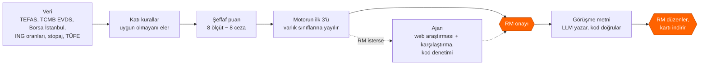
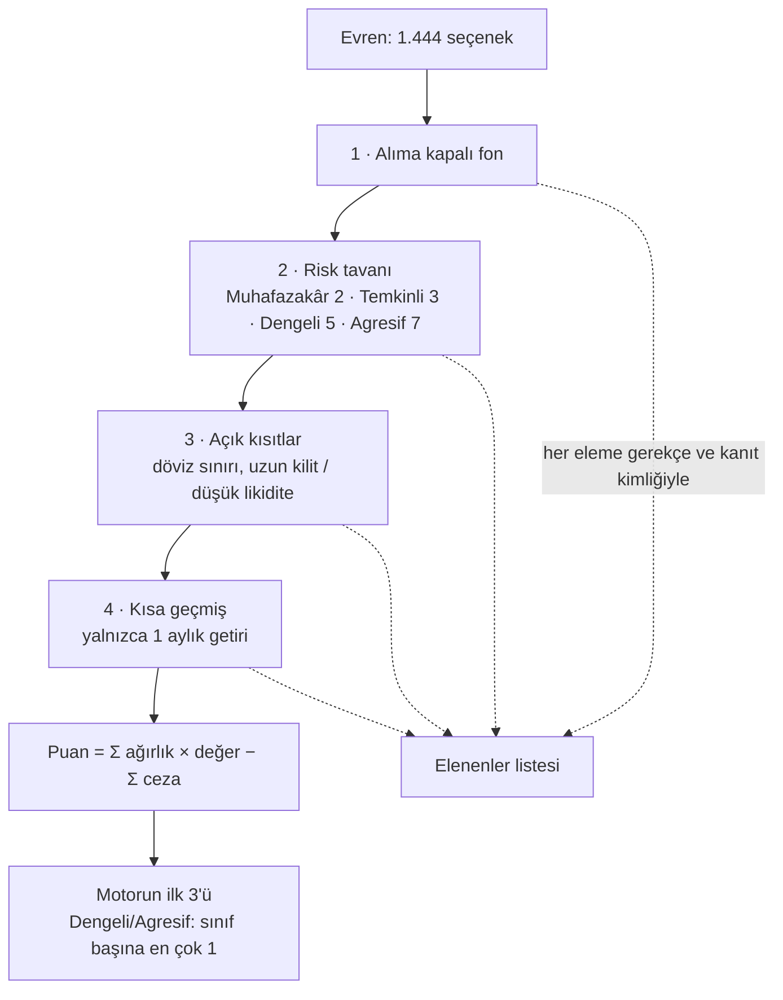
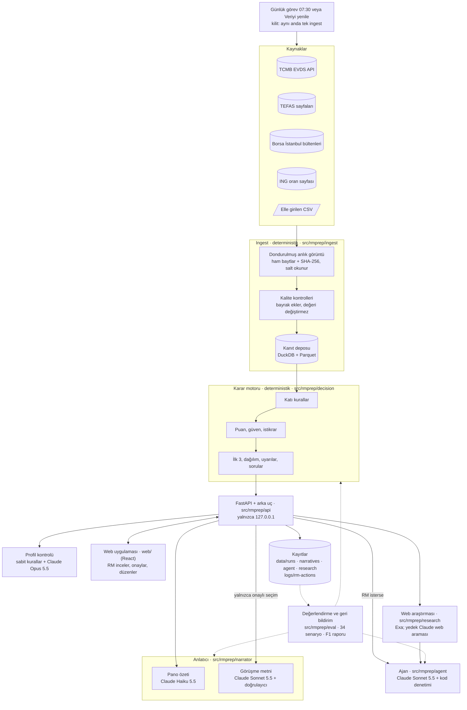
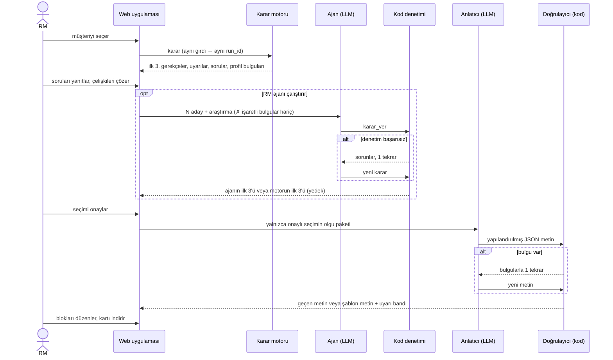
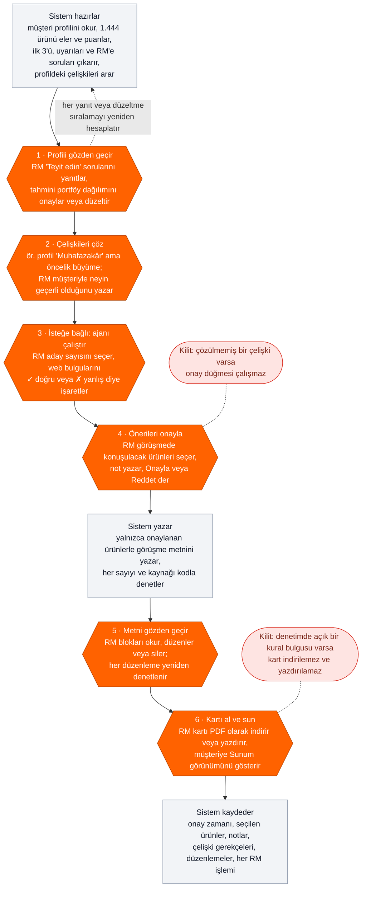
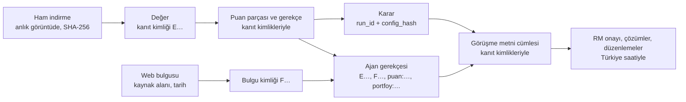

# RM Görüşme Hazırlığı: kanıta dayalı yatırım karar desteği

Agent 007 grubu olarak sunduğumuz bu ürün, Private Banking'deki RMler (Relationship Manager) için tasarlanmış bir yatırım karar destek çözümüdür. 

Ürünümüz, data science ve agentic mühendislik yardımıyla RM'lerin müşteri görüşmesi hazırlığına yardım eder. 

Sistemimizde TEFAS, Borsa İstanbul, TCMB gibi kayaklardan topladığımız ve işlediğimiz toplam 1.444 yatırım seçeneği var. Bu yatırım seçenekleri öncelikle müşterinin profiline ve kısıtlarına göre incelenir, uygunsuz opsiyonlar elenir ve geriye kalan uygun ürünler müşteriye özel puanlama sistemimizle sıralanır. Bu sıralama sonucunda puanlama motorumuz RM'in önüne en yüksek puanlı  3 ürünü öneri olarak sunar. RM, isterse bu önerilerin üzerine tıklayarak detaylarını inceleyebilir, motorun hangi kategorilere göre, neden bu yatırım seçeneğini önerdiğini görebilir. RM, bu üç opsiyon hakkında tereddüt ederse ya da yüksek puanlı opsiyonlar hakkında daha detaylı bir karşılaştırma yapmak isterse *Ajan Araştırması* bölümünü kullanabilir. Ajan araştırması, puanlama motorunun sıraladığı en üst seçenekler hakkında detaylı bir şirket ve ürün araştırması yapar, bununla birlikte müşterinin portföy bilgisi, istek ve kısıtlarını göz önünde bulundurarak motorun yaptığı tercihleri değiştirebilir, RM'e yeni bir ürün sıralaması önerebilir. 

RM; bu süreç boyunca müşteri profilini düzenleyebilir; müşterinin portföy detaylarını değiştirebilir, yatırım seçenekleri hakkında detaylı web araştırması yaptırabilir. Web araştırması sonucunda çıkan bulguları onaylayabilir veya reddedebilir. Reddedilen bilgiler ajana girdi olarak verilmez, onaylanan bilgiler ajana daha güçlü bir şekilde önerilir. 

RM hazırlık sayfasındaki önerilerden ve haberlerden, değiştirdiği bilgilerden memnun olduğu takdirde müşteri görüşme metnini hazırlatabilir. Metin; sayfada yer alan bilgiler ve RM'in verdiği kararlara göre hazırlanır. Bu süreçte ekrandaki her sayının kaynağı, tarihi ve kanıt kimliği vardır. Araç yatırım tavsiyesi vermez; kararı ve müşteri iletişimini RM yapar.


*P02 (ihracatçı, Dengeli) panosu, 17.10.2026 verisi. Üstte profil ve AI
kontrolünün alıntılı "Sorulacak" bulguları var. Ortada kodun yazdığı piyasa
notu duruyor; her değer "K" ile kanıtına bağlı. En altta RM'in onay çubuğu
var.*

Hızlı başlangıç (Windows, Python 3.11+, Node yalnızca web derlemesi için):

```powershell
python -m venv .venv; .venv\Scripts\Activate.ps1
pip install -e ".[dev,web,narrator]"
cd web; npm ci; npm run build; cd ..
python -m rmprep ingest          # veriyi çeker (yaklaşık 16 dk), yeni anlık görüntü
python -m rmprep serve           # http://127.0.0.1:8600
pytest -q                        # 150 dosyada 3.053 test, ağ erişimi yok
python -m rmprep eval --no-llm   # değerlendirme paketi, ücretsiz geçiş
python -m rmprep feedback        # RM işlem kaydından geri bildirim raporu
```

`.env` dosyasında `EVDS_API_KEY` (TCMB EVDS), `ANTHROPIC_API_KEY` (görüşme
metni, ajan, profil kontrolü) ve `EXA_API_KEY` (web araştırması) gerekir. Bir
anahtar yoksa ona bağlı parça kapanır, karar motoru yine çalışır.

| Brief teslimatı | Bu belgede | Ayrıntı |
|---|---|---|
| 1 · Çalışan demo | Hızlı başlangıç, bölüm 4-6 | `python -m rmprep serve` |
| 2 · Problem tanımı | bölüm 1 | [`docs/teslim/01-problem-tanimi.md`](docs/teslim/01-problem-tanimi.md) |
| 3 · Analitik çözüm | bölüm 2-3, 6 | [`docs/decision.md`](docs/decision.md), [`config/decision.yaml`](config/decision.yaml) |
| 4 · Çözüm tasarımı | bölüm 4-6 | [`docs/agent.md`](docs/agent.md), [`docs/narrator.md`](docs/narrator.md), [`docs/web-ui.md`](docs/web-ui.md) |
| 5 · Test ve öğrenimler | bölüm 7 | [`docs/eval.md`](docs/eval.md), [`docs/found-and-fixed.md`](docs/found-and-fixed.md) |
| 6 · Kanıt kaydı örneği | bölüm 8 | [`docs/teslim/06-kanit-kaydi-ornegi.md`](docs/teslim/06-kanit-kaydi-ornegi.md) |

## 1. Problem tanımı ve çözüm yaklaşımı

RM her görüşmeden önce yüzlerce ürünü dağınık kaynaklardan elle karşılaştırıyor.
Bu iş yavaş ilerliyor ve metin müşteriye yeterince uyarlanmıyor. Açık bir
kısıt gözden kaçabiliyor. Önerinin hangi veriye, varsayıma ve gerekçeye
dayandığı da sonradan gösterilemiyor.

Verimizden üç örnek (anlık görüntü `20261017-110343-d12a`, 17.10.2026):

| Gözlem | Sayı |
|---|---|
| Muhafazakâr bir müşteri (P01) için evren | 1.444 seçenek (815 fon, 37 BYF, 590 pay, 2 ING mevduatı); kurallar 1.301'ini eler, 143'ü kalır |
| ING Turuncu Hesap %23 faiz, stopaj ve yıllık TÜFE (%29,73) sonrası | reel −%8,3 |
| P01'in risk sınırı içindeki 37 para piyasası fonu, son 1 yıl reel | medyan +%6,6, en iyisi +%9,6 |

Nominal faiz tek başına yanıltır: müşteri mevduatta değer kaybettiğini
görmeyebilir. Kalan 143 seçeneği elle reel getiriye, vergiye ve risk uyumuna
göre sıralamak bir görüşme hazırlığının süresine sığmaz.

### Beklenen iş etkisi

| Gösterge | Bugün | Çözümle (ölçüldü) |
|---|---|---|
| Hazırlık süresi | **[VARSAYIM]** görüşme başına ~60 dk | analiz ort. 1,18 sn, görüşme metni ort. 24,9 sn; geri kalan RM'in okuması ve onayı |
| Kısıt ihlali | elle kontrol | 34 senaryo, 39 çalıştırmada 0 |
| Tutarlılık | kişiye bağlı | aynı girdi → aynı sonuç ve aynı metin (5/5 tekrar) |
| Uyarlama | genel metin | 5 personada 5 farklı öneri seti; gerekçe müşterinin önceliklerine bağlı |
| İzlenebilirlik | dağınık | her sayı kaynak, değer tarihi, alınma zamanı ve kanıt kimliğiyle |

### Yaklaşım

Ürünleri kod eler ve sıralar. Ajan ve dil modeli (LLM) yalnızca bu kodun
çizdiği sınırlar içinde öneri yapar ve metin yazar. Yazdıklarını yeniden kod
denetler. Son kararı RM verir.



Araç yalnızca görüşmeden önceki hazırlığı kapsar. Getiri tahmini, otomatik
işlem, müşteriyle doğrudan iletişim ve müşteriye açık bir sohbet botu kapsam
dışıdır.

## 2. Kullanılan veri kaynakları ve temel sinyaller

| Kaynak | Ne verir | Nasıl okunur |
|---|---|---|
| TCMB EVDS (resmî API) | politika faizi, USD/TRY, TCMB fonlama maliyeti, 3 aya kadar mevduat faizi, TÜFE endeksi (→ yıllık TÜFE), BIST 100 | API anahtarıyla; 900 günden uzun pencereler parça parça |
| TEFAS fon getirileri sayfası | ~2.100 fon ve BYF'ler: 1 ay-5 yıl getiri, SPK risk değeri (1-7) | tek kamuya açık HTML sayfası; robots.txt'nin yasakladığı `/api/` hiç çağrılmaz |
| TEFAS fon detay sayfaları | fiyat, büyüklük, yatırımcı sayısı, alış/satış valörü, ücretler, alım durumu, portföy dağılımı | fon başına bir sayfa, en az 1 sn arayla |
| Borsa İstanbul gün sonu bültenleri | 628 pay: kapanış, 1 ay-5 yıl getiri, 1 ve 5 yıllık oynaklık, işlem hacmi, BIST 100 üyeliği | ücretsiz günlük ZIP dosyaları, sn'de en çok 1 istek; dosyalar SHA-256 ile önbellekte |
| ING oran sayfası | Turuncu Hesap ve e-Vadeli Mevduat oranları (dört ürün okunur, ikisi kullanılır) | ING'nin kamuya açık formu, istekler arası 2 sn; hata olursa önceki anlık görüntü, sonra elle girilen CSV |
| Elle girilen CSV | stopaj oranları (geçerlilik sonu 31.12.2026), yıllık TÜFE (çapraz kontrol), ING oranları (yedek) | her satır kaynak bağlantısı ve tarihiyle; kaynaksız satır reddedilir |
| Fon yöneticisi belgeleri | izahname ve yatırımcı bilgi formu bağlantıları | RM fon kartını açınca, yöneticinin kendi sitesinden; yalnızca bağlantı |
| Web araştırması (Exa) | önerilen ürünler ve şirketleri için son 90 günün haberleri ve öne çıkanlar | yalnızca ürün ve şirket adı gider; etiket "web kaynağı, doğrulanmamış" |

### KAP neden yok?

kap.org.tr botları engeller. Ayna siteler kendi kullanım koşullarında otomatik
okumayı yasaklar ve KAP verisinin yeniden dağıtımı lisans ister (brief kuralı
8). Bu yüzden fon belgeleri için yöneticinin kendi sayfasına bağlantı veririz,
şirket haberlerini de web araştırmasından alırız. Araştırma kap.org.tr'yi de
dışarıda tutar.

Evren 815 TEFAS fonu, 37 BYF, 590 pay ve 2 ING mevduatından oluşur; Turuncu
Hesap karşılaştırma tabanıdır. "Serbest" fonlar (yalnızca nitelikli
yatırımcıya açık), W ve S pazarlarındaki paylar, varant ve sertifikalar evrene
girmez. Diğer bankaların mevduat oranları (İş Bankası, Ziraat) okunur, ama
puana girmez ve ekranda gösterilmez.

### Ürün ve müşteri sinyalleri

Ürün tarafında motor şunlara bakar: stopaj ve TÜFE sonrası reel getiri; SPK
risk değeri (paylarda oynaklık bandı, değer yoksa varlık sınıfından tahmin);
satış valörü, yani paraya ne kadar sürede erişildiği; fon büyüklüğü ve
yatırımcı sayısı (paylarda işlem hacmi); alım durumu; giriş ve çıkış ücreti;
çok varlıklı fonlarda gerçek portföy dağılımı; piyasa mevduat ortalaması.

Müşteri tarafında persona dosyasının alanları şöyle kullanılır:

| Alan | Kararda nasıl kullanılır |
|---|---|
| Risk profili | risk tavanı (katı kural), risk bandı ve risk iştahı (puan) |
| Yatırım ufku | hangi dönemin getirisine bakılır; ufuk ≥ 3 yılsa getiri ağırlığı artar |
| Likidite, gelir, anapara koruma | Düşük 0 · Orta 0,5 · Yüksek 1 → ilgili ölçütün ağırlığı ve ceza şiddeti |
| Döviz maruziyeti | döviz cezasının şiddeti; açık kısıtsa katı kural |
| Öncelikler | eşleşen her öncelik ilgili ölçüt ağırlığına +1 |
| Açık kısıtlar | katı kural (ör. döviz sınırı, uzun kilit) |
| Durum, amaç, RM notu | mevcut portföy dağılımının tahmini (D27) ve metindeki uyarlama |
| Yaş | puana girmez; metinde ve profil tutarlılık kontrolünde kullanılır |

Brief'in 6.1'de saydığı müşteri ve ürün özelliklerinin her biri bir ölçüte,
bir cezaya veya bir katı kurala karşılık gelir. Getiriyi reel ve stopaj
sonrası ölçeriz, çünkü %30 enflasyonda nominal getiri yanlış bir sıra verir.

Yaşı puana katmadık. Uygunluğu risk profili zaten belirliyor; yaşı ayrıca
puanlamak aynı bilgiyi iki kez saymak olur. Tek başına bir yaş-risk kuralının
kamuya açık bir dayanağını da bulamadık. Yaş metinde kullanılır, profil
kontrolü de yaşla çelişen bir notu (ör. `yas` 62, notta "45 yaşında") RM'e
gösterir.

## 3. Karşılaştırma / sıralama veya karar mantığı

Karar katmanı deterministik bir kural ve puanlama motorudur
([`docs/decision.md`](docs/decision.md); tüm tablolar
[`config/decision.yaml`](config/decision.yaml) içinde). Aynı girdi her zaman
aynı sonucu ve aynı `run_id`'yi verir.

### Neden kural ve şeffaf puan?

Elimizde etiketli geçmiş öneri verisi yok, bu yüzden denetimli bir model
eğitemeyiz. Kural 5'i (uygun olmayan ürün listeye girmez) de her seferinde
kesin uygulamamız gerekir; olasılıkla çalışan bir model bunu garanti edemez.
Puanın her parçası RM'e ve jüriye gösterilebilir ve yeniden üretilebilir. Dil
modelini başka işlerde kullanırız: metin yazmak, araştırmayı özetlemek ve
adayları nitel olarak karşılaştırmak (bölüm 5).



Ekranda aynı huni "Bu öneriler nasıl seçildi?" bloğunda görünür. Blok
müşterinin kriter ağırlıklarını, her kuralın kaç ürünü elediğini ve istikrar
testinin sonucunu gösterir.


Risk değeri bilinmeyen bir ürün elenmez. Motor değeri aynı sınıftaki bilinen
risklerin üst çeyreğiyle tahmin eder, ürünün güvenini düşürür ve RM'e uyarı
verir.

### Puan

Her ölçüt 0 ile 1 arasında bir değer alır. Motor değeri ağırlıkla çarpar,
çarpımları toplar ve cezaları çıkarır. Ağırlıklar müşterinin profilinden gelir
ve toplamları 1'dir.

| Ölçüt | Ne ölçer | Ham ağırlık |
|---|---|---|
| Getiri | stopaj, ücret ve TÜFE sonrası reel getirinin adaylar içindeki sırası | 2 + 2 × risk iştahı (+1, ufuk ≥ 3 yıl) |
| Risk uyumu | risk değeri müşterinin bandında mı (bandın altındaki her seviye −0,5) | 2 |
| Likidite | satış valörü (aynı gün 1,0 … 10 günden uzun 0,2) | 2 × likidite ihtiyacı |
| Gelir | ürün türünün düzenli gelire uygunluğu | 2 × gelir ihtiyacı |
| Anapara | anaparanın korunması (mevduat 1; fon riskle azalır) | 2 × anapara koruma tercihi |
| Sadelik | ürün yapısının sadeliği | yalnızca "sade ürün yapısı" önceliğiyle |
| Kalite | fon büyüklüğü ve yatırımcı sayısı (pay: işlem hacmi) | 0,5 |
| Portföy açığı | müşterinin mevcut dağılımının model banttan uzaklığı (D27) | 1 × kaynak katsayısı; yalnızca RM'in girdiği, RM'in onayladığı veya müşteri dosyasından gelen dağılımla |

Cezaların üst sınırı anapara riski, yavaş erişim, döviz maruziyeti, bilinmeyen
risk, reel kayıp ve piyasa altı getiri için 0,3; geçmiş eksikliği için 0,2;
küçük fon için 0,1'dir. Ceza = üst sınır × müşterinin önem derecesi × ürünün
ihlal derecesi.

### Neden bu ağırlıklar?

MiFID II ve SPK yerindelik kuralları sayısal bir ağırlık vermez. Ağırlıkları
bu yüzden biz seçtik ve açıkça gösteriyoruz **[VARSAYIM]**. Bu seçimin etkisini
iki yolla ölçüyoruz. İstikrar testi her ağırlığı ±%20 değiştirip sıralamayı
yeniden hesaplar (bölüm 6). Değerlendirme paketi de persona değişikliklerinin
sonucu beklenen yönde değiştirip değiştirmediğine bakar (bölüm 7).

### Önerilen ilk 3 (D19)

Muhafazakâr ve Temkinli müşteride ilk 3, puan sırasının ilk üçüdür. Dengeli ve
Agresif müşteride, ayrıca çeşitlendirme isteyen her müşteride, motor listeyi
puan sırasıyla dolaşır ve her varlık sınıfından en çok bir seçenek alır. Nakit
benzeri ve pay için de sınır birdir. Son bir yılda reel getirisi negatif olan
seçeneği almaz. Çok varlıklı bir fonun sınıfını fonun gerçek portföy dağılımı
belirler: payı %50 veya üstü olan sınıf; böyle bir sınıf yoksa "dengeli".

Örnek P02 (Dengeli, 1-3 yıl, "erişilebilir likidite" önceliği; 17.10.2026):
ağırlıklar getiri 0,339 · risk uyumu 0,203 · likidite 0,203 · gelir 0,102 ·
anapara 0,102 · kalite 0,051.

| Seçenek | Sınıf | Reel getiri (1 yıl) | Puan | Neden |
|---|---|---|---|---|
| EIL Astra Para Piyasası | nakit benzeri | +%7,7 | 0,783 | en iyi nakit benzeri; aynı gün erişim |
| NJR Nurol Borçlanma Araçları | borçlanma | +%8,1 | 0,743 | en iyi borçlanma fonu |
| KDE Kuveyt Türk Dengeli Katılım | dengeli | +%9,5 | 0,741 | en iyi dengeli; risk bandın içinde |
| ING e-Vadeli Mevduat | nakit benzeri | +%2,1 | 0,434 | sıralanır, ama nakit benzeri yeri EIL'de |
| ING Turuncu Hesap (karşılaştırma) | nakit benzeri | −%8,3 | 0,185 | reel kayıp ve piyasa altı cezaları |

Fon kartı ("Neden bu öneri?") her puan parçasını gerekçesiyle gösterir. Fonun
geçtiği katı kurallar kanıt kimlikleriyle, en yakın alternatif de aradaki
farkla birlikte listelenir. Ekranda puanlar 100 ile çarpılmış olarak görünür:


RPP (0,775) KDE'den yüksek puan alır, ama tek nakit benzeri yerini EIL
doldurduğu için listeye girmez. P02'nin döviz kısıtı 15 döviz fonunu eler; RM
bu kısıtı gerekçe yazarak kaldırabilir. Aynı gün beş personanın ilk 3'ü:

| Persona | Kalan / evren | Motorun ilk 3'ü |
|---|---|---|
| P01 Emekli girişimci, Muhafazakâr | 143 / 1.444 | PPN · OSD · AIS |
| P02 İhracatçı, Dengeli | 306 / 1.444 | EIL · NJR · KDE |
| P03 Teknoloji kurucusu, Agresif | 1.250 / 1.444 | ASELS (pay) · TE3 · OKT |
| P04 Aile ofisi, Dengeli | 312 / 1.444 | OKT · RPP · TCF |
| P05 Hekim, Temkinli | 180 / 1.444 | EIL · GBL · KSK |

Dağılım görünümü risk profiline göre model bantları (Ata Yatırım, 28.04.2026),
müşterinin mevcut dağılımını ve her sınıfın en iyi seçeneğini gösterir.
P02'nin dosyasında mevcut dağılım yok. Bu yüzden ekrandaki değerler "tahmini
senaryo"dur ve RM "Tahmini onayla" veya "Düzenle" diyene kadar sıralamayı
etkilemez.


## 4. Genel çözüm mimarisi ve veri akışı



| Modül | Sorumluluk | Klasör |
|---|---|---|
| Ingest | kaynak adaptörleri, anlık görüntü, kalite kontrolleri, kanıt deposu, günlük görev ve kilit | `src/rmprep/ingest/`, `config/sources.yaml` |
| Karar motoru | evren, katı kurallar, puan, güven, istikrar, ilk 3, dağılım bantları, mevcut dağılım, uyarılar | `src/rmprep/decision/`, `config/decision.yaml` |
| Ajan | adaylar, veri paketi, araçlar, kod denetimi, yedek | `src/rmprep/agent/`, `config/agent.yaml` |
| Web araştırması | Exa ve Claude sağlayıcıları, soru kontrolü, biçimlendirme, önbellek, günlük sınır | `src/rmprep/research/`, `config/research.yaml` |
| Anlatıcı | olgu paketi, LLM çağrısı, doğrulayıcı, tekrar, şablon metin, piyasa notu, maliyet defteri | `src/rmprep/narrator/`, `config/narrator.yaml` |
| API ve arka uç | çalıştırma, profil kontrolü, onay, kayıt, işlem kaydı, veri güncelliği | `src/rmprep/api/`, `src/rmprep/backend.py` |
| Web uygulaması | pano, öneriler, ajan kutusu, araştırma paneli, fon kartı, kanıt penceresi, görüşme metni, sunum görünümü | `web/` |
| Değerlendirme | senaryolar, kural kontrolleri, LLM hakemi, ajan A/B, geri bildirim raporu | `src/rmprep/eval/`, `config/eval.yaml` |

Sözleşmeler (veri tipleri) `src/rmprep/contracts.py` içindedir. Tasarım
belgeleri: [`docs/ingest.md`](docs/ingest.md), [`docs/decision.md`](docs/decision.md),
[`docs/agent.md`](docs/agent.md), [`docs/research.md`](docs/research.md),
[`docs/narrator.md`](docs/narrator.md), [`docs/web-ui.md`](docs/web-ui.md),
[`docs/eval.md`](docs/eval.md).

## 5. AI/Agentic bileşenler ve görev/karar akışı

LLM hiçbir ürünü elemez ve hiçbir katı kuralı aşamaz; eleme ve puan koddadır.
LLM'i metin, araştırma ve nitel karşılaştırma için kullanırız. Her çıktısını
kod denetler, denetimden geçmeyen bir çıktının yerine deterministik bir yedek
gelir.

| Bileşen | Model | Görev | Güvence | Maliyet |
|---|---|---|---|---|
| Ajan ilk 3 | Claude Sonnet 5.5 | motorun en iyi 10 adayı (RM 20'ye kadar seçer) arasından kendi ilk 3'ünü seçer | kod denetimi; 1 tekrar; sonra motorun ilk 3'ü | karar başına ~0,05-0,10 $, günlük 3 $ |
| Web araştırması | Exa (yedek: Claude Haiku 5.5 web araması) | ilk 3 ve şirketleri için haberler ve öne çıkanlar | soru kontrolü (müşteri bilgisi gitmez); kaynaksız bulgu atılır; "doğrulanmamış" etiketi | ürün başına ~0,02 $, günlük 5 $ |
| Profil kontrolü | Claude Opus 5.5 | profilin tamamında çelişki arar | her bulgu iki tarafı da kelimesi kelimesine alıntılar; sunucu alıntıyı alanda arar | profil başına ~0,015 $, önbellekte |
| Görüşme metni | Claude Sonnet 5.5 | onaylı seçimi bölümlü Türkçe metne çevirir | doğrulayıcı; 1 tekrar; sonra şablon metin | metin başına 0,034 $, ort. 24,9 sn |
| Pano özeti | Claude Haiku 5.5 | RM'e 1-2 cümlelik özet | doğrulayıcı; hata → düz cümle | ~0,003 $ |
| Değerlendirme hakemi | Claude Haiku 5.5 | metnin uyarlanmış, açık, dengeli olup olmadığını notlar; ajan ile motoru kör A/B karşılaştırır | yalnızca kodun ölçemediği şeyler | paket başına < 0,01 $ |

### Ajan nasıl çalışır?

Ajan yalnızca RM "Ajanı çalıştır" deyince başlar. Girdisi tek bir JSON veri
paketidir: müşteri, mevcut dağılım, adayların puan parçaları, olguları ve
uyarıları, bir de araştırma bulguları. Sistem istemi modele araştırma
bulgularının talimat değil veri olduğunu söyler. Ajanın üç aracı vardır:

- `karsilastir(a, b, amac)`: iki adayı kodla karşılaştırır (en çok 4 kez).
- `arastir(option_id, soru, amac)`: bir aday için tek bir web sorusu sorar (en çok 2 kez).
- `karar_ver(secimler, cikanlar, ozet)`: kararı önerir.

Kod ajanın kararında şunlara bakar:

- 3 farklı aday seçilmiş mi; en çok 1 pay var mı; varlık sınıfı kuralı tutuyor mu?
- Her gerekçe bir kanıta (E…), bir bulguya (F…), bir puan parçasına veya bir portföy satırına atıf yapıyor mu?
- Her sayı ve tarih atıf yapılan veride var mı; yasak ifade var mı?
- Motorun listesinden çıkarılan her seçenek için bir gerekçe yazılmış mı?

Denetim başarısız olursa ajan sorunların listesini alır ve kararını bir kez
düzeltir. İkinci bir hata, 90 saniyelik süre aşımı veya günlük sınır motorun
ilk 3'ünü geri getirir. RM ajanın beş adımını (Adaylar, Ajan araştırması, Ajan
analizi, Kontrol, Karar) süre, maliyet ve notlarıyla görür. Modelin ham
düşüncesi saklanmaz ve gösterilmez.


*P01 için ajan motorun önerdiği AIS'i çıkarıp yerine ZBJ'yi aldı. Her gerekçe
bir puan parçasına veya kanıt kimliğine bağlı. Tahmini dağılıma dayanan cümleye
"(tahmini dağılıma göre)" etiketini kod ekler.*

Aşağıda ajanın ve RM'in gördüğü web araştırması var. RM her bulguyu ✓ veya ✗
ile işaretler; ✗ işaretli bulgu ajana verilmez:




### Görüşme metni ve doğrulayıcı

Doğrulayıcı şunları içeren bir metni reddeder: olgu paketinde olmayan bir sayı
veya tarih; elenen ya da listede olmayan bir ürünün adı; "garanti", "risksiz",
"kesin getiri" gibi yasak bir ifade; kaynağı olmayan bir öneri cümlesi; ING
ürün adının yanında ING'ye ait olmayan bir oran; tahmini dağılımdan bir sayı.
Eksik bir bölüm veya eksik "yatırım tavsiyesi değildir" cümlesi de ret
sebebidir. Piyasa notunu (politika faizi, USD/TRY, fonlama maliyeti) LLM hiç
yazmaz; kod yazar ve her değerin yanına kanıt kimliğini koyar.

Metin yazılırken RM anlatıcının adımlarını ve her adımın girdisini görür:


Görüşme metni tek bir sayfadır. Beyaz alan müşteriye gösterilecek sunumdur.
Sarı kutular yalnızca RM içindir; "Sunum görünümü"nde ve çıktıda yer almaz.
Metindeki her kaynak numarası sağdaki "Kaynaklar" listesinde bir kanıt
kimliğine bağlanır:


### Neden ajan ile metin ayrı?

Ajan, tek bir puanın gösteremediği şeyleri tartar: güncel haberleri, iki
adayın nitel farkını ve müşterinin mevcut dağılımını. Kararını yine kodun
sınırları içinde verir ve RM motorun ilk 3'ünü her zaman yan yana görür.
Görüşme metni ise tek bir model çağrısıdır (en çok bir tekrar), bu yüzden
maliyeti ve süresi öngörülebilir kalır.

Geliştirmede de çoklu ajan kullandık. Bir lider oturumu ve her modül için bir
işçi Claude Code oturumu ayrı git çalışma ağaçlarında çalıştı. Sözleşmeler
dondurulmuştu ve her adım yeşil testlerle bitti
([`docs/workflow.md`](docs/workflow.md)).

## 6. Varsayımlar, belirsizlikler ve insan onay noktaları

### Varsayımlar

Varsayımlar ekranda ve kayıtta görünür. `[VARSAYIM]` ile işaretli olanları
mentorlarla teyit edeceğiz.

- Fon getirileri geçmiş getirilerdir, bir tahmin değildir. 1 yıldan kısa dönem getirileri yıllığa çevrilmez.
- Getiriler stopaj sonrası ve yıllık TÜFE'ye (%29,73) göre reeldir.
- Yatırım tutarı bilinmiyor; mevduatta 100.000-249.999 TL diliminin standart oranı kullanılır.
- Risk bantları (Muhafazakâr 1-2, Temkinli 2-3, Dengeli 3-5, Agresif 4-7) ve ağırlıklar bizim yargımızdır **[VARSAYIM]**.
- Payların risk değeri oynaklık bandından gelir ve en az 6'dır; BYF stopajı %17,5'tir **[VARSAYIM]**.
- Dağılım bantları tek bir kamuya açık kaynaktan gelir; Temkinli bandını biz çıkardık **[VARSAYIM]**.
- Mevcut dağılım müşteri dosyasında yoksa meslek tablosu veya ulusal ortalama (TCMB FİR 2026-I) ile tahmin edilir. Bu tahmin sıralamayı değiştirmez; RM onaylarsa değiştirir **[VARSAYIM]**.

### Belirsizlik yönetimi

| Araç | Ne yapar |
|---|---|
| Veri güveni (0-1) | kullanılan en zayıf veri satırı × tahmin katsayıları (elle girilen 0,9 · doğrulanmamış seri 0,8 · eski 0,7 · çelişen 0,6 · tahmini risk × 0,7 · kısa geçmiş × 0,8 · reel getiri hesaplanamadı × 0,8) |
| İstikrar (0-1) | her ağırlık ve ceza üst sınırı ×0,8 ve ×1,2 ile değiştirilir (30-32 yeniden sıralama); önerilen seçenek için "öneri yine çıkıyor mu" oranı ([ayrıntı](docs/kararlilik-veri-guveni.md)) |
| Tahmin yerine soru | risk profili veya kısıt tanınmazsa sıralama durur ve RM'e soru açılır; diğer bilinmeyenlerde güvenli düzey + "Teyit edin" maddesi |
| Profil çelişkileri | 8 sabit kural ve AI kontrolü (ör. "Muhafazakâr" ile büyüme önceliği; `durum`'da gelecek yıl ev peşinatı ile likidite "Düşük") |
| Uyarılar (yalnızca RM) | düşük istikrar, tahmini risk, döviz fonu, tek pay, payda sert düşüş, ING oranı piyasanın altında, süresi geçmiş stopaj veya eski TÜFE |

Ekranda belirsizlik "Teyit edin" listesine dönüşür. Motor bir alanı
okuyamazsa güvenli bir düzeyle devam eder ve RM'e yanıt seçenekleri olan bir
soru açar:


### İnsan onay noktaları

Sistem öneriyi hazırlar, ama müşteriye gidecek hiçbir şey RM görmeden ve
onaylamadan çıkmaz. Aşağıdaki akış, bir RM'in bir müşteri için ekranda
sırayla geçtiği adımları gösterir:

- Turuncu altıgenler RM'in karar verdiği yerlerdir.
- Gri kutular sistemin kendi başına yaptığı işlerdir.
- Kırmızı kutular kilitlerdir: RM bir şeyi tamamlamazsa sistem o noktadan ilerlemez.



| Adım | RM ekranda ne görür | RM ne yapar | Bu adım neden var |
|---|---|---|---|
| 1 · Profili gözden geçir | "Teyit edin" listesi: motorun okuyamadığı alanlar, eksik bilgiler, tahmini portföy dağılımı | soruyu bir seçenekle yanıtlar; dağılımı "Tahmini onayla" ile kabul eder veya "Düzenle" ile girer | motor eksik bilgiyi tahmin etmez, RM'e sorar; her yanıt yeni bir hesaplama başlatır |
| 2 · Çelişkileri çöz | "Profilde çelişki" kartları; her kart çelişen alanları adlandırır, AI bulgusu iki tarafı da kelimesi kelimesine alıntılar | müşteriyle teyit ettiği durumu kısa bir gerekçe olarak yazar ("Müşteriyle teyit edildi: …") veya profili düzeltir | çelişkili bir profil yanlış bir öneriye götürür; RM'in gerekçesi kayda ve karta girer |
| 3 · Ajanı çalıştır (isteğe bağlı) | ajanın beş adımı, ajanın ilk 3'ü ve motorun ilk 3'ü yan yana, web bulguları | aday sayısını seçer (3-20); her web bulgusunu ✓ veya ✗ ile işaretler | ajan kendiliğinden başlamaz; ✗ işaretli bulgu ajana verilmez, ✓ işaretli bulgu "(web, RM doğruladı)" etiketini alır |
| 4 · Önerileri onayla | alttaki onay çubuğu: seçili ürünler, not alanı, "Reddet" ve "Onayla ve metni hazırla" | konuşulacak ürünleri seçer, isterse not yazar, onaylar veya reddeder | görüşme metni yalnızca RM'in onayladığı ürünlerle yazılır |
| 5 · Metni gözden geçir | tek sayfalık görüşme metni; beyaz alan müşteri için, sarı kutular yalnızca RM için | blokları ✎ ile düzenler veya siler; "Riskler" bölümü silinemez, "yatırım tavsiyesi değildir" cümlesi her zaman kalır | RM metnin her cümlesinden sorumludur; düzenlenen blok yeniden denetlenir |
| 6 · Kartı al ve sun | "Kart" kutusu (PDF veya Markdown), "Sunum görünümü" düğmesi | kartı indirir veya yazdırır; müşteriye sunum görünümünü gösterir | sunum görünümü sarı kutuları, notları ve kaynak numaralarını gizler; RM'e özel bilgi müşteriye gitmez |

Bu akışın kuralları:

- RM bir çelişkiyi çözmeden onay veremez: sistem onay isteğini "Çözülmemiş çelişki var" diye geri çevirir. Henüz bitmemiş bir AI kontrolü onayı engellemez.
- RM'e sorulan sorular (kart etiketi "Sorulacak") öneridir, onayı engellemez. Bir reddetme için gerekçe gerekmez.
- Açık bir kural bulgusu varken kart indirilemez ve yazdırılamaz.
- RM ajanı bir kez başlattıysa, yeni bir dağılım veya yanıt yeni bir hesaplama yaptığında ajan aynı aday sayısıyla kendiliğinden yeniden çalışır.

Sistemin müşteriye bir iletim kanalı yoktur; uygulama yalnızca yerel
bilgisayarda (`127.0.0.1`) çalışır. Düzenlenmiş veya yüklenmiş bir profil
açıkça işaretlenir ve kartta "Düzenlenmiş profil ile hazırlandı" yazar.

## 7. Test yaklaşımı, sonuçlar, hata analizi ve yapılan iyileştirmeler

Testler dört katmandan oluşur:

| Katman | Soru | Kapsam |
|---|---|---|
| Birim ve sözleşme testleri | Her kural tek başına doğru mu? | `pytest`: 150 dosyada 3.053 test; web: 451 test; ağ erişimi yok, LLM yerine sahte model |
| Senaryo değerlendirmesi | Sistem uçtan uca, jürinin değiştirebileceği girdilerle doğru mu? | 34 senaryo, 39 çalıştırma, dondurulmuş veri: temel personalar, persona değişiklikleri, kısıtlar, kaynak erişilemez, hatalı veri, regresyonlar |
| Ajan değerlendirmesi | Ajan kurallara uyuyor mu, motordan iyi mi? | 8 karar: kod denetimi, yedek oranı, tekrar, kör A/B hakemi, RM işaretleri |
| Canlı kontrol ve geri bildirim | RM için kullanışlı mı? | ekran incelemesi, ücretli canlı kontroller, RM işlem kaydı üzerinden F1 raporu |

### Neden bu göstergeler?

Brief'in kesin kurallarında (kısıt ihlali yok, uydurma veri yok, kaynak atfı
var, yasak ifade yok) hedefimiz %100'dür, çünkü tek bir ihlal bile kabul
edilemez. Metin kalitesini yalnızca yön göstergesi olarak okuruz: hakem bir
LLM'dir ve notu kod kontrolleri kadar güvenilir değildir.

Son tam değerlendirme (`data/eval/20261017-160939-n12-client-page`, dondurulmuş
anlık görüntü `20261014-233110-1565`, istem n12):

| Gösterge | Sonuç | Hedef |
|---|---|---|
| Kural kontrolleri (15 kontrol) | %100 | %100 |
| Kısıt ihlali (kural 5) · risk tavanı aşımı | 0 (37/37) · 0 (37/37) | 0 |
| Uydurma veri yok · kaynak atfı | 39/39 · 39/39 | %100 |
| Tahmin yerine soru · eksik veri gösteriliyor | 2/2 · 7/7 | %100 |
| Persona değişikliği sonucu beklenen yönde değiştiriyor | 21/21 | %100 |
| Doğrulayıcı (LLM metni, şablona düşmeden) | 24/25 (%96) | ≥ %95 |
| Yasak ifade | 0 | 0 |
| Tekrar tutarlılığı | 5/5 | %100 |
| Süre: karar · görüşme metni | 1,18 sn · 24,9 sn (ort.) | rapor |
| Maliyet | 0,866 $ paket · 0,034 $ metin başına | ≤ 5 $ |
| LLM hakemi: uyarlanmış / açık / dengeli | %50 / %50 / %58 | yön göstergesi |

Ajan değerlendirmesinde (`20261015-182316`, 8 karar) kod denetimi 8/8 geçti
ve hiç yedeğe düşülmedi. Önbellekten tekrar 8/8, önbelleksiz tekrar 5/8 aynı
sonucu verdi. Kör A/B hakemi (Claude Haiku, "Hangisi müşteriye daha uygun ve
neden?") ilk turda ajan 5, motor 0, eşit 1 dedi. Ancak ajanın 3 kazancı
P03'teydi ve orada motorun seçtiği IDY ile OKT ajanın aday listesinde yoktu;
hakem bu iki fonun verisini göremedi. Aday listesini motorun ilk 3'üyle
başlayacak biçimde düzelttik ve P03'ü yeniden çalıştırdık: motor 2, ajan 0.
Adil karşılaştırmaların toplamı ajan 3 (P01, olumsuz haber senaryosu, RM
işaretleri), motor 2, eşit 1. Bu sayılar ajanın daha iyi olduğunu göstermez;
bu yüzden RM iki listeyi yan yana görür ve kararı kendisi verir.

### Hata analizleri ve iyileştirmeler

Tam liste: [`docs/found-and-fixed.md`](docs/found-and-fixed.md).

| Bulgu | Nasıl bulduk, kök neden | İyileştirme | Ölçülen sonuç |
|---|---|---|---|
| Kurallar %100 geçerken 5 personanın 4'ü yalnızca risk 1 nakit benzeri fon aldı | değerlendirme paketi; geçmiş getiri baskındı, risk bütçesi ölçütü yoktu | D19: risk uyumu bandı, varlık sınıfı, sınıf kuralı | 5 personada 5 farklı set |
| Profil kendisiyle çelişebiliyordu ve hiçbir şey bunu göstermiyordu | 5 personaya çelişki yerleştirerek canlı kontrol; motor yalnızca sabit değerleri okuyordu | sabit kurallar + alıntılı AI kontrolü + onaydan önce RM gerekçesi | sabit kurallar 0/5, AI kontrolü 5/5; P01, P03, P05'te yanlış alarm yok |
| İlk sayfa ~33 sn, her müşteri geçişi ~6 sn sürüyordu | adım adım zamanlama ve cProfile; bir sorgu her çağrıda ~30.000 satırı tarıyordu | varlığa göre dizin, SDK ilk kullanımda, anlık görüntü arka planda | karar 2,86 sn → 1,18 sn; sunucu açılışı 8,7 sn → 2,3 sn; aynı ilk 3 |
| Stopaj ve TÜFE yokken fon güveni 1,00 kaldı | "eksik veri" senaryosu; eski bayrak açığı gizliyordu | D24: reel getiri hesaplanamazsa güven × 0,8 | eksik veri gösteriliyor 5/7 → 7/7 |
| ING oranları elle kopyalanmıştı ve eskimişti | ING sayfasını elle dosyayla karşılaştırdık: 28 e-Vadeli oranı değişmişti | ING'nin kamuya açık oran sayfası için adaptör; elle dosya yedek | motor %35,00 yerine güncel %34,50'yi kullanıyor |
| Pay geçmişinde sıçramalar vardı | bilinen bölünmelerin etrafında fiyatlar; bültendeki önceki kapanış düzeltilmemiş | sıçrama tespiti ve gün limitine kırpma | 5 yıllık düzeltilmiş pay getirileri |
| 5 yıllık geçmiş 15.02.2023'te kesiliyordu | 8-14.02.2023 "okunamaz" işaretlenmişti: deprem sonrası borsa kapalıydı | 0 kapanışlı geçerli bülten = işlem olmayan gün | tam 5 yıllık geçmiş |
| Bir metin şablona düştü ("Garanti Portföy GZP" → yasak ifade "garanti") | değerlendirmenin hata listesi cümleyi ve bulguyu verdi | doğrulayıcı adlandırılmış fonun kurucu adını yasak ifade taramasından önce çıkarır; başka yerde "garanti" hâlâ bulgudur | testler iki yönde geçiyor; canlı yeniden çalıştırma önbellekteki eski metni okudu, açık iş |

Açık işler de var. TEFAS bazı günlerde bir fon için fiyatı ve büyüklüğü 0
yayımlıyor (son anlık görüntüde 45 fon) ve bu sıfırları henüz işaretlemiyoruz
(I9). İki EVDS serisi (BIST 100 getiri endeksi, altın) doğrulanmadı ve
"doğrulanmamış seri" bayrağı taşıyor. LLM hakemi neredeyse her metne "kısmen"
veriyor; rubriği de müşteri sayfası için değil RM notu için yazılmıştı.

### Geri bildirim döngüsü

Sistem her RM işlemini (onay, ret, düzenleme, silme, ✓/✗ işareti, dağılım,
ajan başlatma) sürüm bilgileriyle `data/logs/rm-actions/` altına bir JSON
satırı olarak yazar. `rmprep feedback` bu kayıttan beş ölçü hesaplar ve sabit
eşiklerle öneriler verir; örneğin hangi bölümün sık silindiğini, ajanın
önerisinin ne sıklıkla kabul edildiğini ve dağılım tahmininin ne kadar
yanıldığını gösterir. Rapor hiçbir şeyi kendiliğinden değiştirmez ve LLM
kullanmaz.

## 8. Veri kaynağı, zaman damgası ve karar gerekçesi gibi izlenebilirlik yaklaşımları

Her öneriyi dayandığı verinin kaynağına, tarihine ve alınma zamanına kadar
geri izleyebiliriz. Tüm zamanlar Türkiye saatindedir (`Europe/Istanbul`).



| Ne | Nasıl izlenir |
|---|---|
| Her değer | kanıt kimliği (kaynak, ölçü, varlık ve tarihin özeti), kaynak, kaynak adresi, değer tarihi (`as_of`), alınma zamanı (`fetched_at`), kalite bayrakları |
| Ham veri | anlık görüntüde bayt bayt; her dosyanın SHA-256 özeti; kullanılan yapılandırmanın kopyası; salt okunur. `rmprep replay` aynı çıktıyı ağsız yeniden üretir |
| Kalite | kontroller değeri değiştirmez, bayrak ekler: eksik, eski, aralık dışı, çelişen, yedek anlık görüntü, doğrulanmamış seri, elle girilen. Kaynaklar arası çapraz kontrol (ör. TÜFE: EVDS 29,7315, elle 29,73) |
| Her karar | `run_id` (müşteri + anlık görüntü + yapılandırma özeti; aynı girdi → aynı kimlik), her puan parçası ve gerekçesi kanıt kimlikleriyle, elenenler gerekçeleriyle, varsayımlar, uyarılar |
| Ajan kararı | `data/agent/<run_id>.json`: adaylar, araçların `amac` notları, denetim sonuçları, her gerekçenin atıfları, istem sürümü, model, maliyet |
| Web bulguları | bulgu kimliği, kaynak alanı, tarih, "doğrulanmamış" etiketi, RM'in ✓/✗ işareti; günlük önbellek ve maliyet defteri |
| Onaylar | RM karar zamanı, seçim, notlar, profil çelişkilerinin çözümleri; `data/runs/`, `data/narratives/`, `data/cards/` |
| Metin | her cümle seçenek ve kanıt kimliği taşır; model, istem sürümü, doğrulayıcı sonucu, RM düzenlemeleri ve maliyet kayda girer |
| RM işlemleri | `data/logs/rm-actions/<gün>.jsonl`: her işlem zaman, çalıştırma, persona, anlık görüntü ve yapılandırma/istem sürümleriyle |

Ekranda her sayının yanındaki "K" işareti kanıt penceresini açar:


*Örnek: EIL'in 1 yıllık getirisi %48,13; kaynak TEFAS getiri sayfası
(`tefas_web`); değer tarihi 16.10.2026 (önceki iş günü); alınma zamanı
17.10.2026 11:04; kanıt kimliği `Edede971a`; bayrak yok.* Tam bir karar kaydı
örneği: [Teslimat 6](docs/teslim/06-kanit-kaydi-ornegi.md).

## Brief kurallarına uyum

| Kural | Nasıl uyuyoruz |
|---|---|
| 1 · Yalnızca sentetik personalar | verilen 5 persona; yüklenen profil şemaya göre denetlenir ve KVKK uyarısı gösterilir |
| 2 · Her veri noktası kaynak ve zamanla | kanıt kimliği, kaynak adresi, `as_of`, `fetched_at`; ekranda "K" penceresi |
| 3 · Veri yoksa uydurma yok | eksik veri bayrak ve uyarı olur; doğrulayıcı olgu paketinde olmayan sayıyı reddeder |
| 4 · RM onayı olmadan müşteriye çıktı yok | iletim kanalı yok; onay, çelişki çözümü ve kural bulgusu kilitleri |
| 5 · Uygun olmayan ürün listede ve metinde yok | katı kurallar; ajan ve metin yalnızca kalan adaylardan; değerlendirmede 37/37 |
| 6 · Getiri garantisi yok | yasak ifade taraması (metin, özet, ajan); değerlendirmede 0 |
| 7 · Vergi oranları koda yazılmaz | stopaj kaynaklı CSV'den, geçerlilik tarihiyle; süresi geçince RM'e uyarı |
| 8 · Kaynak kullanım koşulları | robots.txt ve koşullar kontrol edildi; KAP ve ayna siteler kullanılmaz; bot engeli aşılmaz |
| 9 · Skor tavsiye değildir | görüşme metni ve kart "yatırım tavsiyesi değildir" cümlesini taşır (doğrulayıcı kontrol eder); karar RM'in |
| 10 · Açıklanabilir yöntem | puan parçaları, elenenler, varsayımlar, ajanın atıflı gerekçeleri |

`.env` ve `data/` depoya girmez. Bu prototip ING Agentic AI Hackathon için
geliştirilmiştir.
