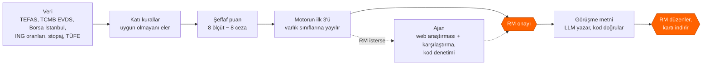
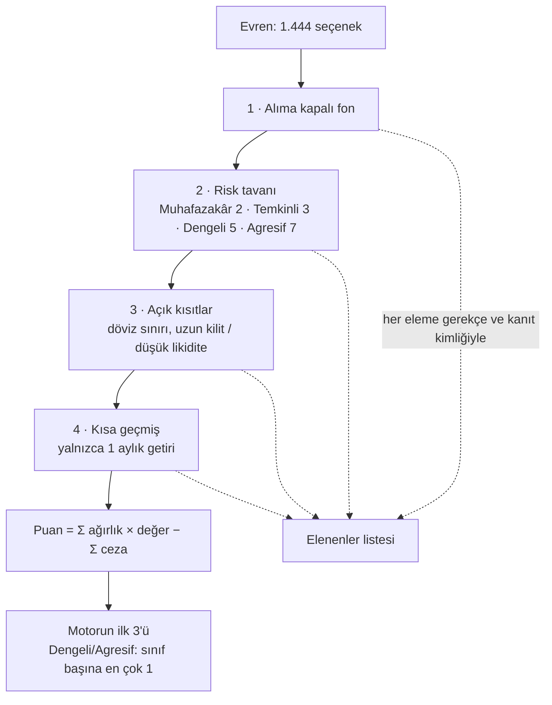
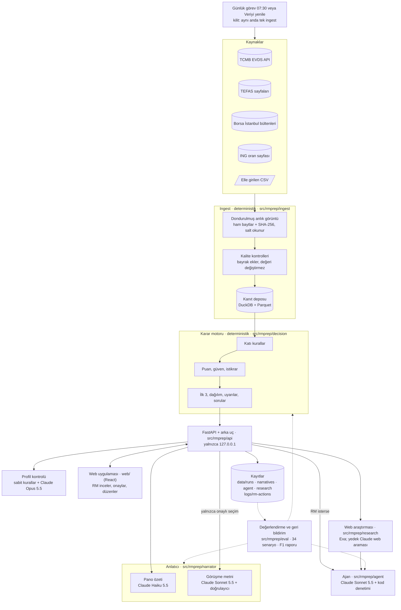
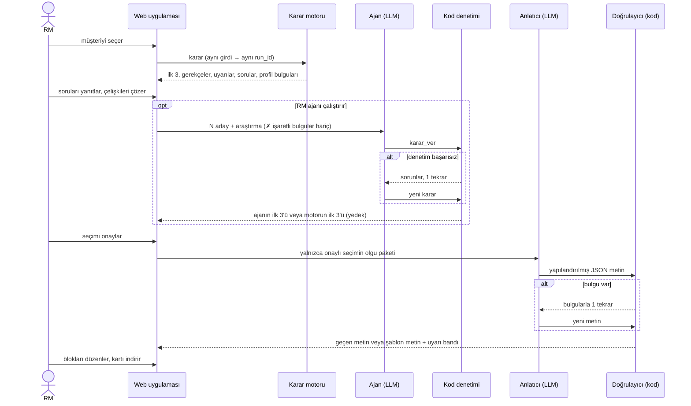
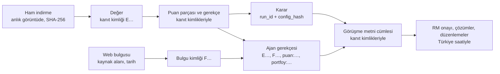

# RM Görüşme Hazırlığı: kanıta dayalı yatırım karar desteği

Agent 007 grubu olarak sunduğumuz bu ürün, Private Banking'deki RM'ler (Relationship Manager) için tasarlanmış bir yatırım karar destek çözümüdür. 

Ürünümüz, data science ve agentic mühendislik yardımıyla RM'lerin müşteri görüşmesi hazırlığına yardım eder. 

Sistemimizde TEFAS, Borsa İstanbul, TCMB gibi kaynaklardan topladığımız ve işlediğimiz toplam 1.444 yatırım seçeneği var. Bu yatırım seçenekleri öncelikle müşterinin profiline ve kısıtlarına göre incelenir, uygunsuz opsiyonlar elenir ve geriye kalan uygun ürünler müşteriye özel puanlama sistemimizle sıralanır. Bu sıralama sonucunda puanlama motorumuz RM'in önüne en yüksek puanlı 3 ürünü öneri olarak sunar. RM, isterse bu önerilerin üzerine tıklayarak detaylarını inceleyebilir, motorun hangi kategorilere göre, neden bu yatırım seçeneğini önerdiğini görebilir. RM, bu üç opsiyon hakkında tereddüt ederse ya da yüksek puanlı opsiyonlar hakkında daha detaylı bir karşılaştırma yapmak isterse *Ajan Araştırması* bölümünü kullanabilir. Ajan araştırması, puanlama motorunun sıraladığı en üst seçenekler hakkında detaylı bir şirket ve ürün araştırması yapar, bununla birlikte müşterinin portföy bilgisi, istek ve kısıtlarını göz önünde bulundurarak motorun yaptığı tercihleri değiştirebilir, RM'e yeni bir ürün sıralaması önerebilir. 

RM; bu süreç boyunca müşteri profilini düzenleyebilir; müşterinin portföy detaylarını değiştirebilir, yatırım seçenekleri hakkında detaylı web araştırması yaptırabilir. Web araştırması sonucunda çıkan bulguları onaylayabilir veya reddedebilir. Reddedilen bilgiler ajana girdi olarak verilmez, onaylanan bilgiler ajana daha güçlü bir şekilde önerilir. 

RM hazırlık sayfasındaki önerilerden ve haberlerden, değiştirdiği bilgilerden memnun olduğu takdirde müşteri görüşme metnini hazırlatabilir. Metin; sayfada yer alan bilgiler ve RM'in verdiği kararlara göre hazırlanır. Bu süreçte ekrandaki her sayının kaynağı, tarihi ve kanıt kimliği vardır. Araç yatırım tavsiyesi vermez; kararı ve müşteri iletişimini RM yapar.


*Yukarıda P02 (ihracatçı şirket sahibi, Dengeli profil) müşterisinin hazırlık sayfasını görüyorsunuz; veriler 17.10.2026 tarihli. Sayfanın üstünde müşteri profili ve yapay zekânın profilde bulduğu, RM'in müşteriye sorması gereken noktalar yer alır. Ortada kodun yazdığı piyasa notu vardır ve her değerin yanındaki "K" işareti o değerin kanıtını açar. En altta ise RM'in önerileri onayladığı çubuk durur.*

Sistemi kendi bilgisayarınızda çalıştırmak için (Windows, Python 3.11+, Node yalnızca web derlemesi için):

```powershell
python -m venv .venv; .venv\Scripts\Activate.ps1
pip install -e ".[dev,web,narrator]"
cd web; npm ci; npm run build; cd ..
python -m rmprep ingest          # veriyi çeker (yaklaşık 16 dk), yeni anlık görüntü
python -m rmprep serve           # http://127.0.0.1:8600
pytest -q                        # 150 dosyada 3.053 test, ağ erişimi yok
python -m rmprep eval --no-llm   # değerlendirme paketi, ücretsiz geçiş
python -m rmprep feedback        # RM işlem kaydından geri bildirim raporu
```

Bunun için `.env` dosyasında üç anahtar gerekir: TCMB verisi için `EVDS_API_KEY`, görüşme metni, ajan ve profil kontrolü için `ANTHROPIC_API_KEY`, web araştırması için `EXA_API_KEY`. Anahtarlardan biri eksikse yalnızca ona bağlı parça kapanır; puanlama motorumuz yine çalışır.

Bu README sekiz bölümden oluşur. Aşağıdaki tablo her bölümün yarışma brief'inin 8. maddesindeki hangi teslimata karşılık geldiğini ve ayrıntının hangi belgede olduğunu gösterir. Çalışan demo (teslimat 1) yukarıdaki komutlarla açılır.

| README bölümü | Brief'teki teslimat | Ayrıntılı belge |
|---|---|---|
| 1 · Problem tanımı ve çözüm yaklaşımı | 2 · Problem tanımı | [`docs/teslim/01-problem-tanimi.md`](docs/teslim/01-problem-tanimi.md) |
| 2 · Veri kaynakları ve temel sinyaller | 3 · Analitik çözüm | [`docs/ingest.md`](docs/ingest.md), [`docs/research.md`](docs/research.md) |
| 3 · Karşılaştırma, sıralama ve karar mantığı | 3 · Analitik çözüm | [`docs/decision.md`](docs/decision.md), [`config/decision.yaml`](config/decision.yaml) |
| 4 · Çözüm mimarisi ve veri akışı | 4 · Çözüm tasarımı | [`docs/ingest.md`](docs/ingest.md), [`docs/web-ui.md`](docs/web-ui.md) |
| 5 · AI/Agentic bileşenler | 4 · Çözüm tasarımı | [`docs/agent.md`](docs/agent.md), [`docs/narrator.md`](docs/narrator.md), [`docs/research.md`](docs/research.md) |
| 6 · Varsayımlar, belirsizlikler ve insan onay noktaları | 3 · Analitik çözüm, 4 · Çözüm tasarımı | [`docs/kararlilik-veri-guveni.md`](docs/kararlilik-veri-guveni.md), [`docs/web-ui.md`](docs/web-ui.md) |
| 7 · Test, sonuçlar, hata analizi ve iyileştirmeler | 5 · Test ve öğrenimler | [`docs/eval.md`](docs/eval.md), [`docs/found-and-fixed.md`](docs/found-and-fixed.md) |
| 8 · İzlenebilirlik | 6 · Kanıt kaydı örneği | [`docs/teslim/06-kanit-kaydi-ornegi.md`](docs/teslim/06-kanit-kaydi-ornegi.md) |

## 1. Problem tanımı ve çözüm yaklaşımı

Bir RM, her müşteri görüşmesinden önce yüzlerce yatırım ürününü farklı kaynaklardan toplayıp elle karşılaştırmak zorunda kalıyor. Faiz oranları TCMB'de, fon getirileri TEFAS'ta, mevduat oranları bankaların sayfalarında duruyor ve RM bunları kendisi bir araya getiriyor. Bu iş uzun sürdüğü için görüşme metni çoğu zaman müşteriye yeterince uyarlanamıyor, müşterinin açık bir kısıtı gözden kaçabiliyor ve önerinin hangi veriye, varsayıma ve gerekçeye dayandığı sonradan gösterilemiyor.

Problemin büyüklüğünü kendi verimizle ölçtük (anlık görüntü `20261017-110343-d12a`, 17.10.2026):

| Gözlem | Sayı |
|---|---|
| Muhafazakâr bir müşteri (P01) için evren | 1.444 seçenek (815 fon, 37 BYF, 590 pay, 2 ING mevduatı); kurallar 1.301'ini eler, 143'ü kalır |
| ING Turuncu Hesap %23 faiz, stopaj ve yıllık TÜFE (%29,73) sonrası | reel −%8,3 |
| P01'in risk sınırı içindeki 37 para piyasası fonu, son 1 yıl reel | medyan +%6,6, en iyisi +%9,6 |

Tablonun ikinci ve üçüncü satırı bize şunu gösterdi: %23 faiz kâğıt üzerinde iyi görünse de stopaj ve enflasyondan sonra müşteri mevduatta değer kaybediyor, aynı risk seviyesindeki para piyasası fonları ise enflasyonun üstünde kalıyor. RM'in bunu görebilmesi için 143 seçeneği reel getiriye, vergiye ve risk uyumuna göre sıralaması gerekir ve bu iş bir görüşme hazırlığının süresine sığmaz.

### Beklenen iş etkisi

| Gösterge | Bugün | Çözümle (ölçüldü) |
|---|---|---|
| Hazırlık süresi | **[VARSAYIM]** görüşme başına ~60 dk | analiz ort. 1,18 sn, görüşme metni ort. 24,9 sn; geri kalan RM'in okuması ve onayı |
| Kısıt ihlali | elle kontrol | 34 senaryo, 39 çalıştırmada 0 |
| Tutarlılık | kişiye bağlı | aynı girdi → aynı sonuç ve aynı metin (5/5 tekrar) |
| Uyarlama | genel metin | 5 personada 5 farklı öneri seti; gerekçe müşterinin önceliklerine bağlı |
| İzlenebilirlik | dağınık | her sayı kaynak, değer tarihi, alınma zamanı ve kanıt kimliğiyle |

### Yaklaşımımız

Çözümümüzde işleri dört katmana ayırdık. Ürünleri eleyen ve sıralayan kısım koddur; aynı girdiyle her seferinde aynı sonucu verir ve her adımı açıklanabilir. Ajan ve dil modeli (LLM) yalnızca bu kodun çizdiği sınırlar içinde çalışır: ajan motorun önerilerini araştırıp yeni bir sıralama önerebilir, dil modeli de görüşme metnini yazar. Ajanın ve dil modelinin yazdığı her şeyi yeniden kod denetler. Son karar ise her zaman RM'indir.



Ürünümüz yalnızca görüşmeden önceki hazırlığı kapsar. Getiri tahmini, otomatik alım satım, müşteriyle doğrudan iletişim ve müşteriye açık bir sohbet botu kapsamımızın dışındadır.

## 2. Kullanılan veri kaynakları ve temel sinyaller

Sistemimiz her sabah 07:30'da (ya da RM "Veriyi yenile" dediğinde) aşağıdaki kaynaklardan güncel veriyi çeker. Her kaynağın kullanım koşullarını ve robots.txt dosyasını kontrol ettik; bir kaynak bot engeli koyduysa o engeli aşmaya çalışmayız, bir önceki günün verisiyle devam ederiz.

| Kaynak | Ne verir | Nasıl okunur |
|---|---|---|
| TCMB EVDS (resmî API) | politika faizi, USD/TRY, TCMB fonlama maliyeti, 3 aya kadar mevduat faizi, TÜFE endeksi (→ yıllık TÜFE), BIST 100 | API anahtarıyla; 900 günden uzun pencereler parça parça |
| TEFAS fon getirileri sayfası | ~2.100 fon ve BYF'ler: 1 ay-5 yıl getiri, SPK risk değeri (1-7) | tek kamuya açık HTML sayfası; robots.txt'nin yasakladığı `/api/` hiç çağrılmaz |
| TEFAS fon detay sayfaları | fiyat, büyüklük, yatırımcı sayısı, alış/satış valörü, ücretler, alım durumu, portföy dağılımı | fon başına bir sayfa, en az 1 sn arayla |
| Borsa İstanbul gün sonu bültenleri | 628 pay: kapanış, 1 ay-5 yıl getiri, 1 ve 5 yıllık oynaklık, işlem hacmi, BIST 100 üyeliği | ücretsiz günlük ZIP dosyaları, sn'de en çok 1 istek; dosyalar SHA-256 ile önbellekte |
| ING oran sayfası | Turuncu Hesap ve e-Vadeli Mevduat oranları (dört ürün okunur, ikisi kullanılır) | ING'nin kamuya açık formu, istekler arası 2 sn; hata olursa önceki anlık görüntü, sonra elle girilen CSV |
| Elle girilen CSV | stopaj oranları (geçerlilik sonu 31.12.2026), yıllık TÜFE (çapraz kontrol), ING oranları (yedek) | her satır kaynak bağlantısı ve tarihiyle; kaynaksız satır reddedilir |
| Fon yöneticisi belgeleri | izahname ve yatırımcı bilgi formu bağlantıları | RM fon kartını açınca, yöneticinin kendi sitesinden; yalnızca bağlantı |
| Web araştırması (Exa) | önerilen ürünler ve şirketleri için son 90 günün haberleri ve öne çıkanlar | yalnızca ürün ve şirket adı gider; etiket "web kaynağı, doğrulanmamış" |

### KAP'ı neden kullanmıyoruz?

Brief KAP'ı önerilen kaynaklar arasında sayıyor, ancak kap.org.tr botları engelliyor. KAP verisini yayınlayan ayna siteler de kendi kullanım koşullarında otomatik okumayı yasaklıyor ve KAP verisini yeniden dağıtmak lisans gerektiriyor (brief kuralı 8). Bu yüzden fon belgeleri için fon yöneticisinin kendi sitesindeki izahnameye ve yatırımcı bilgi formuna bağlantı veriyoruz, şirket haberlerini ise web araştırmasıyla topluyoruz. Web araştırması da kap.org.tr'yi dışarıda tutar.

Sonuçta yatırım evrenimiz 815 TEFAS fonu, 37 BYF, 590 pay ve 2 ING mevduatından oluşur. ING Turuncu Hesap sıralamaya girmez; önerileri karşılaştırdığımız taban olarak durur. Yalnızca nitelikli yatırımcıya açık "Serbest" fonları, Borsa İstanbul'un W ve S pazarlarındaki payları, varant ve sertifikaları evrene almadık. İş Bankası ve Ziraat'in mevduat oranlarını da okuyoruz, ama bu oranlar puana girmez ve ekranda gösterilmez.

### Ürün ve müşteri sinyalleri

Puanlama motorumuz bir ürünü değerlendirirken stopaj ve enflasyon sonrası reel getirisine, SPK risk değerine, satış valörüne (yani müşterinin parasına kaç günde ulaşacağına), fon büyüklüğüne ve yatırımcı sayısına, alım durumuna, giriş ve çıkış ücretine bakar. Çok varlıklı fonlarda fonun adına değil gerçek portföy dağılımına bakarak hangi varlık sınıfına girdiğini belirler. Paylarda SPK risk değeri olmadığı için riski oynaklıktan, büyüklüğü de işlem hacminden hesaplar. Bir ürünün risk değeri hiç yoksa aynı sınıftaki ürünlerden tahmin eder.

Müşteri tarafında ise persona dosyasındaki her alanın kararda bir karşılığı vardır:

| Alan | Kararda nasıl kullanılır |
|---|---|
| Risk profili | risk tavanı (katı kural), risk bandı ve risk iştahı (puan) |
| Yatırım ufku | hangi dönemin getirisine bakılır; ufuk ≥ 3 yılsa getiri ağırlığı artar |
| Likidite, gelir, anapara koruma | Düşük 0 · Orta 0,5 · Yüksek 1 → ilgili ölçütün ağırlığı ve ceza şiddeti |
| Döviz maruziyeti | döviz cezasının şiddeti; açık kısıtsa katı kural |
| Öncelikler | eşleşen her öncelik ilgili ölçüt ağırlığına +1 |
| Açık kısıtlar | katı kural (ör. döviz sınırı, uzun kilit) |
| Durum, amaç, RM notu | mevcut portföy dağılımının tahmini (D27) ve metindeki uyarlama |
| Yaş | puana girmez; metinde ve profil tutarlılık kontrolünde kullanılır |

Brief'in 6.1 maddesinde sayılan müşteri ve ürün özelliklerinin her birini bir ölçüte, bir cezaya veya bir katı kurala bağladık. Getiriyi bilerek reel ve stopaj sonrası ölçüyoruz, çünkü %30 civarındaki enflasyonda nominal getiriye göre yapılan bir sıralama müşteriyi yanıltır.

Yaşı ise puana katmadık. Müşterinin hangi ürünlere uygun olduğunu risk profili zaten belirliyor; yaşı ayrıca puanlamak aynı bilgiyi iki kez saymak olurdu ve tek başına bir yaş-risk kuralının kamuya açık bir dayanağını bulamadık. Yaş, görüşme metninde ve profil kontrolünde kullanılır: örneğin dosyada `yas` 62 yazarken RM notunda "45 yaşında" geçiyorsa sistem bu çelişkiyi RM'e gösterir.

## 3. Karşılaştırma / sıralama veya karar mantığı

Karar katmanımız deterministik bir kural ve puanlama motorudur. Aynı müşteri ve aynı veriyle her çalıştırıldığında aynı sonucu ve aynı `run_id`'yi verir. Motorun tüm tabloları ve ağırlıkları [`config/decision.yaml`](config/decision.yaml) dosyasında, tasarım kararları da [`docs/decision.md`](docs/decision.md) belgesinde durur.

### Neden kural ve şeffaf puan?

Bu yaklaşımı üç nedenle seçtik. Birincisi, elimizde hangi müşteriye hangi ürünün önerildiğini gösteren etiketli bir geçmiş veri yok, dolayısıyla denetimli bir model eğitemeyiz. İkincisi, brief'in 5. kuralı (müşteriye uygun olmayan ürün öneri listesine girmez) her seferinde kesin olarak uygulanmalı ve olasılıkla çalışan bir model bunu garanti edemez. Üçüncüsü, kural ve puan yaklaşımında puanın her parçasını RM'e ve jüriye gösterebiliyor, aynı sonucu istediğimiz zaman yeniden üretebiliyoruz. Dil modelini ise metin yazmak, araştırmayı özetlemek ve adayları nitel olarak karşılaştırmak gibi kendi güçlü olduğu işlerde kullanıyoruz (bölüm 5).



Motor önce dört katı kuralı sırayla uygular: alıma kapalı fonları, müşterinin risk tavanını aşan ürünleri, müşterinin açık kısıtlarına uymayan ürünleri ve yeterli getiri geçmişi olmayan ürünleri eler. Elenen her ürün, hangi kurala takıldığı ve bu kararın dayandığı kanıtla birlikte *Elenenler* listesine yazılır. Kalan ürünler puanlanır. RM bu huniyi hazırlık sayfasındaki *Bu öneriler nasıl seçildi?* bölümünde görür: müşterinin kriter ağırlıkları, her kuralın kaç ürünü elediği ve önerilerin ne kadar kararlı olduğu burada yazar.


### Puan nasıl hesaplanır?

Kurallardan geçen her ürün sekiz ölçütün her birinden 0 ile 1 arasında bir değer alır. Motor bu değerleri müşterinin ağırlıklarıyla çarpıp toplar, sonra ürünün zayıf yönleri için cezaları çıkarır. Ağırlıkları müşterinin profili belirler ve toplamları her zaman 1'dir; örneğin likidite ihtiyacı yüksek bir müşteride likidite ölçütünün ağırlığı büyür.

| Ölçüt | Ne ölçer | Ham ağırlık |
|---|---|---|
| Getiri | stopaj, ücret ve TÜFE sonrası reel getirinin adaylar içindeki sırası | 2 + 2 × risk iştahı (+1, ufuk ≥ 3 yıl) |
| Risk uyumu | risk değeri müşterinin bandında mı (bandın altındaki her seviye −0,5) | 2 |
| Likidite | satış valörü (aynı gün 1,0 … 10 günden uzun 0,2) | 2 × likidite ihtiyacı |
| Gelir | ürün türünün düzenli gelire uygunluğu | 2 × gelir ihtiyacı |
| Anapara | anaparanın korunması (mevduat 1; fon riskle azalır) | 2 × anapara koruma tercihi |
| Sadelik | ürün yapısının sadeliği | yalnızca "sade ürün yapısı" önceliğiyle |
| Kalite | fon büyüklüğü ve yatırımcı sayısı (pay: işlem hacmi) | 0,5 |
| Portföy açığı | müşterinin mevcut dağılımının model banttan uzaklığı (D27) | 1 × kaynak katsayısı; yalnızca RM'in girdiği, RM'in onayladığı veya müşteri dosyasından gelen dağılımla |

Cezalar ürünün müşteriye uymayan yanlarını puandan düşer. Anapara riski, yavaş erişim, döviz maruziyeti, bilinmeyen risk, reel kayıp ve piyasa altı getiri için ceza en çok 0,3, eksik getiri geçmişi için 0,2, küçük fon için 0,1 olabilir. Bir cezanın büyüklüğü üç şeyin çarpımıdır: cezanın üst sınırı, o konunun müşteri için ne kadar önemli olduğu ve ürünün o konuda ne kadar zayıf kaldığı.

### Bu ağırlıkları neden seçtik?

MiFID II ve SPK'nın yerindelik kuralları hangi kritere ne kadar ağırlık verileceğini sayıyla söylemez. Bu yüzden ağırlıkları kendimiz seçtik ve ekranda açıkça gösteriyoruz **[VARSAYIM]**. Seçimimizin sonucu ne kadar etkilediğini de iki yolla ölçüyoruz: istikrar testimiz her ağırlığı %20 artırıp azaltarak sıralamayı yeniden hesaplar (bölüm 6), değerlendirme paketimiz de persona değiştiğinde sonucun beklenen yönde değişip değişmediğine bakar (bölüm 7).

### İlk 3 öneri nasıl seçilir? (D19)

Muhafazakâr ve Temkinli müşterilerde ilk 3 öneri doğrudan puan sırasının ilk üç ürünüdür. Dengeli ve Agresif müşterilerde ya da çeşitlendirme isteyen her müşteride ise motor listeyi puan sırasıyla dolaşır ve her varlık sınıfından en çok bir ürün alır; böylece üç öneri aynı türden fonlar olmaz. Nakit benzeri ürünler ve paylar için de sınır birdir ve son bir yılda enflasyonun altında kalmış bir ürün bu yöntemle seçilmez. Çok varlıklı bir fonun sınıfını fonun gerçek portföy dağılımı belirler: portföyün %50 veya fazlasını oluşturan sınıf; böyle bir sınıf yoksa fon "dengeli" sayılır.

Örneğin P02, döviz geliri olan ve 1-3 yıllık ufku bulunan Dengeli profilli bir ihracatçı; önceliklerinden biri erişilebilir likidite. Motorumuz bu müşteri için ağırlıkları getiri 0,339, risk uyumu 0,203, likidite 0,203, gelir 0,102, anapara 0,102 ve kalite 0,051 olarak hesapladı (17.10.2026):

| Seçenek | Sınıf | Reel getiri (1 yıl) | Puan | Neden |
|---|---|---|---|---|
| EIL Astra Para Piyasası | nakit benzeri | +%7,7 | 0,783 | en iyi nakit benzeri; aynı gün erişim |
| NJR Nurol Borçlanma Araçları | borçlanma | +%8,1 | 0,743 | en iyi borçlanma fonu |
| KDE Kuveyt Türk Dengeli Katılım | dengeli | +%9,5 | 0,741 | en iyi dengeli; risk bandın içinde |
| ING e-Vadeli Mevduat | nakit benzeri | +%2,1 | 0,434 | sıralanır, ama nakit benzeri yeri EIL'de |
| ING Turuncu Hesap (karşılaştırma) | nakit benzeri | −%8,3 | 0,185 | reel kayıp ve piyasa altı cezaları |

RPP adlı para piyasası fonu 0,775 puanla KDE'den yüksek puan aldı, ama nakit benzeri sınıfın tek yerini EIL doldurduğu için listeye girmedi. P02'nin "döviz maruziyetini gerekçesiz artırmama" kısıtı 15 döviz fonunu eledi; RM isterse bu kısıtı gerekçe yazarak kaldırabilir.

RM bir önerinin üzerine tıkladığında fon kartı açılır. Kartın *Neden bu öneri?* bölümü puanın her parçasını gerekçesiyle, fonun geçtiği katı kuralları kanıt kimlikleriyle ve en yakın alternatifle arasındaki farkı gösterir. Ekranda puanlar 100 ile çarpılmış olarak yazar:


Aynı gün beş personamız için motorun önerdiği ilk 3 şöyle oldu:

| Persona | Kalan / evren | Motorun ilk 3'ü |
|---|---|---|
| P01 Emekli girişimci, Muhafazakâr | 143 / 1.444 | PPN · OSD · AIS |
| P02 İhracatçı, Dengeli | 306 / 1.444 | EIL · NJR · KDE |
| P03 Teknoloji kurucusu, Agresif | 1.250 / 1.444 | ASELS (pay) · TE3 · OKT |
| P04 Aile ofisi, Dengeli | 312 / 1.444 | OKT · RPP · TCF |
| P05 Hekim, Temkinli | 180 / 1.444 | EIL · GBL · KSK |

Önerilerin yanında *Dağılım* görünümü de var. Bu görünüm müşterinin risk profiline göre her varlık sınıfı için model bir bandı (Ata Yatırım, 28.04.2026), müşterinin bugünkü dağılımını ve her sınıfın en iyi seçeneğini yan yana koyar. P02'nin dosyasında mevcut portföy dağılımı olmadığı için ekrandaki değerler "tahmini senaryo" olarak işaretlidir ve RM "Tahmini onayla" ya da "Düzenle" diyene kadar sıralamayı etkilemez.


## 4. Genel çözüm mimarisi ve veri akışı

Aşağıdaki şema verinin kaynaktan RM'in ekranına kadar izlediği yolu gösterir. Veri önce değiştirilemeyen bir anlık görüntüye kaydedilir, kalite kontrollerinden geçer ve kanıt deposuna yazılır. Karar motoru bu depodan okur; web uygulaması, ajan, web araştırması ve görüşme metni de motorun sonucunu API üzerinden alır. RM'in yaptığı her işlem kayıtlara geçer ve değerlendirme paketimiz bu kayıtları tekrar okuyabilir.



Sistemi birbirinden bağımsız test edilebilen modüllere böldük:

| Modül | Sorumluluk | Klasör |
|---|---|---|
| Ingest | kaynak adaptörleri, anlık görüntü, kalite kontrolleri, kanıt deposu, günlük görev ve kilit | `src/rmprep/ingest/`, `config/sources.yaml` |
| Karar motoru | evren, katı kurallar, puan, güven, istikrar, ilk 3, dağılım bantları, mevcut dağılım, uyarılar | `src/rmprep/decision/`, `config/decision.yaml` |
| Ajan | adaylar, veri paketi, araçlar, kod denetimi, yedek | `src/rmprep/agent/`, `config/agent.yaml` |
| Web araştırması | Exa ve Claude sağlayıcıları, soru kontrolü, biçimlendirme, önbellek, günlük sınır | `src/rmprep/research/`, `config/research.yaml` |
| Anlatıcı | olgu paketi, LLM çağrısı, doğrulayıcı, tekrar, şablon metin, piyasa notu, maliyet defteri | `src/rmprep/narrator/`, `config/narrator.yaml` |
| API ve arka uç | çalıştırma, profil kontrolü, onay, kayıt, işlem kaydı, veri güncelliği | `src/rmprep/api/`, `src/rmprep/backend.py` |
| Web uygulaması | pano, öneriler, ajan kutusu, araştırma paneli, fon kartı, kanıt penceresi, görüşme metni, sunum görünümü | `web/` |
| Değerlendirme | senaryolar, kural kontrolleri, LLM hakemi, ajan A/B, geri bildirim raporu | `src/rmprep/eval/`, `config/eval.yaml` |

Modüller arasındaki veri tipleri (sözleşmeler) `src/rmprep/contracts.py` dosyasındadır. Her modülün tasarım belgesi ayrı tutulur: [`docs/ingest.md`](docs/ingest.md), [`docs/decision.md`](docs/decision.md), [`docs/agent.md`](docs/agent.md), [`docs/research.md`](docs/research.md), [`docs/narrator.md`](docs/narrator.md), [`docs/web-ui.md`](docs/web-ui.md), [`docs/eval.md`](docs/eval.md).

## 5. AI/Agentic bileşenler ve görev/karar akışı

Sistemimizde yapay zekâyı kullandığımız her yerde aynı ilkeye uyduk: dil modeli hiçbir ürünü elemez ve hiçbir katı kuralı aşamaz, çünkü eleme ve puan koddadır. Dil modelini metin yazmak, web araştırması yapmak ve adayları nitel olarak karşılaştırmak için kullanıyoruz. Modelin her çıktısını kod denetler ve denetimden geçmeyen bir çıktının yerine her zaman deterministik bir yedek gelir; bu yüzden model hata yapsa da RM boş bir ekranla karşılaşmaz.

| Bileşen | Model | Görev | Güvence | Maliyet |
|---|---|---|---|---|
| Ajan ilk 3 | Claude Sonnet 5.5 | motorun en iyi 10 adayı (RM 20'ye kadar seçer) arasından kendi ilk 3'ünü seçer | kod denetimi; 1 tekrar; sonra motorun ilk 3'ü | karar başına ~0,05-0,10 $, günlük 3 $ |
| Web araştırması | Exa (yedek: Claude Haiku 5.5 web araması) | ilk 3 ve şirketleri için haberler ve öne çıkanlar | soru kontrolü (müşteri bilgisi gitmez); kaynaksız bulgu atılır; "doğrulanmamış" etiketi | ürün başına ~0,02 $, günlük 5 $ |
| Profil kontrolü | Claude Opus 5.5 | profilin tamamında çelişki arar | her bulgu iki tarafı da kelimesi kelimesine alıntılar; sunucu alıntıyı alanda arar | profil başına ~0,015 $, önbellekte |
| Görüşme metni | Claude Sonnet 5.5 | onaylı seçimi bölümlü Türkçe metne çevirir | doğrulayıcı; 1 tekrar; sonra şablon metin | metin başına 0,034 $, ort. 24,9 sn |
| Pano özeti | Claude Haiku 5.5 | RM'e 1-2 cümlelik özet | doğrulayıcı; hata → düz cümle | ~0,003 $ |
| Değerlendirme hakemi | Claude Haiku 5.5 | metnin uyarlanmış, açık, dengeli olup olmadığını notlar; ajan ile motoru kör A/B karşılaştırır | yalnızca kodun ölçemediği şeyler | paket başına < 0,01 $ |

### Ajan nasıl çalışır?

Ajan kendiliğinden başlamaz; RM hazırlık sayfasındaki *Ajan değerlendirmesi* kutusunda aday sayısını seçip "Ajanı çalıştır" dediğinde çalışır. Ajana tek bir veri paketi veririz: müşterinin profili ve mevcut dağılımı, motorun en iyi adaylarının puan parçaları, olguları ve uyarıları, bir de bu adaylar hakkındaki web araştırması bulguları. Sistem isteminde araştırma bulgularının talimat değil veri olduğunu açıkça belirtiriz; böylece bir web sayfasındaki yazının ajana talimat gibi etki etme riskini azaltırız. Ajanın kullanabileceği üç araç vardır:

- `karsilastir(a, b, amac)`: iki adayı kodla karşılaştırır (en çok 4 kez).
- `arastir(option_id, soru, amac)`: bir aday için tek bir web sorusu sorar (en çok 2 kez).
- `karar_ver(secimler, cikanlar, ozet)`: kararı önerir.

Ajan kararını verdiğinde kodumuz bu kararı şu sorularla denetler:

- 3 farklı aday seçilmiş mi; en çok 1 pay var mı; varlık sınıfı kuralı tutuyor mu?
- Her gerekçe bir kanıta (E…), bir bulguya (F…), bir puan parçasına veya bir portföy satırına atıf yapıyor mu?
- Her sayı ve tarih atıf yapılan veride var mı; yasak ifade var mı?
- Motorun listesinden çıkarılan her seçenek için bir gerekçe yazılmış mı?

Denetimden geçmeyen bir kararda ajan bulunan sorunların listesini alır ve kararını bir kez düzeltir. İkinci kez hata yaparsa, 90 saniyeyi aşarsa veya günlük bütçe dolarsa RM'in önüne motorun kendi ilk 3'ü gelir. RM ajanın beş adımını (Adaylar, Ajan araştırması, Ajan analizi, Kontrol, Karar) süresi, maliyeti ve notlarıyla izleyebilir; modelin ham düşüncesini ise saklamayız ve göstermeyiz.


*P01 için ajan, motorun önerdiği AIS fonunu çıkarıp yerine ZBJ'yi aldı ve nedenini yazdı. Her gerekçe bir puan parçasına veya kanıt kimliğine bağlı. Tahmini portföy dağılımına dayanan bir cümleye "(tahmini dağılıma göre)" etiketini kod ekler.*

Ajanın kullandığı web araştırması *Ajan araştırması* bölümünde RM'in önünde de durur. RM her bulgunun yanındaki ✓ ve ✗ işaretleriyle bulguyu onaylayabilir ya da reddedebilir. Reddedilen bulgu ajana hiç verilmez, onaylanan bulgu ise ajana "(web, RM doğruladı)" etiketiyle gider:


Aşağıdaki şema bir hazırlığın baştan sona akışını gösterir. RM müşteriyi seçtiğinde motor sonucu hazırlar; RM isterse ajan devreye girer; RM onay verdikten sonra anlatıcı görüşme metnini yazar ve doğrulayıcı bu metni kontrol eder.



### Görüşme metni nasıl yazılır ve nasıl denetlenir?

RM önerileri onayladığında anlatıcımız yalnızca onaylanan ürünlerin verilerinden bir olgu paketi hazırlar ve görüşme metnini bu paketten yazdırır. Metin hazırlanırken RM ekranda anlatıcının adımlarını ve her adımda hangi bilginin kullanıldığını görür:


Metin RM'e ulaşmadan önce doğrulayıcımızdan geçer. Doğrulayıcı olgu paketinde olmayan bir sayı veya tarih, elenmiş ya da listede olmayan bir ürünün adı, "garanti", "risksiz", "kesin getiri" gibi yasak bir ifade, kaynağı gösterilmemiş bir öneri cümlesi, ING ürün adının yanında ING'ye ait olmayan bir oran veya tahmini dağılımdan alınmış bir sayı bulursa metni reddeder. Eksik bir bölüm ya da eksik "yatırım tavsiyesi değildir" cümlesi de ret sebebidir. Reddedilen metin bulunan sorunlarla birlikte bir kez yeniden yazdırılır; yine geçmezse RM'in önüne kurallı bir şablon metin ve bir uyarı bandı gelir. Piyasa notunu (politika faizi, USD/TRY, fonlama maliyeti) ise dil modeline hiç yazdırmayız; bu bölümü kod yazar ve her değerin yanına kanıt kimliğini koyar.

Hazırlanan görüşme metni tek bir sayfadır. Sayfanın beyaz kısmı müşteriye gösterilecek sunumdur, sarı kutular ise yalnızca RM içindir ve *Sunum görünümü*nde ve çıktıda yer almaz. Metindeki her kaynak numarası sağdaki *Kaynaklar* listesinde bir kanıt kimliğine bağlanır:


### Ajanı ve metni neden ayrı tuttuk?

Ajan, tek bir puanın gösteremediği şeyleri tartmak için var: güncel haberler, iki adayın nitel farkı ve müşterinin mevcut dağılımı gibi. Yine de kararını kodun çizdiği sınırlar içinde verir ve RM motorun ilk 3'ünü her zaman ajanın önerisiyle yan yana görür. Görüşme metni ise tek bir model çağrısıyla (en çok bir tekrarla) yazılır; böylece maliyeti ve süresi her seferinde öngörülebilir kalır.

Ürünü geliştirirken de çoklu ajanla çalıştık. Bir lider Claude Code oturumu ve her modül için bir işçi oturumu ayrı git çalışma ağaçlarında çalıştı; modüller arasındaki sözleşmeleri dondurduk ve her adımı yeşil testlerle bitirdik ([`docs/workflow.md`](docs/workflow.md)).

## 6. Varsayımlar, belirsizlikler ve insan onay noktaları

### Varsayımlarımız

Bazı konularda veri olmadığı için bir varsayım yapmak zorunda kaldık. Bu varsayımların hepsi ekranda ve kayıtta görünür; `[VARSAYIM]` ile işaretlediklerimizi mentorlarla teyit edeceğiz.

- Fon getirileri geçmiş getirilerdir, bir tahmin değildir. 1 yıldan kısa dönem getirilerini yıllığa çevirmeyiz.
- Getiriler stopaj sonrası ve yıllık TÜFE'ye (%29,73) göre reeldir.
- Yatırım tutarını bilmiyoruz; mevduatta 100.000-249.999 TL diliminin standart oranını kullanıyoruz.
- Risk bantları (Muhafazakâr 1-2, Temkinli 2-3, Dengeli 3-5, Agresif 4-7) ve ağırlıklar bizim yargımızdır **[VARSAYIM]**.
- Payların risk değerini oynaklık bandından hesaplıyoruz ve en az 6 alıyoruz; BYF stopajını %17,5 kabul ediyoruz **[VARSAYIM]**.
- Dağılım bantları tek bir kamuya açık kaynaktan geliyor; Temkinli bandını o kaynaktan biz çıkardık **[VARSAYIM]**.
- Müşteri dosyasında mevcut dağılım yoksa onu meslek tablosundan veya ulusal ortalamadan (TCMB FİR 2026-I) tahmin ediyoruz. Bu tahmin sıralamayı değiştirmez; RM onaylarsa değiştirir **[VARSAYIM]**.

### Belirsizliği nasıl yönetiyoruz?

Verinin eksik, eski veya çelişkili olduğu durumlarda sistemimiz bunu saklamaz, RM'e gösterir. Bunun için beş araç kullanıyoruz:

| Araç | Ne yapar |
|---|---|
| Veri güveni (0-1) | kullanılan en zayıf veri satırı × tahmin katsayıları (elle girilen 0,9 · doğrulanmamış seri 0,8 · eski 0,7 · çelişen 0,6 · tahmini risk × 0,7 · kısa geçmiş × 0,8 · reel getiri hesaplanamadı × 0,8) |
| İstikrar (0-1) | her ağırlık ve ceza üst sınırı ×0,8 ve ×1,2 ile değiştirilir (30-32 yeniden sıralama); önerilen seçenek için "öneri yine çıkıyor mu" oranı ([ayrıntı](docs/kararlilik-veri-guveni.md)) |
| Tahmin yerine soru | risk profili veya kısıt tanınmazsa sıralama durur ve RM'e soru açılır; diğer bilinmeyenlerde güvenli düzey + "Teyit edin" maddesi |
| Profil çelişkileri | 8 sabit kural ve AI kontrolü (ör. "Muhafazakâr" ile büyüme önceliği; `durum`'da gelecek yıl ev peşinatı ile likidite "Düşük") |
| Uyarılar (yalnızca RM) | düşük istikrar, tahmini risk, döviz fonu, tek pay, payda sert düşüş, ING oranı piyasanın altında, süresi geçmiş stopaj veya eski TÜFE |

RM bu belirsizlikleri hazırlık sayfasında *Teyit edin* listesi olarak görür. Motor bir alanı okuyamadığında tahmin yürütmez; güvenli bir düzeyle devam eder ve RM'e yanıt seçenekleri olan bir soru açar. RM soruyu yanıtladığında sıralama yeniden hesaplanır:


### İnsan onay noktaları

Sistemimiz öneriyi hazırlar, ama müşteriye gidecek hiçbir şey RM görmeden ve onaylamadan çıkmaz. Aşağıdaki akış, bir RM'in bir müşteri için ekranda sırayla geçtiği adımları gösterir:

- Turuncu altıgenler RM'in karar verdiği yerlerdir.
- Gri kutular sistemin kendi başına yaptığı işlerdir.
- Kırmızı kutular kilitlerdir: RM bir şeyi tamamlamazsa sistem o noktadan ilerlemez.


| Adım | RM ekranda ne görür | RM ne yapar | Bu adım neden var |
|---|---|---|---|
| 1 · Profili gözden geçir | "Teyit edin" listesi: motorun okuyamadığı alanlar, eksik bilgiler, tahmini portföy dağılımı | soruyu bir seçenekle yanıtlar; dağılımı "Tahmini onayla" ile kabul eder veya "Düzenle" ile girer | motor eksik bilgiyi tahmin etmez, RM'e sorar; her yanıt yeni bir hesaplama başlatır |
| 2 · Çelişkileri çöz | "Profilde çelişki" kartları; her kart çelişen alanları adlandırır, AI bulgusu iki tarafı da kelimesi kelimesine alıntılar | müşteriyle teyit ettiği durumu kısa bir gerekçe olarak yazar ("Müşteriyle teyit edildi: …") veya profili düzeltir | çelişkili bir profil yanlış bir öneriye götürür; RM'in gerekçesi kayda ve karta girer |
| 3 · Ajanı çalıştır (isteğe bağlı) | ajanın beş adımı, ajanın ilk 3'ü ve motorun ilk 3'ü yan yana, web bulguları | aday sayısını seçer (3-20); her web bulgusunu ✓ veya ✗ ile işaretler | ajan kendiliğinden başlamaz; ✗ işaretli bulgu ajana verilmez, ✓ işaretli bulgu "(web, RM doğruladı)" etiketini alır |
| 4 · Önerileri onayla | alttaki onay çubuğu: seçili ürünler, not alanı, "Reddet" ve "Onayla ve metni hazırla" | konuşulacak ürünleri seçer, isterse not yazar, onaylar veya reddeder | görüşme metni yalnızca RM'in onayladığı ürünlerle yazılır |
| 5 · Metni gözden geçir | tek sayfalık görüşme metni; beyaz alan müşteri için, sarı kutular yalnızca RM için | blokları ✎ ile düzenler veya siler; "Riskler" bölümü silinemez, "yatırım tavsiyesi değildir" cümlesi her zaman kalır | RM metnin her cümlesinden sorumludur; düzenlenen blok yeniden denetlenir |
| 6 · Kartı al ve sun | "Kart" kutusu (PDF veya Markdown), "Sunum görünümü" düğmesi | kartı indirir veya yazdırır; müşteriye sunum görünümünü gösterir | sunum görünümü sarı kutuları, notları ve kaynak numaralarını gizler; RM'e özel bilgi müşteriye gitmez |

Bu akışta birkaç kural geçerlidir. RM bir çelişkiyi çözmeden önerileri onaylayamaz; sistem onay isteğini "Çözülmemiş çelişki var" diye geri çevirir, ancak henüz bitmemiş bir AI kontrolü onayı engellemez. "Sorulacak" etiketli kartlar yalnızca öneridir ve onayı engellemez; önerileri reddetmek için de gerekçe gerekmez. Denetimde açık bir kural bulgusu varken kart indirilemez ve yazdırılamaz. RM ajanı bir kez çalıştırdıysa, sonradan girdiği bir dağılım veya verdiği bir yanıt sıralamayı yeniden hesaplattığında ajan da aynı aday sayısıyla kendiliğinden yeniden çalışır.

Sistemimizin müşteriye bir şey gönderebileceği bir kanal yoktur; uygulama yalnızca RM'in bilgisayarında (`127.0.0.1`) çalışır. RM bir profili düzenlediyse veya yeni bir profil yüklediyse bu durum ekranda açıkça işaretlenir ve kartta "Düzenlenmiş profil ile hazırlandı" yazar.

## 7. Test yaklaşımı, sonuçlar, hata analizi ve yapılan iyileştirmeler

Çözümümüzü dört katmanda test ettik:

| Katman | Soru | Kapsam |
|---|---|---|
| Birim ve sözleşme testleri | Her kural tek başına doğru mu? | `pytest`: 150 dosyada 3.053 test; web: 451 test; ağ erişimi yok, LLM yerine sahte model |
| Senaryo değerlendirmesi | Sistem uçtan uca, jürinin değiştirebileceği girdilerle doğru mu? | 34 senaryo, 39 çalıştırma, dondurulmuş veri: temel personalar, persona değişiklikleri, kısıtlar, kaynak erişilemez, hatalı veri, regresyonlar |
| Ajan değerlendirmesi | Ajan kurallara uyuyor mu, motordan iyi mi? | 8 karar: kod denetimi, yedek oranı, tekrar, kör A/B hakemi, RM işaretleri |
| Canlı kontrol ve geri bildirim | RM için kullanışlı mı? | ekran incelemesi, ücretli canlı kontroller, RM işlem kaydı üzerinden F1 raporu |

### Hangi göstergelere bakıyoruz ve neden?

Brief'in kesin kurallarında, yani kısıt ihlali olmaması, uydurma veri olmaması, her bilginin kaynağının gösterilmesi ve yasak ifade kullanılmaması konularında hedefimiz %100'dür; bu kurallarda tek bir ihlal bile kabul edilemez. Metin kalitesini ise yalnızca yön gösterici olarak okuyoruz, çünkü metni puanlayan hakem de bir dil modeli ve verdiği not kod kontrolleri kadar güvenilir değil.

Son tam değerlendirmemizin sonuçları (`data/eval/20261017-160939-n12-client-page`, dondurulmuş anlık görüntü `20261014-233110-1565`, istem n12):

| Gösterge | Sonuç | Hedef |
|---|---|---|
| Kural kontrolleri (15 kontrol) | %100 | %100 |
| Kısıt ihlali (kural 5) · risk tavanı aşımı | 0 (37/37) · 0 (37/37) | 0 |
| Uydurma veri yok · kaynak atfı | 39/39 · 39/39 | %100 |
| Tahmin yerine soru · eksik veri gösteriliyor | 2/2 · 7/7 | %100 |
| Persona değişikliği sonucu beklenen yönde değiştiriyor | 21/21 | %100 |
| Doğrulayıcı (LLM metni, şablona düşmeden) | 24/25 (%96) | ≥ %95 |
| Yasak ifade | 0 | 0 |
| Tekrar tutarlılığı | 5/5 | %100 |
| Süre: karar · görüşme metni | 1,18 sn · 24,9 sn (ort.) | rapor |
| Maliyet | 0,866 $ paket · 0,034 $ metin başına | ≤ 5 $ |
| LLM hakemi: uyarlanmış / açık / dengeli | %50 / %50 / %58 | yön göstergesi |

### Ajan motordan daha iyi mi?

Ajan değerlendirmemizde (`20261015-182316`, 8 karar) ajanın kararları kod denetiminden 8/8 geçti ve hiçbir kararda yedeğe düşülmedi. Aynı karar önbellekten tekrarlandığında 8/8, önbellek olmadan tekrarlandığında 5/8 aynı sonucu verdi. Ajanın önerisini motorunkiyle karşılaştırmak için kör bir A/B hakemi kullandık (Claude Haiku, "Hangisi müşteriye daha uygun ve neden?"). İlk turda hakem 5 kez ajanı, hiç motoru seçmedi ve 1 kez eşit dedi. Ancak ajanın 3 kazancı P03'teydi ve orada motorun seçtiği IDY ile OKT ajanın aday listesinde yoktu, yani hakem bu iki fonun verisini göremiyordu. Aday listesini motorun ilk 3'üyle başlayacak şekilde düzelttik ve P03'ü yeniden çalıştırdık; bu kez hakem iki kez de motoru seçti. Adil karşılaştırmaların toplamı ajan 3 (P01, olumsuz haber senaryosu, RM işaretleri), motor 2, eşit 1. Bu sayılar ajanın daha iyi olduğunu göstermiyor; bu yüzden RM iki listeyi her zaman yan yana görür ve kararı kendisi verir.

### Bulduğumuz hatalar ve yaptığımız iyileştirmeler

Geliştirme boyunca bulduğumuz her hatayı, nedenini nasıl bulduğumuzu ve düzeltmenin sonucunu kaydettik. Tam liste [`docs/found-and-fixed.md`](docs/found-and-fixed.md) belgesinde; en önemlileri şunlar:

| Bulgu | Nasıl bulduk, kök neden | İyileştirme | Ölçülen sonuç |
|---|---|---|---|
| Kurallar %100 geçerken 5 personanın 4'ü yalnızca risk 1 nakit benzeri fon aldı | değerlendirme paketi; geçmiş getiri baskındı, risk bütçesi ölçütü yoktu | D19: risk uyumu bandı, varlık sınıfı, sınıf kuralı | 5 personada 5 farklı set |
| Profil kendisiyle çelişebiliyordu ve hiçbir şey bunu göstermiyordu | 5 personaya çelişki yerleştirerek canlı kontrol; motor yalnızca sabit değerleri okuyordu | sabit kurallar + alıntılı AI kontrolü + onaydan önce RM gerekçesi | sabit kurallar 0/5, AI kontrolü 5/5; P01, P03, P05'te yanlış alarm yok |
| İlk sayfa ~33 sn, her müşteri geçişi ~6 sn sürüyordu | adım adım zamanlama ve cProfile; bir sorgu her çağrıda ~30.000 satırı tarıyordu | varlığa göre dizin, SDK ilk kullanımda, anlık görüntü arka planda | karar 2,86 sn → 1,18 sn; sunucu açılışı 8,7 sn → 2,3 sn; aynı ilk 3 |
| Stopaj ve TÜFE yokken fon güveni 1,00 kaldı | "eksik veri" senaryosu; eski bayrak açığı gizliyordu | D24: reel getiri hesaplanamazsa güven × 0,8 | eksik veri gösteriliyor 5/7 → 7/7 |
| ING oranları elle kopyalanmıştı ve eskimişti | ING sayfasını elle dosyayla karşılaştırdık: 28 e-Vadeli oranı değişmişti | ING'nin kamuya açık oran sayfası için adaptör; elle dosya yedek | motor %35,00 yerine güncel %34,50'yi kullanıyor |
| Pay geçmişinde sıçramalar vardı | bilinen bölünmelerin etrafında fiyatlar; bültendeki önceki kapanış düzeltilmemiş | sıçrama tespiti ve gün limitine kırpma | 5 yıllık düzeltilmiş pay getirileri |
| 5 yıllık geçmiş 15.02.2023'te kesiliyordu | 8-14.02.2023 "okunamaz" işaretlenmişti: deprem sonrası borsa kapalıydı | 0 kapanışlı geçerli bülten = işlem olmayan gün | tam 5 yıllık geçmiş |
| Bir metin şablona düştü ("Garanti Portföy GZP" → yasak ifade "garanti") | değerlendirmenin hata listesi cümleyi ve bulguyu verdi | doğrulayıcı adlandırılmış fonun kurucu adını yasak ifade taramasından önce çıkarır; başka yerde "garanti" hâlâ bulgudur | testler iki yönde geçiyor; canlı yeniden çalıştırma önbellekteki eski metni okudu, açık iş |

Henüz çözmediğimiz konular da var. TEFAS bazı günlerde bir fonun fiyatını ve büyüklüğünü 0 olarak yayımlıyor (son anlık görüntüde 45 fon) ve bu sıfırları henüz işaretlemiyoruz (I9). İki EVDS serisini (BIST 100 getiri endeksi ve altın) doğrulamadık; bu seriler "doğrulanmamış seri" bayrağı taşıyor. Metinleri puanlayan LLM hakemi de neredeyse her metne "kısmen" diyor, çünkü rubriği müşteri sayfası için değil RM notu için yazılmıştı.

### Geri bildirim döngüsü

Sistemimiz RM'in yaptığı her işlemi (onay, ret, düzenleme, silme, ✓/✗ işareti, dağılım girişi, ajan başlatma) sürüm bilgileriyle birlikte `data/logs/rm-actions/` altına bir JSON satırı olarak yazar. `rmprep feedback` komutu bu kayıtlardan beş ölçü hesaplar ve sabit eşiklere göre öneriler çıkarır: örneğin RM'lerin hangi metin bölümünü sık sildiğini, ajanın önerisinin ne sıklıkla kabul edildiğini ve dağılım tahminimizin ne kadar yanıldığını gösterir. Rapor hiçbir ayarı kendiliğinden değiştirmez ve dil modeli kullanmaz; değişiklik kararını yine biz veririz.

## 8. Veri kaynağı, zaman damgası ve karar gerekçesi gibi izlenebilirlik yaklaşımları

Sistemimizdeki her öneriyi, dayandığı verinin kaynağına, değer tarihine ve verinin hangi saatte çekildiğine kadar geriye doğru izleyebiliriz. Tüm zamanlar Türkiye saatiyle (`Europe/Istanbul`) tutulur. Aşağıdaki şema bir sayının ham indirmeden görüşme metnindeki cümleye kadar izlediği yolu gösterir:



Her katmanda neyi nasıl izlediğimiz:

| Ne | Nasıl izlenir |
|---|---|
| Her değer | kanıt kimliği (kaynak, ölçü, varlık ve tarihin özeti), kaynak, kaynak adresi, değer tarihi (`as_of`), alınma zamanı (`fetched_at`), kalite bayrakları |
| Ham veri | anlık görüntüde bayt bayt; her dosyanın SHA-256 özeti; kullanılan yapılandırmanın kopyası; salt okunur. `rmprep replay` aynı çıktıyı ağsız yeniden üretir |
| Kalite | kontroller değeri değiştirmez, bayrak ekler: eksik, eski, aralık dışı, çelişen, yedek anlık görüntü, doğrulanmamış seri, elle girilen. Kaynaklar arası çapraz kontrol (ör. TÜFE: EVDS 29,7315, elle 29,73) |
| Her karar | `run_id` (müşteri + anlık görüntü + yapılandırma özeti; aynı girdi → aynı kimlik), her puan parçası ve gerekçesi kanıt kimlikleriyle, elenenler gerekçeleriyle, varsayımlar, uyarılar |
| Ajan kararı | `data/agent/<run_id>.json`: adaylar, araçların `amac` notları, denetim sonuçları, her gerekçenin atıfları, istem sürümü, model, maliyet |
| Web bulguları | bulgu kimliği, kaynak alanı, tarih, "doğrulanmamış" etiketi, RM'in ✓/✗ işareti; günlük önbellek ve maliyet defteri |
| Onaylar | RM karar zamanı, seçim, notlar, profil çelişkilerinin çözümleri; `data/runs/`, `data/narratives/`, `data/cards/` |
| Metin | her cümle seçenek ve kanıt kimliği taşır; model, istem sürümü, doğrulayıcı sonucu, RM düzenlemeleri ve maliyet kayda girer |
| RM işlemleri | `data/logs/rm-actions/<gün>.jsonl`: her işlem zaman, çalıştırma, persona, anlık görüntü ve yapılandırma/istem sürümleriyle |

RM ekranda bir sayının yanındaki "K" işaretine tıkladığında o sayının kanıt penceresi açılır:


*Bu örnekte EIL fonunun 1 yıllık getirisi %48,13. Değer TEFAS getiri sayfasından (`tefas_web`) geliyor, değer tarihi 16.10.2026 (bir önceki iş günü), veri 17.10.2026 saat 11:04'te çekilmiş, kanıt kimliği `Edede971a` ve değerin üzerinde hiçbir kalite bayrağı yok.* Bir önerinin tam karar kaydını [Teslimat 6](docs/teslim/06-kanit-kaydi-ornegi.md) belgesinde görebilirsiniz.

## Brief kurallarına uyum

Brief'in 12. maddesindeki on kurala nasıl uyduğumuz:

| Kural | Nasıl uyuyoruz |
|---|---|
| 1 · Yalnızca sentetik personalar | verilen 5 persona; yüklenen profil şemaya göre denetlenir ve KVKK uyarısı gösterilir |
| 2 · Her veri noktası kaynak ve zamanla | kanıt kimliği, kaynak adresi, `as_of`, `fetched_at`; ekranda "K" penceresi |
| 3 · Veri yoksa uydurma yok | eksik veri bayrak ve uyarı olur; doğrulayıcı olgu paketinde olmayan sayıyı reddeder |
| 4 · RM onayı olmadan müşteriye çıktı yok | iletim kanalı yok; onay, çelişki çözümü ve kural bulgusu kilitleri |
| 5 · Uygun olmayan ürün listede ve metinde yok | katı kurallar; ajan ve metin yalnızca kalan adaylardan; değerlendirmede 37/37 |
| 6 · Getiri garantisi yok | yasak ifade taraması (metin, özet, ajan); değerlendirmede 0 |
| 7 · Vergi oranları koda yazılmaz | stopaj kaynaklı CSV'den, geçerlilik tarihiyle; süresi geçince RM'e uyarı |
| 8 · Kaynak kullanım koşulları | robots.txt ve koşullar kontrol edildi; KAP ve ayna siteler kullanılmaz; bot engeli aşılmaz |
| 9 · Skor tavsiye değildir | görüşme metni ve kart "yatırım tavsiyesi değildir" cümlesini taşır (doğrulayıcı kontrol eder); karar RM'in |
| 10 · Açıklanabilir yöntem | puan parçaları, elenenler, varsayımlar, ajanın atıflı gerekçeleri |

`.env` ve `data/` klasörü depoya girmez. Bu prototipi ING Agentic AI Hackathon için geliştirdik.
