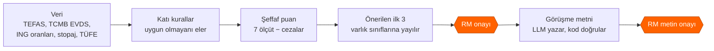
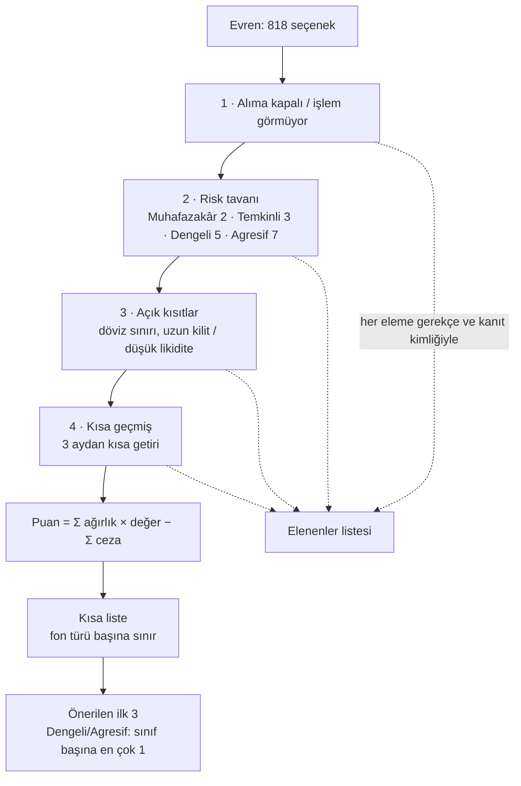
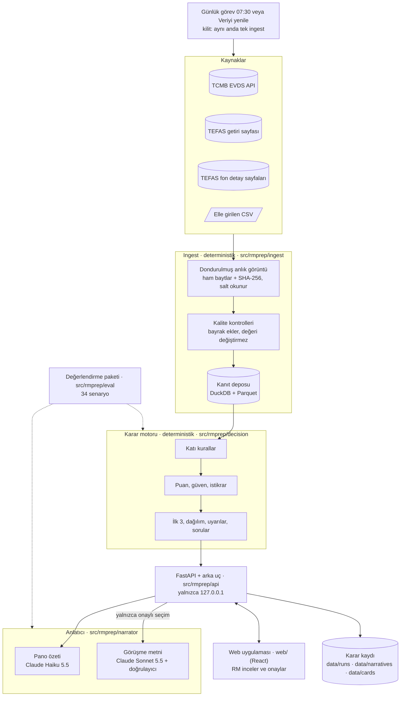
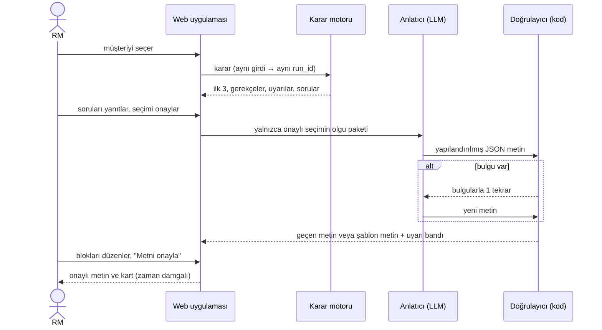
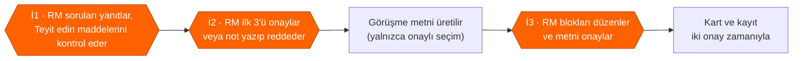
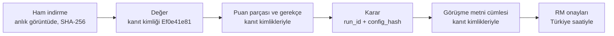

# RM Görüşme Hazırlığı — kanıta dayalı yatırım karar desteği

ING Agentic AI Hackathon · Private Banking RM Yatırım Karar Destek Çözümü

Private Banking RM'i bir müşteri görüşmesine hazırlanırken bu araç, yüzlerce
yatırım ürününü müşterinin profiline ve kısıtlarına göre eler, şeffaf bir
puanla sıralar, önerilen ilk 3'ü gerekçesiyle gösterir ve RM onayından sonra
görüşme metnini yazar. Her sayı kaynağı, tarihi ve kanıt kimliğiyle izlenebilir.
**Araç yatırım tavsiyesi vermez; kararı ve müşteri iletişimini RM yapar.**


*P02 (ihracatçı, Dengeli) panosu, 14.10.2026 verisi. Solda gündem ve "Teyit
edin" maddeleri; sağda önerilen ilk 3 kart olarak; en altta RM'in onay çubuğu.*

Hızlı başlangıç (Windows, Python 3.11+, Node yalnızca web derlemesi için):

```powershell
python -m venv .venv; .venv\Scripts\Activate.ps1
pip install -e ".[dev,web,narrator]"
cd web; npm ci; npm run build; cd ..
python -m rmprep ingest          # veriyi çeker (yaklaşık 15 dk), yeni anlık görüntü
python -m rmprep serve           # http://127.0.0.1:8600
pytest -q                        # 1.918 test, ağ erişimi yok
python -m rmprep eval --no-llm   # değerlendirme paketi, ücretsiz geçiş
```

`.env` dosyasında `EVDS_API_KEY` (TCMB EVDS) ve görüşme metni için
`ANTHROPIC_API_KEY` gerekir. Teslimat belgeleri: [`docs/teslim/pdf/`](docs/teslim/pdf/).

---

## 1. Problem tanımı ve çözüm yaklaşımı

**Problem.** RM her görüşmeden önce yüzlerce ürünü dağınık kaynaklardan elle
karşılaştırıyor: iş yavaş, müşteriye yeterince uyarlanmıyor, kısıt kaçabiliyor
ve önerinin hangi veriye dayandığı sonradan gösterilemiyor.

Verimizden üç örnek (14.10.2026):

| Gözlem | Sayı |
|---|---|
| Muhafazakâr bir müşteri (P01) için evren | 818 seçenek; kurallar 679'unu eler, 139'u kalır |
| ING Turuncu Hesap %23 faiz, stopaj ve TÜFE (%29,73) sonrası | **reel −%8,3** |
| Aynı gün erişilebilen para piyasası fonları, reel | medyan **+%6,6**, en iyisi +%9,7 |

**Yaklaşım.** Kararı kod verir, metni LLM yazar, metni yine kod denetler, son
sözü RM söyler.



Kapsam: görüşme **öncesi** hazırlık. Getiri tahmini, otomatik işlem ve
müşteriyle doğrudan iletişim kapsam dışıdır.

## 2. Kullanılan veri kaynakları ve temel sinyaller

| Kaynak | Ne verir | Nasıl okunur |
|---|---|---|
| **TCMB EVDS** (resmî API) | piyasa mevduat faizi ortalaması, TÜFE endeksi (→ yıllık TÜFE), USD/TRY, politika faizi, BIST 100, altın | API anahtarıyla, seri başına bir istek |
| **TEFAS fon getirileri sayfası** | ~2.100 fon: 1 ay–5 yıl getiri, SPK risk değeri (1–7), fon türü | tek kamuya açık HTML sayfası (robots.txt'ye uygun; `/api/` hiç çağrılmaz) |
| **TEFAS fon detay sayfaları** | 816 bireysel fon: fiyat, büyüklük, yatırımcı sayısı, valör, ücret, alım durumu, **portföy dağılımı** | fon başına bir sayfa, 1 sn arayla (~14 dk) |
| **Elle girilen CSV** | ING Turuncu ve e-Vadeli oranları, stopaj oranları (geçerlilik sonu 31.12.2026), yıllık TÜFE (çapraz kontrol) | ing.com.tr, vergi duyuruları, TÜİK; her satır kaynak bağlantısı ve tarihiyle |

Evren: 816 TEFAS fonu + 2 ING mevduat ürünü (Turuncu Hesap karşılaştırma
tabanıdır). 1.292 "Serbest" fon (yalnızca nitelikli yatırımcı) evrene girmez.
Tek tek hisse, BYF ve emeklilik fonları kapsam dışıdır.

**Ürün sinyalleri:** stopaj ve TÜFE sonrası reel getiri · SPK risk değeri
(yoksa varlık sınıfından tahmin) · satış valörü (paraya erişim) · fon
büyüklüğü ve yatırımcı sayısı · alım durumu · giriş/çıkış ücreti · portföy
dağılımı (çok varlıklı fonların varlık sınıfı) · piyasa mevduat ortalaması.

**Müşteri sinyalleri** (persona dosyasının sabit alanları): risk profili →
risk tavanı ve iştah · yatırım ufku → getiri dönemi · likidite, gelir,
anapara seviyeleri (Düşük 0 · Orta 0,5 · Yüksek 1) · öncelikler → ölçüt
ağırlığına +1 · açık kısıtlar → katı kural. Yaş, amaç ve RM notu puana
girmez, yalnızca metinde kullanılır.

## 3. Karşılaştırma / sıralama ve karar mantığı

Karar katmanı deterministik bir kural ve puanlama motorudur
([`docs/decision.md`](docs/decision.md); tüm tablolar
[`config/decision.yaml`](config/decision.yaml) içinde). Aynı girdi her zaman
aynı sonucu verir.



**Puan.** Yedi ölçütün her biri 0–1 arası bir değer alır; değer ağırlıkla
çarpılır, toplanır, cezalar çıkarılır. Ağırlıklar müşteriden gelir ve toplamı 1'dir.

| Ölçüt | Ne ölçer | Ham ağırlık |
|---|---|---|
| Getiri | stopaj ve TÜFE sonrası reel getirinin adaylar içindeki sırası | 2 + 2 × risk iştahı (+1, ufuk ≥ 3 yıl) |
| Risk uyumu | SPK risk değeri müşterinin bandında mı | 2 |
| Likidite | satış valörü (aynı gün 1,0 … 10 günden uzun 0,2) | 2 × likidite ihtiyacı |
| Gelir | ürün türünün düzenli gelire uygunluğu | 2 × gelir ihtiyacı |
| Anapara | anaparanın korunması (mevduat 1; fon riskle azalır) | 2 × anapara koruma tercihi |
| Sadelik | ürün yapısının sadeliği | yalnızca "sade ürün yapısı" önceliğiyle |
| Kalite | fon büyüklüğü ve yatırımcı sayısı | 0,5 |

Cezalar (her biri en çok 0,3): anapara riski, yavaş erişim, döviz maruziyeti,
bilinmeyen risk, geçmiş eksikliği, reel kayıp, piyasa altı getiri, küçük fon.
Ceza = üst sınır × müşterinin önem derecesi × ürünün ihlal derecesi.

**Önerilen ilk 3.** Muhafazakâr ve Temkinli müşteride kısa listenin ilk üçü.
Dengeli ve Agresif müşteride, ya da çeşitlendirme isteyen her müşteride,
motor listeyi puan sırasıyla dolaşır ve **her varlık sınıfından en çok bir**
(nakit benzeri en çok bir) fon alır; son bir yıl reel getirisi negatif olan
fonu almaz. Varlık sınıfı fon adından ve türünden, çok varlıklı fonlarda
(Değişken, Karma, Fon Sepeti, Katılım) **gerçek portföy dağılımından** gelir
(≥ %50 olan sınıf; yoksa "dengeli").

Örnek P02 (Dengeli, 1–3 yıl, "erişilebilir likidite" önceliği): ağırlıklar
getiri 0,339 · risk uyumu 0,203 · likidite 0,203 · gelir 0,102 · anapara 0,102 · kalite 0,051.

| Seçenek | Sınıf, risk | Reel getiri (1 yıl) | Puan | Neden |
|---|---|---|---|---|
| **EIL** Astra Para Piyasası | nakit benzeri, 2 | +%7,7 | 0,777 | en iyi nakit benzeri; aynı gün erişim |
| **KDE** Kuveyt Türk Dengeli Katılım | dengeli, 3 | +%10,1 | 0,742 | en iyi dengeli; risk bandın içinde |
| **NJR** Nurol Borçlanma Araçları | borçlanma, 2 | +%8,2 | 0,740 | en iyi borçlanma |
| ING Turuncu Hesap (karşılaştırma) | nakit benzeri | −%8,3 | 0,190 | reel kayıp ve piyasa altı cezaları (−0,296) |

RPP (0,770) gibi beş para piyasası fonu KDE'den yüksek puan alır, ama tek
nakit benzeri yeri EIL doldurur. **Dağılım** görünümü ayrıca risk profiline
göre model bantları (Ata Yatırım, 28.04.2026) ve her sınıfın en iyi seçeneğini
gösterir; puanı değiştirmez.


## 4. Genel çözüm mimarisi ve veri akışı



| Modül | Sorumluluk | Klasör |
|---|---|---|
| Ingest | kaynak adaptörleri, anlık görüntü, kalite kontrolleri, kanıt deposu, günlük görev ve kilit | `src/rmprep/ingest/`, `scripts/schedule_ingest.ps1` |
| Karar motoru | evren, katı kurallar, puan, güven, istikrar, ilk 3, dağılım bantları, uyarılar | `src/rmprep/decision/`, `config/decision.yaml` |
| Anlatıcı | olgu paketi, LLM çağrısı, doğrulayıcı, tekrar, şablon metin, maliyet defteri | `src/rmprep/narrator/`, `config/narrator.yaml` |
| API ve arka uç | çalıştırma, onay, kayıt, veri güncelliği uç noktası | `src/rmprep/api/`, `src/rmprep/backend.py` |
| Web uygulaması | pano, öneriler (Kartlar · Tablo · Dağılım), fon kartı, kanıt penceresi, görüşme metni | `web/` |
| Değerlendirme | senaryolar, kural kontrolleri, LLM hakemi, rapor | `src/rmprep/eval/`, `config/eval.yaml` |

Sözleşmeler (veri tipleri) `src/rmprep/contracts.py` içindedir. Ayrıntılı
tasarım: [`docs/ingest.md`](docs/ingest.md), [`docs/decision.md`](docs/decision.md),
[`docs/narrator.md`](docs/narrator.md), [`docs/web-ui.md`](docs/web-ui.md),
[`docs/eval.md`](docs/eval.md).

## 5. AI/Agentic bileşenler ve görev/karar akışı

LLM hiçbir ürünü seçmez, elemez veya puanlamaz. Yalnızca dilin gerektiği yerde
kullanılır ve çıktısı her zaman kodla denetlenir.

| Bileşen | Model | Görev | Güvence |
|---|---|---|---|
| Görüşme metni | Claude Sonnet 5.5 | onaylı seçimi 8 bölümlü Türkçe metne çevirir | doğrulayıcı; 1 tekrar; sonra şablon metin |
| Pano özeti | Claude Haiku 5.5 | RM'e 1–2 cümlelik özet | doğrulayıcı; hata → düz cümle |
| Değerlendirme hakemi | Claude Haiku 5.5 | metnin uyarlanmış, açık, dengeli olup olmadığını notlar | yalnızca kodun ölçemediği şeyler; kural kontrolleri hakeme bırakılmaz |



**Doğrulayıcı** şunları reddeder: olgu paketinde olmayan sayı veya tarih;
elenen veya listede olmayan ürün adı; yasak ifade ("garanti", "risksiz",
"kesin getiri"); kaynaksız cümle; ING ürün adının yanında ING'ye ait olmayan
oran; eksik bölüm veya eksik "yatırım tavsiyesi değildir" cümlesi.

**Neden çalışma anında ajan döngüsü yok?** Her metin tek çağrıdır (en çok bir
tekrar). Bu yapı maliyeti (metin başına ~0,044 $), süreyi (~25 sn) ve davranışı
öngörülebilir kılar; araç seçen bir ajan döngüsü bu işte doğruluk eklemez,
denetimi zorlaştırır. **Geliştirmede** ise çoklu ajan kullanıldı: bir lider ve
modül başına bir işçi Claude Code oturumu, ayrı git çalışma ağaçlarında,
dondurulmuş sözleşmelerle ve her adımda yeşil testlerle ([`docs/workflow.md`](docs/workflow.md)).

## 6. Varsayımlar, belirsizlikler ve insan onay noktaları

**Varsayımlar** (ekranda ve kayıtta görünür; `[VARSAYIM]` olanlar mentorlarla teyit edilecek):

- Fon getirileri geçmiş getirilerdir; bir tahmin değildir.
- Getiriler stopaj sonrası ve yıllık TÜFE'ye (%29,73) göre reeldir.
- Yatırım tutarı bilinmez; mevduatta 100.000–249.999 TL diliminin standart oranı kullanılır.
- Risk bantları (Muhafazakâr 1–2, Temkinli 2–3, Dengeli 3–5, Agresif 4–7) ve ağırlıklar bir yargıdır **[VARSAYIM]**.
- Dağılım bantları tek bir kamuya açık kaynaktan gelir; Temkinli bandı bizim çıkarımımızdır **[VARSAYIM]**.

**Belirsizlik yönetimi:**

| Araç | Ne yapar |
|---|---|
| Güven (0–1) | kullanılan en zayıf veri satırı × tahmin katsayıları (elle girilen 0,9 · eski 0,7 · çelişen 0,6 · tahmini risk × 0,7 · reel getiri hesaplanamadı × 0,8) |
| İstikrar (0–1) | ağırlıklar ve cezalar ±%20 değiştirilerek 30 kez yeniden sıralanır; önerilen bir seçenek için "öneri yine çıkıyor mu" oranı |
| Tahmin yerine soru | risk profili veya kısıt tanınmazsa sıralama durur ve RM'e soru açılır |
| Uyarılar (yalnızca RM) | düşük istikrar, tahmini risk, döviz fonu, ING oranı piyasanın altında, süresi geçmiş stopaj veya eski TÜFE |



Sistemin müşteriye bir iletim kanalı yoktur: uygulama yalnızca yerelde
(`127.0.0.1`) çalışır. Düzenlenmiş bir persona test çalıştırmasıdır ve
onaylanamaz. RM'e özel notlar müşteri metnine girmez.

## 7. Test yaklaşımı, sonuçlar, hata analizi ve iyileştirmeler

Üç katman:

| Katman | Soru | Kapsam |
|---|---|---|
| Birim ve sözleşme testleri | Her kural tek başına doğru mu? | `pytest`: 97 dosyada 1.918 test; web: 23 dosyada 152 test; ağ erişimi yok, LLM yerine sahte model |
| Senaryo değerlendirmesi | Sistem uçtan uca, jürinin değiştirebileceği girdilerle doğru mu? | 34 senaryo, 39 çalıştırma, dondurulmuş veri: temel personalar, persona değişiklikleri, kısıtlar, kaynak erişilemez, hatalı veri, 13 regresyon |
| Ekranda inceleme | RM için kullanışlı mı? | demo ve ekran incelemesi |

Son tam değerlendirme (`data/eval/20261014-105720-full`, anlık görüntü `20261014-102329-8fca`):

| Gösterge | Sonuç | Hedef |
|---|---|---|
| Kural kontrolleri | %100 (218/218) | %100 |
| Kısıt ihlali (kural 5) | 0 (37/37) | 0 |
| Uydurma veri yok · kaynak atfı | 39/39 · 39/39 | %100 |
| Doğrulayıcı (LLM metni, şablona düşmeden) | 25/25 | ≥ %95 |
| Yasak ifade | 0 | 0 |
| Tekrar tutarlılığı | 5/5 | %100 |
| Süre: karar · görüşme metni | 0,96 sn · 25,1 sn (ort.) | rapor |
| Maliyet | 1,098 $ paket · 0,044 $ metin başına | ≤ 5 $ |
| LLM hakemi: uyarlanmış / açık / dengeli | %50 / %57 / %62 | yön göstergesi |

**Hata analizleri ve iyileştirmeler** (ayrıntı: [Teslimat 5](docs/teslim/05-test-ve-ogrenimler.md)):

| Bulgu | Kök neden | İyileştirme | Sonuç |
|---|---|---|---|
| Kurallar %100 geçerken 5 personanın 4'ü yalnızca risk 1 nakit benzeri fon aldı | geçmiş getiri baskın; risk bütçesi ölçütü yok; çeşitlilik fon türünde ölçülüyordu | D19: risk uyumu bandı, varlık sınıfı, sınıf kuralı | 5 personada 5 farklı set |
| Metin kurallara uyuyor ama genel kalıyordu | seçenek başına risk ve erişim olgusu yoktu; tekrarlar | N13: olgu paketine risk satırı, yeni doğrulayıcı kuralları | metin %28 kısaldı; her öneri cümlesi fon adıyla başlıyor |
| Stopaj ve TÜFE yokken fon güveni 1,00 kaldı | eski "kontrol gerekli" bayrağı tüm güvenleri 0,90'da tutup açığı gizliyordu | D24: reel getiri hesaplanamazsa güven × 0,8 | "Eksik veri gösteriliyor" 5/7 → 7/7 |
| Sınıf kuralıyla gelen öneride istikrar 0,00 | istikrar yalnızca ilk 20'ye bakıyordu | D25: "öneri yine çıkıyor mu" oranı | P03 IDY ve OKT 0,00 → 1,00 |
| Değerlendirme maliyeti 0 $ çıktı | metin önbelleği RM seçimini anahtarda tutmuyordu | N12: anahtara olgu paketi özeti | doğru metinler, doğru maliyet |

Açık iş: TEFAS bazı günlerde bir fon için fiyat, büyüklük ve getiriyi 0
yayımlıyor; bu sıfırlar henüz işaretlenmiyor (I9, [`docs/ingest.md`](docs/ingest.md)).

## 8. İzlenebilirlik: veri kaynağı, zaman damgası ve karar gerekçesi

Her öneri, dayandığı verinin kaynağına, tarihine ve alınma zamanına kadar geri izlenebilir.



| Ne | Nasıl izlenir |
|---|---|
| Her değer | kanıt kimliği (kaynak, ölçü, varlık ve tarihin özeti), kaynak, kaynak adresi, değer tarihi (`as_of`), alınma zamanı (`fetched_at`), kalite bayrakları |
| Ham veri | anlık görüntüde bayt bayt; her dosyanın SHA-256 özeti; kullanılan yapılandırmanın kopyası; salt okunur. `rmprep replay` aynı çıktıyı yeniden üretir |
| Her karar | `run_id` (müşteri + anlık görüntü + yapılandırma özeti; aynı girdi → aynı kimlik), her puan parçası ve gerekçesi kanıt kimlikleriyle, elenenler gerekçeleriyle, varsayımlar, uyarılar |
| Onaylar | RM karar zamanı ve metin onay zamanı (`Europe/Istanbul`), seçim ve notlar; `data/runs/`, `data/narratives/`, `data/cards/` |
| Metin | her cümle seçenek ve kanıt kimliği taşır; model, istem sürümü, doğrulayıcı sonucu ve maliyet kayda girer |

Ekranda her sayının yanındaki **"K"** işareti kanıt penceresini açar:


*Örnek: EIL'in 1 yıllık getirisi %48,2; kaynak TEFAS getiri sayfası; değer
tarihi 13.10.2026 (önceki iş günü); alınma zamanı 14.10.2026 10:23; kanıt
kimliği `Ef0e41e81`; bayrak yok.* Tam bir karar kaydı örneği:
[Teslimat 6](docs/teslim/06-kanit-kaydi-ornegi.md).

---

Kurallar: yalnızca verilen sentetik personalar kullanılır; vergi oranları
koda yazılmaz; robots.txt ve kaynak koşullarına uyulur; `.env` ve `data/`
depoya girmez. Bu prototip ING Agentic AI Hackathon için geliştirilmiştir.
