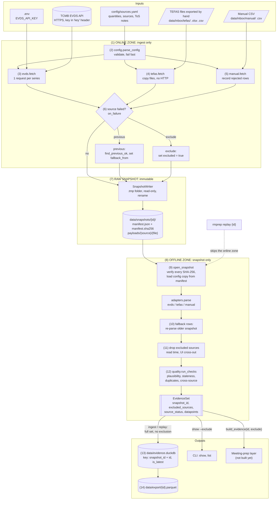

# Ingestion pipeline — architecture

Status: steps 1–9 built (EVDS, TEFAS, manual CSV). Step 10 (KAP via docling) not built.

The diagram renders on GitHub, in VS Code (Markdown Preview Mermaid Support
extension) and at https://mermaid.live. A plain-text version follows it.

Ready-to-view copies: `architecture.pdf` (diagram + tables), `architecture.png`
(diagram only), `architecture.html` (open in a browser). They are made from
`architecture.html` with headless Edge; if you change the diagram here, change it
there too and run (PowerShell, in `prototype/`):

```
$edge = "${env:ProgramFiles(x86)}\Microsoft\Edge\Application\msedge.exe"
$url  = "file:///" + ((Resolve-Path docs\architecture.html).Path -replace '\\','/')
& $edge --headless --no-pdf-header-footer --virtual-time-budget=20000 --print-to-pdf="$PWD\docs\architecture.pdf" $url
& $edge --headless --hide-scrollbars --virtual-time-budget=20000 --force-device-scale-factor=2 --window-size=1300,2450 --screenshot="$PWD\docs\architecture.png" "$url`?diagram=1"
```

## 1. Data flow



## 2. Annotations

| # | Where | What happens | Why |
|---|---|---|---|
| 1 | `pipeline.ingest` | The only code that reads the clock, the network, `.env`, the inbox folders and the current `sources.yaml`. | Keeps every outside input in one place, so everything after the snapshot can be replayed. |
| 2 | `config.py` | Checks types, unknown keys, quantity references and a required `tos_note` for each source. Errors name the key path. | A typo stops the run before any data is fetched. |
| 3 | `adapters/evds.py` | One GET for each series. The key goes in the `key` header, never in the URL. `VERIFY_` codes get no request. Each response is parsed in memory before it is stored. | A stored payload always parses on replay, and the key is never stored. |
| 4 | `adapters/tefas.py` | Copies hand-exported files byte for byte. Matches headers through aliases and reads Turkish numbers and dates. The module imports no HTTP client. | Follows the no-scraping rule. |
| 5 | `adapters/manual.py` | Validates each row. Rejected rows go into the manifest with their reasons, and accepted rows get `manual_entry`. | Every manual value has a source URL and a date. |
| 6 | `pipeline._apply_failure_policy` | A failed source (no key, HTTP error, empty inbox, bad file) gets `fallback_from` (last snapshot where the source was ok) or `excluded: true`. | You choose the policy for each source in `sources.yaml`. |
| 7 | `snapshot.py` | Writes to `.tmp-{id}`, writes the manifest and its hash, makes the files read-only, then renames the folder. The manifest is refused if it contains the API key. | A snapshot is complete or absent, never partly written or changed. |
| 8 | `pipeline.build_evidence` | Pure function of (snapshot bytes, manifest, exclude set). The staleness date is the snapshot `created_at`, not today. | Same snapshot + same exclusions gives the same output. |
| 9 | `snapshot.open_snapshot` | Checks the manifest hash and each payload hash, and rejects extra files. | A changed snapshot cannot be replayed without notice. |
| 10 | `pipeline._source_points` | Re-parses the older snapshot named in `fallback_from`. Rows get the new `snapshot_id` and the `fallback_snapshot` flag, but keep their original `raw_ref` and `fetched_at`. If there is no older snapshot, EVDS gives `missing` rows. | Old data is used openly, never presented as new. |
| 11 | `build_evidence(..., exclude_sources)` | Removes the excluded sources **before** the checks. | A conflict caused only by a crossed-out source disappears. |
| 12 | `quality.py` | Adds flags and notes only; values never change. | The raw evidence stays intact; flags explain the problems. |
| 13 | `store.py` | Load = delete + insert in one transaction (idempotent). `is_latest` = rows of the newest snapshot by `created_at`. Times are stored in Turkey time. | Replaying an old snapshot does not make it the latest. |
| 14 | `store.export_parquet` | Contract columns only, sorted by `id`. `is_latest` is not exported. | Replay gives a byte-identical file. |

## 3. Which stage adds which flag

| Flag | Added by | When |
|---|---|---|
| `missing` | evds adapter, pipeline | `VERIFY_` code; series with no observations; EVDS failed and no older snapshot |
| `unverified_series` | evds adapter | series has `verified: false` |
| `manual_entry` | manual adapter | every accepted manual row |
| `fallback_snapshot` | pipeline | row comes from an older snapshot |
| `out_of_range` | quality | value outside `[min, max]` of its quantity |
| `stale` | quality | latest observation older than `max_age_days` at the snapshot date |
| `conflict` | quality | same id with different values, or sources differ by more than `conflict_tolerance` |
| `needs_check` | quality | conflicting duplicate; `as_of` after snapshot date; quantity not in config |

## 4. Plain-text version

```
 INPUTS                 ONLINE ZONE (ingest only)              RAW SNAPSHOT (immutable)
 ------                 -------------------------              ------------------------
 sources.yaml ──► parse_config ──┬─► evds.fetch ───┐
 .env key ───────────────────────┤   (key header)  │
 EVDS API ◄──────────────────────┘                 │
 inbox/tefas ──────────────────────► tefas.fetch ──┼─► failed? ──► SnapshotWriter ──► snapshots/{id}/
 inbox/manual ─────────────────────► manual.fetch ─┘   previous      (.tmp, hash,      manifest.json
                                                       / exclude      read-only,       manifest.sha256
                                                                      rename)          payloads/...
                                                                                          │
 OFFLINE ZONE (pure: same snapshot + same exclusions ─► same output)                      │
 -------------------------------------------------------------------                      │
   replay {id} ┄┄┄┄┄┄┄┄┄┄┄┄┄┄┄┄┄┄┄┄┄┄┄┄┄┄┄┄┄┄┄┄┄┄┄┄┄┄┄┄┄┄┄┄┄┄┄┄┄┄┄┄┄┄┄┄┄┄┄┄┄┄┄┄┄┄┄┄┄┄┄┄┄┄┄┄┄┄┐ │
                                                                                        ▼ ▼
   EvidenceSet ◄── run_checks ◄── drop excluded ◄── fallback rows ◄── adapters.parse ◄── open_snapshot
        │          (flags only)   (read time)       (older snapshot)                   (verify hashes)
        ├──► evidence.duckdb (snapshot_id + id, is_latest) ──► export/{id}.parquet
        ├──► rmprep show [--exclude SOURCE]
        └──► meeting-prep layer (not built yet)
```
