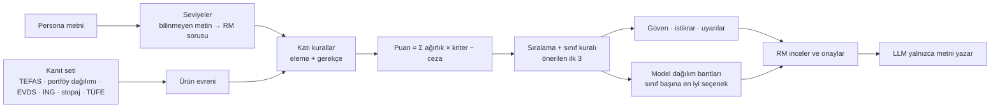

# Analitik çözüm

> Teslimat 3 · Taslak (2026-10-14) · Sayılar: dondurulmuş veri anlık görüntüsü
> `20261014-102329-8fca`, karar yapılandırması `c5e83ccc4e4b` (D20–D25
> dahil). Örnekler salt okunur `decide()` çalışmalarından alındı (P01
> `Rd2ea7dd1c5`, P02 `R441a211b99`; son tam değerlendirmeyle aynı kimlikler).
> **[VARSAYIM]** ile işaretli değerler mentorlarla teyit edilecek.

## 1. Kısa özet

Karar katmanı deterministik bir kural ve puanlama motorudur. Önce düzenleyici
kuralları ve müşterinin açık kısıtlarını **katı kural** olarak uygular; kalan
ürünleri, müşterinin seviyelerinden türetilen ağırlıklarla şeffaf biçimde
puanlar. Her puan parçalarına, her parça bir kanıt satırına (kaynak, tarih,
kimlik) bağlıdır. Büyük dil modeli (LLM) sıralamaya ve elemeye katılmaz;
yalnızca motorun sonucunu görüşme metnine döker, metin bir doğrulayıcıdan geçer
ve RM onayı olmadan müşteriye gitmez. Nedeni: etiketli veri yok, uygunluk
kuralları pazarlığa açık değil ve aynı girdi her zaman aynı sonucu vermeli.

## 2. Veri ve sinyaller

### 2.1 Ürün sinyalleri

Evren: 816 fon, ING Turuncu Hesap (vadesiz, karşılaştırma tabanı) ve ING
e-Vadeli Mevduat (32 gün), toplam 818 seçenek. 1.292 Serbest fon (yalnızca
nitelikli yatırımcı) evrene girmez.

| Sinyal | Kullanım | Kaynak |
|---|---|---|
| Geçmiş getiri (1a, 3a, 6a, 1y, 3y, 5y) | ufka uygun dönem yıllıklandırılır; dönem yoksa bir kısa dönem | TEFAS fon getirileri sayfası |
| Stopaj ve TÜFE sonrası reel getiri | `return` kriteri, `real_loss` cezası | stopaj: CK 10041 / CK 11444 (RG 33286) oranları, elle girilen tablo, geçerlilik sonu 31.12.2026; TÜFE: TCMB EVDS endeksi `TP.TUKFIY2025.GENEL`, 12 aylık değişim (Eylül 2026) %29,73; elle girilen TÜİK satırı çapraz kontrol olarak kalır |
| SPK risk değeri (1–7) | risk tavanı, `risk_fit`, anapara koruma; değer yoksa varlık sınıfından tahmin (D21) | TEFAS fon getirileri ve fon detay sayfaları |
| Satış valörü (gün) | likidite değeri, `liquidity_need` kuralı | TEFAS fon detay sayfası |
| Giriş / çıkış komisyonu | net getiriden ufka yayılarak düşülür | TEFAS fon detay (anlık görüntüde yalnızca 1 fonda değer var) |
| Fon büyüklüğü, yatırımcı sayısı | `quality` kriteri, `fund_size` cezası | TEFAS fon detay |
| Alım durumu | `not_buyable` kuralı | TEFAS fon detay |
| Şemsiye türü, fon adı | ürün türü, döviz etiketi (ad içinde DÖVİZ, EUROBOND, DOLAR), varlık sınıfı | TEFAS fon getirileri sayfası |
| Portföy dağılımı (varlık türü ve payı, %) | çok varlıklı fonların ve döviz borçlanma fonlarının varlık sınıfı (D23, bölüm 3.3) | TEFAS fon detay sayfası (`varlikData`; 775 fonda var) |
| Mevduat oranları | Turuncu %23 (taban), e-Vadeli %35 | ing.com.tr, elle |
| Piyasa mevduat ortalaması %43,82 | `underperformance` ölçütü, ING uyarısı | TCMB EVDS |

Kalite işaretleri: elle girilen satırlar (stopaj, TÜFE, ING oranları)
`manual_entry` alır. TEFAS satırları `needs_check` almaz: kaynak 12 anlık
görüntüde biçim değiştirmedi (bu kural yalnızca 14.10.2026'dan sonraki anlık
görüntülerde geçerlidir). Aralık dışı, eski ve çelişen değerler ayrıca
işaretlenir; aralık dışı bir değer eksik sayılır. Stopaj satırlarının bir
geçerlilik sonu vardır (31.12.2026); bu tarihten sonra satır `stale` olur
(bölüm 6). Aynı ay için EVDS ve elle girilen TÜFE satırı varsa elle girilen
satır kullanılır; daha yeni bir EVDS ayı gelince EVDS satırı kullanılır.

Veri güncelliği: veri alımı her gün 07:30'da zamanlanmış görevle çalışır;
bilgisayar kapalıysa görev daha sonra çalışır. RM, web uygulamasındaki
"Veriyi yenile" düğmesiyle de bir alım başlatabilir. Aynı anda yalnızca bir
alım çalışır (kilit dosyası).

### 2.2 Müşteri sinyalleri

Persona serbest Türkçe metindir. Motor metni normalleştirir (Türkçe küçük harf,
boşluk, noktalama) ve bir tablo anahtarıyla **tam** eşleştirir; bulanık eşleşme
yoktur.

| Alan | Seviye |
|---|---|
| `risk_profili` | tavan ve risk iştahı: Muhafazakâr 2 / 0, Temkinli 3 / ⅓, Dengeli 5 / ⅔, Agresif 7 / 1 |
| `yatirim_ufku` | "1-3 yıl" → 1y dönemi, "5+ yıl" → 3y dönemi |
| likidite, gelir, anapara | Düşük 0, Orta 0,5, Yüksek 1 |
| `doviz_maruz_kalma_tercihi` | Sınırlı → döviz yoğunluğu 1; Açık, Çeşitlendirilmiş → 0 |
| `oncelikler` | ifade → kriter ağırlığına +1 (ör. "düzenli gelir" → `income`) |
| `acik_kisitlar` | ifade → kural (ör. "yüksek riskli ürünlerden kaçınma" → tavan en fazla 4) |

Profil, yaş, durum, amaç ve RM notu puana girmez; yalnızca metinde kullanılır.
Tabloda olmayan bir metin için motor **tahmin etmez, sorar**: risk profili ve
açık kısıt bilinmiyorsa sıralama yapılmaz (`needs_rm_input`); diğer alanlarda
güvenli düzey kullanılır ve "Teyit edin" panelinde soru açılır. Örnek: P02'nin
"Mevcut döviz gelirini dikkate alarak kontrollü" metni tabloda yoktur; motor
"Sınırlı" düzeyini kullanır ve RM'e soru sorar.

## 3. Karar mantığı

### 3.1 Katı kurallar (eleme)

Sıra: `not_buyable`, `risk_ceiling`, açık kısıt kuralları, `short_history`.
Bir fon birden çok kurala takılabilir; tüm gerekçeler "Elenenler" listesinde
kanıt kimliğiyle görünür.

| Kural | Koşul |
|---|---|
| `not_buyable` | TEFAS'ta işlem görmüyor veya alıma kapalı |
| `risk_ceiling` | bilinen SPK risk değeri müşterinin tavanının üzerinde |
| `fx_limit` (P02) | döviz etiketli fon; RM kısıtı gerekçe yazarak kaldırabilir |
| `liquidity_need` (P05) | satış valörü 3 günden uzun veya vade 91 günden uzun |
| `short_history` | yalnızca 1 aylık getiri var (Agresif müşteride elenmez, ceza alır) |

Risk değeri olmayan bir fon elenmez: bir risk değeri tahmin edilir, fon ceza
ve düşük güven alır. **Tahmin (D21):** aynı varlık sınıfındaki bilinen SPK risk
değerlerinin üst çeyreği (0,75 yüzdelik, yukarı yuvarlanmış). Bu anlık
görüntüde: nakit benzeri 2, borçlanma 4, hisse 6, dengeli 5, altın/döviz 6
(sınıflar D23 ile portföy dağılımından da gelir, bölüm 3.3). Sınıfta 5'ten az
bilinen değer varsa eski kural kalır (şemsiye türündeki en yüksek risk).
Önceki kural yalnızca şemsiye türüne bakıyordu: risk değeri olmayan bir altın
katılım fonu (KZL) Katılım türünden 1–2 tahmini aldı ve Muhafazakâr müşterinin
2 olan tavanının içinde kaldı. Hata D20 dağılım çalışması sırasında bulundu.
Şimdi KZL'nin tahmini 6'dır; fon tavanı aşan tahmin için ceza alır (P01'de
puan −0,918, güven 0,63) ve P01'in altın/döviz satırında en iyi seçenek
olamaz.

### 3.2 Puanlama

`puan = Σ ağırlık × kriter değeri − Σ ceza`. Ham ağırlıklar müşterinin
seviyelerinden gelir; eşleşen her öncelik +1 ekler; toplam 1'e normalleştirilir.

| Kriter | Değer (0–1) | Ham ağırlık |
|---|---|---|
| `return` | stopaj ve TÜFE sonrası reel getirinin adaylar içindeki yüzdelik sırası | 2 + 2 × iştah (3+ yıl ufukta +1) |
| `risk_fit` | risk bandı içinde 1; bandın altındaki her seviye için −0,5 | 2 |
| `liquidity` | satış valörü: 0 gün 1,0 · 1 gün 0,9 · 2 gün 0,8 · 3 gün 0,7; valör yoksa ürün türü | 2 × likidite (3+ yıl ufukta × 0,5) |
| `income` | ürün türü tablosu | 2 × gelir |
| `principal` | mevduat 1; fon max(0; 0,8 − 0,15 × (risk − 1)) | 2 × anapara |
| `simplicity` | ürün türü tablosu | 0 (+1 "sade ürün yapısı") |
| `quality` | büyüklük ve yatırımcı sayısı yüzdeliği; mevduat 0,5 | 0,5 |

Reel getiri: `N = R × (1 − stopaj) − komisyon / ufuk yılı`,
`r = (1 + N) / (1 + TÜFE) − 1`. Zararda stopaj yoktur; e-Vadeli 32 günde bir
yenilenir.

Ceza = üst sınır × müşteri yoğunluğu × ürün ihlali:

| Ceza | Üst | Yoğunluk | İhlal |
|---|---|---|---|
| `principal` | 0,3 | anapara | (risk − 2) / 3, 0–1 |
| `liquidity` | 0,3 | likidite | 1 − likidite değeri |
| `fx_exposure` | 0,3 | döviz | döviz fonu ise 1 |
| `risk_unknown` | 0,3 (tahmin tavanı aşarsa × 2) | 1 | risk değeri yoksa 1 |
| `track_record` | 0,2 | 1 | ufuk dönemi getirisi yoksa 1 |
| `real_loss` | 0,3 | anapara | −r / 0,10, 0–1 |
| `underperformance` | 0,3 | iştah | (B − N) / 0,20; B = piyasa ortalaması stopaj sonrası %36,2 |
| `fund_size` | 0,1 | 1 | 100 mn TL veya 100 yatırımcı altı |

**Risk bantları [VARSAYIM]:** Muhafazakâr 1–2, Temkinli 2–3, Dengeli 3–5,
Agresif 4–7. Bantlar yapılandırmada açıkça varsayım olarak işaretlidir.

### 3.3 Önerilen ilk 3 ve çeşitlendirme

Ürünler beş varlık sınıfına ayrılır: `nakit_benzeri`, `borclanma`, `dengeli`,
`hisse`, `altin_doviz`. Motor ilk uyan kuralı kullanır:

1. Ad içinde döviz sözcüğü (DÖVİZ, EUROBOND, DOLAR) → altın/döviz.
2. Borçlanma fonunda portföyün %50 veya fazlası altın ve döviz varlığı (ör.
   dış borçlanma araçları) → altın/döviz.
3. Ad sözcükleri: "PARA PİYASASI", "KISA VADELİ" → nakit benzeri; "BORÇLANMA
   ARACI" → borçlanma; "ALTIN", "KIYMETLİ MADENLER" → altın/döviz.
4. **Portföy dağılımı (D23):** Değişken, Karma, Fon Sepeti ve Katılım
   fonlarında payı %50 veya fazla olan sınıf kazanır; hiçbir sınıf %50'ye
   ulaşmazsa sınıf dengelidir. Başka fonların katılma payları içine bakılmaz;
   bu paylar çoğunluktaysa veya dağılım yoksa sonraki kurallar karar verir.
5. Katılım fonunda risk 5 veya üstü → hisse.
6. Şemsiye türü (ör. Borçlanma → borçlanma, Değişken → dengeli).

Para Piyasası, Hisse Senedi, Kıymetli Madenler ve TL Borçlanma fonlarının
içeriğini düzenleme belirler; bu yüzden bu fonlarda portföy dağılımı sınıfı
değiştirmez. Eski ad kuralı "ÇOKLU VARLIK" → dengeli kaldırıldı. Kontrolde
(anlık görüntü `20261014-005625-c76a`) 214 fonun sınıfı değişti; çoğu
Değişken fondur ve dengeli sınıfından hisse sınıfına geçti. Sınıfı portföy
dağılımından gelen seçeneğin gerekçesinde bir satır görünür, ör. P03'ün
önerisi GBV: "Varlık sınıfı: portföyün %85'i hisse senedi (TEFAS portföy
dağılımı)."

Müşteri Dengeli veya Agresif ise ya da çeşitlendirme isterse, motor ilk 3'ü puan sırasıyla seçer: her sınıftan en
fazla bir, nakit benzeri en fazla bir seçenek. Bu kural, geçmiş 1 yıllık reel
getirisi negatif olan bir seçeneği seçmez (`min_real_return` 0). Üçten az sınıf
varsa kural adım adım gevşer. Muhafazakâr ve Temkinli müşteride, çeşitlendirme
önceliği yoksa, sade puan sırası kalır.

### 3.4 Model dağılım bantları (D20)

RM, müşterinin risk profili için **stratejik bir model dağılımı** görür: her
varlık sınıfı için bir yüzde bandı ve o sınıfta bu müşteriye en iyi seçenek.
Ekranda bu, "Öneriler" bölümünün üçüncü görünümü **Dağılım**'dır.

| Sınıf | Muhafazakâr | Temkinli * | Dengeli | Agresif |
|---|---|---|---|---|
| nakit benzeri | %10–20 | %5–20 | %5–10 | %0–5 |
| borçlanma | %60–70 | %40–60 | %30–40 | %5–10 |
| hisse | %10–20 | %20–40 | %40–50 | %70–85 |
| altın / döviz | %5–10 | %5–15 | %10–15 | %5–10 |
| dengeli | — | — | — | — |

- **Kaynak:** Ata Yatırım, "Yatırım Portföyü Oluşturma Stratejileri ve
  Rehberi", 28.04.2026, "Risk Profillerine Göre Örnek Portföy Yapıları"
  tablosu. Kaynaktaki altın/emtia sütunu bizim altın/döviz sınıfımızdır.
  \* Temkinli için kaynakta bant yoktur; bant Muhafazakâr ile Dengeli
  arasından bizim çıkarımımızdır ve ekranda "*" ile işaretlidir
  **[VARSAYIM]**. Dengeli (çoklu varlık) fonlar bir varlık sınıfı değil, bir
  fon türüdür; bantsız listelenir.
- **En iyi seçenek:** sınıftaki, katı kurallardan geçen ve en yüksek puanı
  alan seçenek. Not, ilk uyan kurala göre yazılır: `ceiling` (sınıfta fon var
  ama hiçbiri risk tavanının altında değil), `none` (puanlanan seçenek yok),
  `negative_real` (en iyi seçeneğin son 1 yıl reel getirisi negatif, ör. "Son
  1 yıl reel −%5,6: önerilmiyor.").
- **Mevcut durum ipucu:** persona metninde bir anahtar ifade varsa nitel bir
  not çıkar ve "Teyit edin" listesine "Mevcut portföy dağılımını sorun."
  eklenir. Örnek P01: "Dosyaya göre varlık TL mevduat ağırlıklı: nakit
  benzeri bandı aşılıyor olabilir."
- **Mevcut paylar ve tutarlar yoktur.** Personalar müşterinin varlık
  dağılımını vermez ve brif ek müşteri verisi toplamayı yasaklar. Bu yüzden
  motor bir boşluk analizi yapmaz; mevcut portföy girdisi gelecek iştir.

Bu anlık görüntüde hiçbir satır `ceiling` notu almaz. D23 ile P01'in hisse
satırında PGD (Astra Agresif Değişken, risk 2, portföyün %67'si hisse senedi),
altın/döviz satırında AGC (Ak Portföy İkinci Değişken, risk 2, portföyün %75'i
altın ve döviz) görünür. Beş personanın hepsinde altın/döviz satırı
`negative_real` notu alır (P01, P02 ve P05'te AGC, son 1 yıl reel −%5,6).
Bantlar puana ve önerilen ilk 3'e girmez; yalnızca RM'e bir çerçeve verir.

### 3.5 Çalışılmış örnek: P02 (Dengeli, 1–3 yıl, likidite / gelir / anapara Orta)

Ağırlıklar: `return` 0,339 · `risk_fit` 0,203 · `liquidity` 0,203 (Orta + "erişilebilir
likidite") · `income` 0,102 · `principal` 0,102 · `quality` 0,051.

| Seçenek | Sınıf, risk | return | risk_fit | liquidity | income | principal | quality | ceza | Puan |
|---|---|---|---|---|---|---|---|---|---|
| **EIL** Astra Para Piyasası | nakit, 2 | 0,313 | 0,102 | 0,203 | 0,061 | 0,066 | 0,032 | 0 | **0,777** |
| RPP Rota Para Piyasası | nakit, 2 | 0,294 | 0,102 | 0,203 | 0,061 | 0,066 | 0,043 | 0 | 0,770 |
| **KDE** Kuveyt Türk Dengeli Katılım | dengeli, 3 | 0,330 | 0,203 | 0,163 | 0,041 | 0,051 | 0,034 | −0,080 | **0,742** |
| **NJR** Nurol Birinci Borçlanma Araçları | borçlanma, 2 | 0,321 | 0,102 | 0,183 | 0,051 | 0,066 | 0,033 | −0,015 | **0,740** |
| Turuncu Hesap (taban) | nakit, 1 | 0,054 | 0 | 0,203 | 0,102 | 0,102 | 0,025 | −0,296 | 0,190 |

- **EIL birinci:** son 1 yılın reel getirisi +%7,7 (adayların %92'sinden
  iyi) ve satış valörü 0 gün. Risk 2, Dengeli bandının altında; bu yüzden
  `risk_fit` yalnızca yarım puan alır.
- **RPP (Rota Para Piyasası, 0,770)** ve sonraki yedi nakit benzeri fon
  (0,768–0,747; önceki birinci BVF de bunların arasında, 0,763) KDE'den yüksek
  puan alır. İkinci nakit benzeri seçenek oldukları için ilk 3'e girmezler;
  listede alternatif olarak kalırlar.
- **KDE** bir Katılım fonudur; eski kural onu şemsiye türünden borçlanma
  sayıyordu. Portföy dağılımında hiçbir sınıf %50'ye ulaşmaz (en büyük pay
  nakit benzeri, %48,7), bu yüzden D23 ile sınıfı dengelidir. Dengeli sınıfının
  en iyisidir: son 1 yılın reel getirisi +%10,1 (adayların %97'sinden iyi).
  Risk 3 bandın içindedir; anapara ve likidite cezası toplam −0,080'dir.
- **NJR** borçlanma sınıfının en iyisidir: son 1 yılın reel getirisi +%8,2,
  satış valörü 1 gün.
- **Turuncu Hesap** reel −%8,3 verir: `real_loss` −0,124 ve `underperformance`
  −0,172 cezası alır. e-Vadeli (reel +%2,5) 0,430 puanla 145. sıradadır.

## 4. Neden bu yaklaşım?

| Ölçüt | Kural + şeffaf puan (seçilen) | ML sıralama | Yalnızca LLM |
|---|---|---|---|
| Veri ihtiyacı | etiket gerekmez | geçmiş RM kararları ve sonuçları gerekir; elimizde yok | etiket gerekmez |
| Denetlenebilirlik | her puan parçası ve gerekçesi kanıta bağlı | öznitelik önemi yaklaşık | gerekçe doğrulanamaz |
| Düzenleyici kurallar | katı kural; ihlal mümkün değil | yalnızca öğrenilmiş eğilim | istem ile; ihlal mümkün |
| Determinizm | aynı girdi → aynı `run_id`, aynı sonuç | eğitim sürümüne bağlı | aynı istem farklı çıktı verebilir |
| Değişiklik | yapılandırma dosyası; kod değişmez | yeniden eğitim | istem değişikliği, öngörülemez etki |

Problemin yapısı da bu seçimi destekler: yerindelik önce bir **kısıt
sağlama** problemidir (risk tavanı, alıma açıklık, açık kısıtlar), sonra çok
kriterli bir ödünleşimdir. MiFID II ve SPK yerindelik düzenlemesi sayısal
ağırlık vermez; ağırlıkları biz seçeriz ve açıkça gösteririz.

Ödünleşimler açıktır:

- Ağırlıklar ve bantlar bir yargıdır. Veride ayarlandılar ve her değişiklik
  kayda geçti: reel getiri ağırlığı D9'da yükseldi; bant adımı 0,25'ten 0,5'e
  çıktı, çünkü Dengeli öneriler risk 2'de kalıyordu.
- Getiri sinyali **geçmiş getiridir**; bir tahmin değildir. Yüzdelik sıra
  göreli bir ölçüdür.
- Risk tahmini (D21) veriden gelir, ama yine bir tahmindir: üst çeyrek
  ihtiyatlı bir seçimdir ve tahmini riskli fonlar güven puanında × 0,7 alır.
- Portföy dağılımı (D23) tek bir günün resmidir; bu yüzden yalnızca içeriği
  düzenlemeyle belirlenmeyen fon türlerinde sınıfı belirler.
- Dağılım bantları (D20) stratejik bir çerçevedir; taktik kurum görüşleri
  (ör. yüksek TL faizinde daha çok nakit) bandın dışında kalabilir.
- RM onayları biriktiğinde (`data/runs/`) ağırlıklar bir modelle ayarlanabilir.

## 5. Varsayımlar

Motorun P01–P05 sonuçlarına yazdığı varsayımlar:

- "Fon getirileri geçmiş getirilerdir; mevduat oranı bugünkü orandır."
- "Getiriler stopaj sonrası ve yıllık TÜFE'ye (%29.73, 2026-09-30) göre reel
  olarak hesaplandı."
- "Mevduat için 100.000-249.999 TL diliminin standart oranı kullanıldı (tutar
  bilinmiyor; hoş geldin oranı geçicidir)."
- "Hisse senedi yoğun fonlarda stopaj %0'dır; ihtiyatlı olmak için para
  piyasası dışındaki tüm fonlarda 'diğer fonlar' oranı kullanıldı."
- "Fonlarda likidite satış valöründen (valör yoksa ürün türünden), gelir
  uygunluğu ürün türünden türetildi."
- "32 günlük vade her ay yenilenir; oranlar değişebilir."
- Sınıf kuralı uygulandığında: "Öneriler varlık sınıflarına yayıldı: her
  sınıftan en fazla bir, nakit benzeri en fazla bir seçenek."
- Risk değeri tahmin edildiğinde (D21): "Risk değeri olmayan fonlarda aynı
  varlık sınıfındaki bilinen risk değerlerinin üst çeyreği (yukarı
  yuvarlanmış) kullanıldı."
- Persona varsayımları, ör. P04: "\"kuşaklar arası planlama\" için kanıt yok;
  puana katılmadı."

Ek olarak: risk bantları **[VARSAYIM]**; Temkinli dağılım bandı kaynakta yok,
bizim çıkarımımızdır **[VARSAYIM]**; dağılım bantları tek bir kamuya açık
kaynaktan gelir ve mentorlarla teyit edilecek **[VARSAYIM]**; varlık sınıfı
şemsiye türünden, fon adından ve çok varlıklı fonlarda son günün portföy
dağılımından (%50 eşiği) türetilen bir yaklaşık değerdir; müşterinin mevcut
portföyü bilinmez (yalnızca P01 metninde nitel bir cümle var); stopaj oranları
31.12.2026'ya kadar geçerlidir ve bu tarihten sonra motor RM'e uyarı verir
(D22, bölüm 6).

## 6. Belirsizlik yönetimi

**Güven (0–1)** = seçeneğin kullandığı en zayıf veri satırının katsayısı ×
her tahminin katsayısı. Katsayılar: işaretsiz 1,0; `manual_entry` 0,9
(`needs_check` 0,9 yalnızca eski anlık görüntülerde); `stale` 0,7; `conflict`
0,6; tahmini risk × 0,7; ufuktan kısa getiri dönemi × 0,8; valör yerine ürün
türü × 0,8; reel getiri hesaplanamazsa (TÜFE satırı veya ürün türünün stopaj
satırı yok) × 0,8 (D24). P01'de 139 seçeneğin 101'i 0,90, 10'u 0,72, risk
değeri tahmin edilen 27'si 0,63, 1'i 0,50 güven taşır. Fonlarda 0,90'ın
kaynağı artık elle girilen stopaj ve TÜFE satırlarıdır. Tahmini risk varlık
sınıfından gelir (D21, bölüm 3.1); bu, tahmini riskin tavanı aşıp aşmadığını
değiştirir, güven katsayısını değiştirmez.

**D24'ün nedeni:** ücretsiz değerlendirme geçişi (LLM'siz) bir boşluk buldu.
Elle girilen kaynak dışlanınca (stopaj ve TÜFE yok) fonların güveni 1,00
kaldı ve "eksik veri gösterilir" kontrolü iki senaryoda başarısız oldu. Önceden
her TEFAS satırındaki `needs_check` (0,9) bu boşluğu gizliyordu. D24'ten sonra
bu kontrol tüm senaryolarda geçer.

**İstikrar (0–1):** motor sıralamayı 30 kez yeniden hesaplar; her seferinde 7
ağırlıktan veya 8 ceza üst sınırından birini × 0,8 ya da × 1,2 yapar. Önerilen
bir seçeneğin istikrarı, öneri kuralının (sınıf kuralı veya sade puan sırası)
bu 30 çalışmanın kaçında onu yine önerdiğinin oranıdır (D25): "Bu öneri
ağırlıklar biraz değişince de kalıyor mu?" Diğer seçeneklerde istikrar,
seçeneğin ilk 20'de kaldığı çalışmaların oranıdır. Önerilen bir seçeneğin
istikrarı 0,5'in altındaysa `low_stability` uyarısı çıkar. Önceki ölçü
yalnızca ilk 20'ye bakıyordu; sınıf kuralı tüm sıradan seçtiği için P03'ün
önerileri IDY (42. sıra) ve OKT (57. sıra) 0 alıyordu ve uyarı da çıkmıyordu.
D25 ile ikisi de 1,00 alır. Bu çalışmada beş personanın tüm önerilerinin
istikrarı 0,83 veya üzeridir (en düşük: P05'te GBL, 0,83); `low_stability`
uyarısı çıkmaz.

**Eksik ve çelişen veri** "Olası sorunlar" panelinde not olur. P01 örnekleri:
7 elle girilen değer `manual_entry`; 2 fonun alım durumu yok (alıma açık
sayıldı); 1 aralık dışı değer kullanılmadı; 1.292 serbest fon çıkarıldı. TÜFE
yoksa stopaj sonrası nominal getiri kullanılır, not düşülür ve güven × 0,8
alır (D24).

**Sorular:** engelleyici sorular (risk profili, bilinmeyen açık kısıt)
sıralamayı durdurur. Engelleyici olmayanlar güvenli düzeyle devam eder ve
"Teyit edin" panelinde komut olarak görünür; ör. tüm personalarda "Yatırım
tutarını sorun: 100.000-249.999 TL dilimi varsayıldı.", P02'de döviz düzeyi
sorusu, P01'de dağılım ipucu nedeniyle "Mevcut portföy dağılımını sorun."

**Uyarılar:** ör. "ING standart mevduat oranı (%23.00) piyasa ortalamasının
(%43.82) 20.8 puan altında." P02, P03 ve P04'te ayrıca: "Döviz mevduatı oranı
kanıtlarda yok; döviz mevduatı karşılaştırılamadı."

**Eski vergi ve enflasyon verisi (D22):** sonucun reel getiri için kullandığı
bir stopaj satırının geçerlilik sonu geçtiyse veya TÜFE satırı eskiyse, motor
yalnızca RM'e görünen `stale_tax_input` uyarısını verir: "Vergi veya enflasyon
verisi güncel değil (…); reel getiriler bu değerlerle hesaplandı. Güncel oranı
teyit edin." "Teyit edin" listesine "Güncel stopaj oranını ve TÜFE'yi teyit
edin." eklenir. Puan ve sıra değişmez. Bu anlık görüntüde stopaj satırları
31.12.2026'ya kadar geçerlidir; bu uyarı çıkmaz.

## 7. Dışlanan seçenekler

| Persona | Puanlanan | Elenen | `risk_ceiling` | `not_buyable` | `short_history` | Açık kısıt | Birden çok kurala takılan |
|---|---|---|---|---|---|---|---|
| P01 Muhafazakâr | 139 | 679 | 573 | 195 | 69 | — | 130 |
| P02 Dengeli | 303 | 515 | 356 | 195 | 69 | `fx_limit` 14 | 98 |
| P03 Agresif | 623 | 195 | 0 | 195 | 0 | — | 0 |
| P04 Dengeli | 309 | 509 | 356 | 195 | 69 | — | 90 |
| P05 Temkinli | 176 | 642 | 521 | 195 | 69 | `liquidity_need` 2 | 119 |

Kural sayılarının toplamı elenen sayısından büyüktür, çünkü bir fon birden çok
kurala takılabilir. Örnek: P05'te TFF ve ZSF hem risk tavanını (6 > 3) hem
satış valörü sınırını (4 > 3 gün) aşar; iki gerekçe de listede görünür.

**Doğrulama:** son tam değerlendirme (`20261014-105720-full`, D20–D25
dahil) 34 senaryo ve 39 çalışmada risk tavanı üzerinde, alıma kapalı veya
kısıt ihlal eden **0** seçenek buldu; kural kontrollerinin hepsi geçti (%100).
Aynı girdi 5 tekrarın 5'inde aynı sonucu verdi. 25 görüşme metninin 25'i
doğrulayıcıdan geçti; yasak ifade 0. Hata analizi motoru değiştirdi: nominal
getiriyle P01'de Turuncu tabanı tüm fonların üzerindeydi (0,912; reel getiri
sonrası 0,568, en iyi fon 0,837; bu anlık görüntüde 0,585 ve 0,850); 5
personanın 4'ü yalnızca nakit benzeri, SPK risk 1 fonlar alıyordu (sınıf
kuralı sonrası 5 farklı set). Bu anlık görüntüdeki ücretsiz ön geçiş bir hata
daha buldu; D24 onu düzeltti (bölüm 6).

## Kaynak dosyalar

- `prototype/docs/decision.md` — karar katmanının tasarımı (bölüm 2–6, 10;
  bölüm 11 dağılım bantları D20; bölüm 8 satır D21; bölüm 12–15 D22–D25)
- `prototype/config/decision.yaml` — tüm tablolar, ağırlıklar, cezalar, metinler
- `prototype/src/rmprep/decision/` — motor (`scoring.py`, `recommend.py`, `confidence.py`)
- `prototype/docs/ingest.md` — veri kaynakları ve kalite işaretleri (I5 TÜFE
  EVDS'den, I6 kilit ve günlük alım, I7 stopaj geçerlilik sonu, I8 portföy
  dağılımı)
- `prototype/docs/web-ui.md` — W14 veri güncelliği ve "Veriyi yenile"
- `prototype/data/inbox/manual/` — stopaj, TÜFE ve ING oranları (kaynak URL'leriyle)
- `prototype/data/eval/20261014-105720-full/report.md` — son değerlendirme raporu
- `prototype/data/eval/20261014-105720-full/deliverable_facts.md` — bu
  belgedeki persona sayıları
- `prototype/docs/teslim/01-problem-tanimi.md` — problem tanımı
