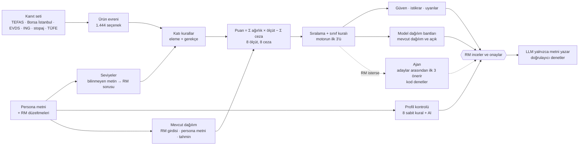

# Analitik çözüm

> Teslimat 3 · Güncelleme 2026-10-28 · Sayılar: dondurulmuş veri anlık görüntüsü
> `20261017-110343-d12a` (17.10.2026), karar yapılandırması `dda3ae095519`.
> Örnekler bu ikisiyle yapılan salt okunur `decide()` çalışmalarından alındı
> (P01 `R56c39ba34f`, P02 `R8e408c63f1`, P03 `Rcaa83de7a2`, P04 `Rc0fbdfca57`,
> P05 `R585d96aa2a`). Doğrulama sayıları son tam değerlendirmeden gelir
> (`20261017-160939-n12-client-page`, bölüm 7). **[VARSAYIM]** ile işaretli
> değerler mentorlarla teyit edilecek.

## 1. Kısa özet

Karar katmanı deterministik bir kural ve puanlama motorudur. Önce düzenleyici
kuralları ve müşterinin açık kısıtlarını **katı kural** olarak uygular; kalan
ürünleri, müşterinin seviyelerinden türetilen ağırlıklarla 8 ölçüt ve 8 ceza
üzerinden şeffaf biçimde puanlar. Her puan parçasına, her parça bir kanıt
satırına (kaynak, tarih, kimlik) bağlıdır. Aynı müşteri ve aynı veri her zaman
aynı sonucu ve aynı `run_id`'yi verir.

Büyük dil modeli (LLM) hiçbir ürünü elemez ve hiçbir puanı değiştirmez. Üç yerde
çalışır ve her çıktısını kod denetler:

- **Ajan (isteğe bağlı):** RM isterse motorun en iyi adayları arasından kendi
  ilk 3'ünü önerir; denetimden geçmezse motorun ilk 3'ü kalır (bölüm 3.7).
- **Profil kontrolü:** müşteri profilinde çelişki arar; her bulgu iki tarafı
  kelimesi kelimesine alıntılar (bölüm 6).
- **Anlatıcı:** RM'in onayladığı seçimi görüşme metnine döker; metin bir
  doğrulayıcıdan geçer.

Nedeni: etiketli veri yok, uygunluk kuralları pazarlığa açık değil ve aynı girdi
her zaman aynı sonucu vermeli. Son karar her zaman RM'indir.

## 2. Veri ve sinyaller

### 2.1 Ürün sinyalleri

Evren: 815 TEFAS fonu, 37 borsa yatırım fonu (BYF), 590 Borsa İstanbul payı ve
2 ING mevduatı, toplam **1.444 seçenek**. ING Turuncu Hesap (vadesiz)
karşılaştırma tabanıdır; ING e-Vadeli Mevduat (32 gün) sıralanan bir
seçenektir. Evrene girmeyenler, gerekçesiyle veri kalitesi notlarında görünür:

- 1.292 Serbest fon (yalnızca nitelikli yatırımcı);
- yakın izleme (W) ve nitelikli yatırımcı (S) pazarındaki 38 pay
  **[VARSAYIM]** (S kodunun anlamı teyit edilmedi);
- varant ve sertifikalar, borsada işlem gören gayrimenkul ve girişim sermayesi
  fonları, tahvil ve eurobondlar.

| Sinyal | Kullanım | Kaynak |
|---|---|---|
| Geçmiş getiri (1a, 3a, 6a, 1y, 3y, 5y) | ufka uygun dönem; dönem yoksa bir kısa dönem. 1 yıldan kısa bir dönem yıllıklandırılmaz (D26c) | fon ve BYF: TEFAS fon getirileri sayfası; pay: Borsa İstanbul gün sonu bültenleri (bölünmeye göre düzeltilmiş, 5 yıl) |
| Stopaj, ücret ve TÜFE sonrası reel getiri | `return` ölçütü, `real_loss` ve `underperformance` cezaları | stopaj: elle girilen tablo, geçerlilik sonu 31.12.2026 (CK 11444); BYF stopajı %17,5 **[VARSAYIM]**, pay %0. TÜFE: TCMB EVDS endeksi `TP.TUKFIY2025.GENEL`, 12 aylık değişim (Eylül 2026) %29,73; elle girilen satır çapraz kontroldür (EVDS 29,7315, elle 29,73) |
| SPK risk değeri (1–7) | risk tavanı, `risk_fit`, anapara; değer yoksa varlık sınıfından tahmin (D21) | fon ve BYF: TEFAS getiri ve fon detay sayfaları |
| Pay risk değeri (1–7) | aynı kullanım | Borsa İstanbul bültenlerinden yıllık oynaklık; SPK yöntemi (bölüm 3.1) |
| Satış valörü (gün) | likidite değeri, `liquidity_need` kuralı | TEFAS fon detay sayfası; BYF ve pay: borsa takası (T+2) |
| Giriş / çıkış komisyonu | ufka yayılarak getiriden düşülür | TEFAS fon detay sayfası |
| Fon büyüklüğü, yatırımcı sayısı | `quality` ölçütü, `fund_size` cezası | TEFAS fon detay; BYF'de yalnızca büyüklük |
| Pay işlem hacmi (3 ay), BIST 100 üyeliği | paylarda `quality` ve `fund_size` cezası | Borsa İstanbul bültenleri |
| Alım durumu | `not_buyable` kuralı (yalnızca fonlar; BYF borsada alınır) | TEFAS fon detay |
| Şemsiye türü, fon adı | ürün türü, döviz etiketi (ad içinde DÖVİZ, EUROBOND, DOLAR), varlık sınıfı | TEFAS fon getirileri sayfası |
| Portföy dağılımı (varlık türü ve payı, %) | çok varlıklı fonların, BYF'lerin ve döviz borçlanma fonlarının varlık sınıfı (D23, bölüm 3.3) | TEFAS fon detay sayfası (`varlikData`) |
| ING mevduat oranları | Turuncu %23 (taban), e-Vadeli %34,50 | ING'nin kamuya açık oran sayfası (`ing_web`); sayfa açılmazsa önceki gün, o da yoksa elle girilen yedek CSV |
| Piyasa mevduat ortalaması (3 aya kadar) | `underperformance` ölçütü, ING uyarısı | TCMB EVDS |

Puana girmeyen sinyaller: politika faizi, USD/TRY, TCMB fonlama maliyeti ve
BIST 100 (EVDS) yalnızca piyasa notunda görünür. Diğer bankaların mevduat
oranları RM için ekranda bağlamdır. Web araştırması (Exa) bulguları ve fon
yöneticisi belgelerinin bağlantıları da puana girmez; bulgular ajana "web
kaynağı, doğrulanmamış" etiketiyle veri olarak gider (bölüm 3.7).

Kalite işaretleri: kontroller değeri değiştirmez, yalnızca bayrak ekler. Elle
girilen satırlar (stopaj, TÜFE, ING yedek oranları) `manual_entry` alır. Elle
doğrulanmamış EVDS serileri (ör. BIST 100 getiri endeksi, altın)
`unverified_series` alır. TEFAS satırları `needs_check` almaz: kaynak biçim
değiştirmedi (bu kural yalnızca 14.10.2026'dan sonraki anlık görüntülerde
geçerlidir). Aralık dışı, eski ve çelişen değerler ayrıca işaretlenir; aralık
dışı bir değer eksik sayılır. Stopaj satırı 31.12.2026'dan sonra `stale` olur
(bölüm 6). Aynı ay için EVDS ve elle girilen TÜFE satırı varsa elle girilen satır
kullanılır; daha yeni bir EVDS ayı gelince EVDS satırı kullanılır.

Veri güncelliği: veri alımı her gün 07:30'da zamanlanmış görevle çalışır. RM,
web uygulamasındaki "Veriyi yenile" düğmesiyle de bir alım başlatabilir. Aynı
anda yalnızca bir alım çalışır (kilit dosyası). Bir kaynak botları engellerse
motor bu engeli aşmaz; önceki günün verisiyle devam eder ve tarihi gösterir.

### 2.2 Müşteri sinyalleri

Persona serbest Türkçe metindir. Motor metni normalleştirir (Türkçe küçük harf,
boşluk, noktalama) ve bir tablo anahtarıyla **tam** eşleştirir; bulanık eşleşme
yoktur.

| Alan | Seviye |
|---|---|
| `risk_profili` | tavan ve risk iştahı: Muhafazakâr 2 / 0, Temkinli 3 / ⅓, Dengeli 5 / ⅔, Agresif 7 / 1 |
| `yatirim_ufku` | 1 yıla kadar → 6a dönemi, "1-3 yıl" → 1y, daha uzun ("5+ yıl") → 3y |
| likidite, gelir, anapara | Düşük 0, Orta 0,5, Yüksek 1 |
| `doviz_maruz_kalma_tercihi` | Sınırlı → döviz yoğunluğu 1; Açık, Çeşitlendirilmiş → 0 |
| `oncelikler` | ifade → ölçüt ağırlığına +1 (ör. "düzenli gelir" → `income`); bazı ifadeler portföy açığı sinyalidir (bölüm 3.4) |
| `acik_kisitlar` | ifade → kural (ör. "yüksek riskli ürünlerden kaçınma" → tavan en fazla 4) |
| `durum`, `yatirim_amaci`, `rm_notu` | mevcut dağılımın tahmini (metin kuralları, meslek satırı) ve portföy açığı sinyalleri |
| `yas` | puana girmez; görüşme metninde ve profil kontrolünde kullanılır |

Risk profilini, müşterinin hangi ürünlere uygun olduğunu belirlediği için yaşın
yerine kullanırız. Tabloda olmayan bir metin için motor **tahmin etmez, sorar**:
risk profili ve açık kısıt bilinmiyorsa sıralama yapılmaz (`needs_rm_input`);
diğer alanlarda güvenli düzey kullanılır ve "Teyit edin" panelinde soru açılır.
Örnek: P02'nin "Mevcut döviz gelirini dikkate alarak kontrollü" metni tabloda
yoktur; motor "Sınırlı" düzeyini kullanır ve RM'e soru sorar.

## 3. Karar mantığı

### 3.1 Katı kurallar (eleme)

Sıra: `not_buyable`, `risk_ceiling`, açık kısıt kuralları, `short_history`.
Bir ürün birden çok kurala takılabilir; tüm gerekçeler "Elenenler" listesinde
kanıt kimliğiyle görünür.

| Kural | Koşul |
|---|---|
| `not_buyable` | fon TEFAS'ta işlem görmüyor veya alıma kapalı (BYF'ye uygulanmaz) |
| `risk_ceiling` | SPK risk değeri (payda oynaklıktan gelen değer) müşterinin tavanının üzerinde |
| `fx_limit` (P02) | döviz etiketli fon veya BYF; RM kısıtı gerekçe yazarak kaldırabilir |
| `liquidity_need` (P05) | satış valörü 3 günden uzun veya vade 91 günden uzun |
| `short_history` | yalnızca 1 aylık getiri var (Agresif müşteride elenmez, ceza alır) |

**Pay riski (D26, D26c):** paylarda SPK risk değeri yoktur. Motor, SPK fon
rehberinin yöntemiyle (9.3.2.1) yıllık oynaklığı bir değere çevirir: %2'nin
altı 1, %2–5 2, %5–10 3, %10–15 4, %15–20 5, %20–30 6, %30 ve üstü 7. 5 yıllık
oynaklık varsa o kullanılır; yoksa 1 yıllık oynaklık bir tahmin sayılır (güven
× 0,7). Tek şirketin riski yoğun olduğu için değer en az 6'dır **[VARSAYIM]**.
Oynaklık yoksa değer 7 kabul edilir. Örnek P03, ASELS: "Risk değeri 7/7: 5
yıllık oynaklıktan (%36.9) SPK yöntemiyle; tek şirket payı için en az 6." Bu
taban yüzünden Muhafazakâr, Temkinli ve Dengeli müşterilerde 590 payın hepsi
risk tavanında elenir.

**Risk değeri olmayan fon (D21):** fon elenmez; bir risk değeri tahmin edilir,
fon ceza ve düşük güven alır. Tahmin, aynı varlık sınıfındaki bilinen SPK risk
değerlerinin üst çeyreğidir (0,75 yüzdelik, yukarı yuvarlanmış). Bu anlık
görüntüde: nakit benzeri 2, borçlanma 4, hisse 6, dengeli 5, altın/döviz 6.
Sınıfta 5'ten az bilinen değer varsa eski kural kalır (şemsiye türündeki en
yüksek risk). Önceki kural yalnızca şemsiye türüne bakıyordu: risk değeri
olmayan bir altın katılım fonu (KZL) Katılım türünden 1–2 tahmini aldı ve
Muhafazakâr tavanının içinde kaldı. Şimdi KZL'nin tahmini 6'dır; fon tavanı
aşan tahmin için çift ceza alır (P01'de puan −0,945, güven 0,63).

### 3.2 Puanlama

`puan = Σ ağırlık × ölçüt değeri − Σ ceza`. Ham ağırlıklar müşterinin
seviyelerinden gelir; eşleşen her öncelik +1 ekler; toplam 1'e normalleştirilir.
Ağırlığı 0 olan bir ölçüt puan parçalarında ve fon kartında görünmez.

| Ölçüt | Değer (0–1) | Ham ağırlık |
|---|---|---|
| `return` (Getiri) | stopaj, ücret ve TÜFE sonrası reel getirinin adaylar içindeki yüzdelik sırası | 2 + 2 × iştah (3+ yıl ufukta +1) |
| `risk_fit` (Risk uyumu) | risk bandı içinde 1; bandın altındaki her seviye için −0,5 | 2 |
| `liquidity` (Likidite) | satış valörü: 0 gün 1,0 · 1 gün 0,9 · 2 gün 0,8 · 3 gün 0,7 · 5 güne kadar 0,6 · 10 güne kadar 0,4 · daha uzun 0,2; valör yoksa ürün türü (BYF ve pay 0,8) | 2 × likidite (3+ yıl ufukta × 0,5) |
| `income` (Gelir) | ürün türü tablosu | 2 × gelir |
| `principal` (Anapara) | mevduat 1; fon, BYF ve pay max(0; 0,8 − 0,15 × (risk − 1)) | 2 × anapara |
| `simplicity` (Sadelik) | ürün türü tablosu | 0 (+1 "sade ürün yapısı") |
| `quality` (Kalite) | fon: büyüklük ve yatırımcı sayısı yüzdeliği; BYF: büyüklük; pay: işlem hacmi yüzdeliği (BIST 100 üyesi en az 0,5); mevduat 0,5 | 0,5 |
| `allocation_gap` (Portföy açığı) | ürünün sınıfında müşterinin bugünkü payı ile model bant arasındaki fark (bölüm 3.4) | 1 × kaynak katsayısı × sinyal çarpanı; aktif bir sınıf yoksa 0 |

Reel getiri, 1 yıl ve daha uzun dönemde: `N = R × (1 − stopaj) − komisyon /
ufuk yılı`, `r = (1 + N) / (1 + TÜFE) − 1`. 1 yıldan kısa bir dönemde (y yıl)
getiri yıllıklandırılmaz: `r = (1 + N) / (1 + TÜFE)^y − 1`; ceza ölçekleri de
× y olur. Zararda stopaj yoktur; e-Vadeli 32 günde bir yenilenir.

Ceza = üst sınır × müşteri yoğunluğu × ürün ihlali:

| Ceza | Üst | Yoğunluk | İhlal |
|---|---|---|---|
| `principal` | 0,3 | anapara | (risk − 2) / 3, 0–1 |
| `liquidity` | 0,3 | likidite | 1 − likidite değeri |
| `fx_exposure` | 0,3 | döviz | döviz fonu ise 1 |
| `risk_unknown` | 0,3 (tahmin tavanı aşarsa × 2) | 1 | fonun risk değeri yoksa 1 (payda bu ceza yoktur) |
| `track_record` | 0,2 | 1 | ufuk dönemi getirisi yoksa 1 |
| `real_loss` | 0,3 | anapara | −r / 0,10, 0–1 |
| `underperformance` | 0,3 | iştah | (B − N) / 0,20; B = piyasa mevduat ortalaması, stopaj sonrası (bu anlık görüntüde %35,8) |
| `fund_size` | 0,1 | 1 | fon: 100 mn TL veya 100 yatırımcı altı; BYF: büyüklük; pay: 3 aylık ortalama günlük işlem hacmi 10 mn TL altı |

**Risk bantları [VARSAYIM]:** Muhafazakâr 1–2, Temkinli 2–3, Dengeli 3–5,
Agresif 4–7. Bantlar yapılandırmada açıkça varsayım olarak işaretlidir.
**Ağırlıklar [VARSAYIM]:** MiFID II ve SPK yerindelik kuralları sayısal ağırlık
vermez; ağırlıkları biz seçtik ve ekranda gösteriyoruz. Etkilerini istikrar
testi (bölüm 6) ve persona değişikliği senaryoları (bölüm 7) ölçer.

### 3.3 Varlık sınıfı ve önerilen ilk 3

Ürünler beş varlık sınıfına ayrılır: `nakit_benzeri`, `borclanma`, `dengeli`,
`hisse`, `altin_doviz`. Paylar her zaman `hisse` sınıfındadır. Bir fon için motor
ilk uyan kuralı kullanır:

1. Ad içinde döviz sözcüğü (DÖVİZ, EUROBOND, DOLAR) → altın/döviz.
2. Borçlanma fonunda portföyün %50 veya fazlası altın ve döviz varlığı (ör.
   dış borçlanma araçları) → altın/döviz.
3. Ad sözcükleri: "PARA PİYASASI", "KISA VADELİ" → nakit benzeri; "BORÇLANMA
   ARACI" → borçlanma; "ALTIN", "KIYMETLİ MADENLER" → altın/döviz.
4. **Gerçek portföy dağılımı (D23):** Değişken, Karma, Fon Sepeti ve Katılım
   fonlarında payı %50 veya fazla olan sınıf kazanır; hiçbir sınıf %50'ye
   ulaşmazsa sınıf dengelidir. Başka fonların katılma payları içine bakılmaz;
   bu paylar çoğunluktaysa veya dağılım yoksa sonraki kurallar karar verir.
5. Katılım fonunda risk 5 veya üstü → hisse.
6. Şemsiye türü (ör. Borçlanma → borçlanma, Değişken → dengeli).

BYF'lerde sıra şudur: döviz etiketi → portföy dağılımı (%50) → ad ("ALTIN",
"GÜMÜŞ" → altın/döviz; "TLREF" → nakit benzeri) → hisse.

Para Piyasası, Hisse Senedi, Kıymetli Madenler ve TL Borçlanma fonlarının
içeriğini düzenleme belirler; bu yüzden bu fonlarda portföy dağılımı sınıfı
değiştirmez. Eski ad kuralı "ÇOKLU VARLIK" → dengeli kaldırıldı. İlk kontrolde
(anlık görüntü `20261014-005625-c76a`) 214 fonun sınıfı değişti; çoğu Değişken
fondur ve dengeli sınıfından hisse sınıfına geçti. Sınıfı portföy dağılımından
gelen seçeneğin gerekçesinde bir satır görünür, ör. P03'ün hisse satırındaki
GBV: "Varlık sınıfı: portföyün %85'i hisse senedi (TEFAS portföy dağılımı)."

**İlk 3 kuralı:** Muhafazakâr ve Temkinli müşteride, çeşitlendirme önceliği
yoksa, ilk 3 sade puan sırasıdır. Müşteri Dengeli veya Agresif ise ya da
çeşitlendirme isterse, motor listeyi puan sırasıyla dolaşır ve şu sınırları
uygular:

- her varlık sınıfından en fazla bir seçenek;
- nakit benzeri en fazla bir seçenek;
- en fazla bir pay (bir pay ilk 3'e girerse RM `single_stock` uyarısını görür);
- son 1 yıllık reel getirisi negatif olan seçenek bu kuralla seçilmez
  (`min_real_return` 0).

Üçten az sınıf varsa kural adım adım gevşer; pay sınırı her adımda kalır.

| Persona | Kalan / evren | Motorun ilk 3'ü |
|---|---|---|
| P01 Emekli girişimci, Muhafazakâr | 143 / 1.444 | PPN · OSD · AIS |
| P02 İhracatçı, Dengeli | 306 / 1.444 | EIL · NJR · KDE |
| P03 Teknoloji kurucusu, Agresif | 1.250 / 1.444 | ASELS (pay) · TE3 · OKT |
| P04 Aile ofisi, Dengeli | 312 / 1.444 | OKT · RPP · TCF |
| P05 Hekim, Temkinli | 180 / 1.444 | EIL · GBL · KSK |

### 3.4 Model dağılım bantları (D20) ve mevcut dağılım (D27)

RM, müşterinin risk profili için **stratejik bir model dağılımı** görür: her
varlık sınıfı için bir yüzde bandı, müşterinin bugünkü payı ve o sınıfta bu
müşteriye en iyi seçenek. Ekranda bu, "Öneriler" bölümünün **Dağılım**
görünümüdür.

| Sınıf | Muhafazakâr | Temkinli * | Dengeli | Agresif |
|---|---|---|---|---|
| nakit benzeri | %10–20 | %5–20 | %5–10 | %0–5 |
| borçlanma | %60–70 | %40–60 | %30–40 | %5–10 |
| hisse | %10–20 | %20–40 | %40–50 | %70–85 |
| altın / döviz | %5–10 | %5–15 | %10–15 | %5–10 |
| dengeli | — | — | — | — |

- **Kaynak:** Ata Yatırım, "Yatırım Portföyü Oluşturma Stratejileri ve
  Rehberi", 28.04.2026, "Risk Profillerine Göre Örnek Portföy Yapıları"
  tablosu. Kaynaktaki altın/emtia sütunu bizim altın/döviz sınıfımızdır.
  \* Temkinli için kaynakta bant yoktur; bant Muhafazakâr ile Dengeli
  arasından bizim çıkarımımızdır ve ekranda "*" ile işaretlidir
  **[VARSAYIM]**. Dengeli (çoklu varlık) fonlar bir varlık sınıfı değil, bir
  fon türüdür; bantsız listelenir.
- **En iyi seçenek:** sınıftaki, katı kurallardan geçen ve en yüksek puanı
  alan fon veya BYF. Bir pay sınıfın örneği olamaz (tek şirket bir sınıfı temsil
  etmez). Not, ilk uyan kurala göre yazılır: `ceiling` (sınıfta fon var ama
  hiçbiri risk tavanının altında değil), `none` (puanlanan seçenek yok),
  `negative_real` (en iyi seçeneğin son 1 yıl reel getirisi negatif).

**Mevcut dağılım (D27).** Motor müşterinin bugünkü dağılımını beş sınıf
üzerinden şu sırayla belirler; ilk bulunan kaynak geçerlidir ve paylar 100'e
tamamlanır:

1. RM girdisi (`rm`) veya RM'in onayladığı tahmin (`rm_confirmed`);
2. persona metninde varlığı anlatan bir cümle (`persona_text`), ör. `durum`
   içinde "mevduat ağırlıklı" → nakit benzeri %60–90;
3. meslek satırı (`profile`), ör. "Şirket sahibi (ihracatçı)": nakit 22,
   borçlanma 22, hisse 13, altın/döviz 33, dengeli 10. Türkiye için meslek
   veya yaşa göre bir dağılım verisi yoktur; satırlar ulusal ortalamadan bir
   kuralla türetildi **[VARSAYIM]** (aile ofisi satırı UBS Global Family Office
   Report 2025'ten uyarlandı);
4. ulusal ortalama (`national`): TCMB Finansal İstikrar Raporu 2026-I, Tablo
   III.1.2 (Mart 2026): nakit 39, borçlanma 10, hisse 10, altın/döviz 30,
   dengeli 11.

Brifin "uydurma müşteri bilgisi yok" kuralı nedeniyle yalnızca `rm`,
`rm_confirmed` ve `persona_text` kaynakları sıralamayı değiştirir. Meslek
satırı ve ulusal ortalama bir öneridir: ekranda "tahmini senaryo, müşteri
bilgisi değildir" yazar ve "Teyit edin" listesinin ilk maddesi "Müşterinin
mevcut portföy dağılımını alın (şu an tahmini senaryo)." olur. RM "Tahmini
onayla" der ya da "Düzenle" ile kendi değerlerini girer; her ikisi yeni bir
hesaplama başlatır.

**Portföy açığı ölçütü.** Açık = bugünkü payın model bandın en yakın kenarına
uzaklığıdır (pozitif: eksik, negatif: fazla, bant içinde 0). Ölçüt değeri =
açık / 30, −1 ile 1 arasında; fazla ağırlıklı sınıfta × 0,5. Ağırlık = 1 ×
kaynak katsayısı (`rm` 1,0; `rm_confirmed` ve `persona_text` 0,75) × (1 + 0,5 ×
değişim sinyali sayısı, en fazla 2). Değişim sinyalleri: "çeşitlendirme",
"mevduat yoğunluğunu azalt", "tek ürün veya tek varlık sınıfında
yoğunlaşmama", "fırsat maliyetini azaltma". Aktif bir sınıf yoksa ağırlık 0'dır
ve puanlar, sıra ve istikrar D27 öncesiyle aynıdır.

Bu anlık görüntüde:

- **P01:** persona metni "mevduat ağırlıklı" der; nakit benzeri payı %75'tir
  (aralık 60–90), bant %10–20, açık −55. Ölçüt ağırlığı 0,083'tür; nakit benzeri
  fonların puanı bu ölçütle düşer. Diğer sınıflar Emekli satırından gelir ve
  aktif değildir.
- **P03:** "şirket satışından gelen nakdi" cümlesi nakit benzeri payını %75
  yapar (aralık 50–100); ağırlık 0,136'dır.
- **P02, P04, P05:** dağılım yalnızca meslek satırından gelir; ağırlık 0'dır.
  RM tahmini onaylarsa ölçüt devreye girer.

Hiçbir satır `ceiling` notu almaz. Beş personanın hepsinde altın/döviz satırı
`negative_real` notu alır (P01, P02 ve P05'te AGC, Ak Portföy İkinci Değişken,
portföyün %75'i altın ve döviz, son 1 yıl reel −%5,7). Bantlar ilk 3'ün
sınırlarını değiştirmez; yalnızca portföy açığı ölçütü üzerinden puana girer.

### 3.5 Çalışılmış örnek: P02 (Dengeli, 1–3 yıl, likidite / gelir / anapara Orta)

Ağırlıklar: `return` 0,339 · `risk_fit` 0,203 · `liquidity` 0,203 (Orta +
"erişilebilir likidite") · `income` 0,102 · `principal` 0,102 · `quality`
0,051. Portföy açığı ağırlığı 0'dır (dağılım tahmini senaryodur).

| Seçenek | Sınıf, risk | Reel (1 yıl) | return | risk_fit | liquidity | income | principal | quality | ceza | Puan |
|---|---|---|---|---|---|---|---|---|---|---|
| **EIL** Astra Para Piyasası | nakit, 2 | +%7,7 | 0,318 | 0,102 | 0,203 | 0,061 | 0,066 | 0,033 | 0 | **0,783** |
| RPP Rota Para Piyasası | nakit, 2 | +%6,6 | 0,299 | 0,102 | 0,203 | 0,061 | 0,066 | 0,043 | 0 | 0,775 |
| **NJR** Nurol Birinci Borçlanma Araçları | borçlanma, 2 | +%8,1 | 0,325 | 0,102 | 0,183 | 0,051 | 0,066 | 0,032 | −0,015 | **0,743** |
| **KDE** Kuveyt Türk Dengeli Katılım | dengeli, 3 | +%9,5 | 0,330 | 0,203 | 0,163 | 0,041 | 0,051 | 0,033 | −0,080 | **0,741** |
| ING e-Vadeli Mevduat | nakit, 1 | +%2,1 | 0,187 | 0 | 0,122 | 0,092 | 0,102 | 0,025 | −0,093 | 0,434 |
| ING Turuncu Hesap (taban) | nakit, 1 | −%8,3 | 0,046 | 0 | 0,203 | 0,102 | 0,102 | 0,025 | −0,292 | 0,185 |

Parçalar üç basamağa yuvarlandı; bu yüzden bir satırın toplamı puandan 0,001
farklı olabilir.

- **EIL birinci:** son 1 yılın reel getirisi +%7,7 (adayların %94'ünden iyi)
  ve satış valörü 0 gün. Risk 2, Dengeli bandının (3–5) altında; bu yüzden
  `risk_fit` yalnızca yarım puan alır.
- **RPP (0,775)** ve sonraki sekiz nakit benzeri fon (0,771–0,747) NJR ve
  KDE'den yüksek puan alır. Nakit benzeri sınıfın tek yerini EIL doldurduğu için
  ilk 3'e girmezler; listede alternatif olarak kalırlar.
- **NJR** borçlanma sınıfının en iyisidir: reel +%8,1, satış valörü 1 gün
  (likidite cezası −0,015).
- **KDE** bir Katılım fonudur; eski kural onu şemsiye türünden borçlanma
  sayıyordu. Portföy dağılımında hiçbir sınıf %50'ye ulaşmaz, bu yüzden D23 ile
  sınıfı dengelidir. Dengeli sınıfının en iyisidir: reel +%9,5 (adayların
  %97'sinden iyi). Risk 3 bandın içindedir; satış valörü 2 gündür. Anapara ve
  likidite cezası toplam −0,080'dir.
- **e-Vadeli** reel +%2,1 verir; puanı 0,434 ile 306 adayın 142.'sidir. Nakit
  benzeri yeri EIL'dedir. Stopaj sonrası getirisi (%32,5) piyasa ortalamasının
  altında kalır.
- **Turuncu Hesap** reel −%8,3 verir: `real_loss` −0,124 ve `underperformance`
  −0,168 cezası alır.
- P02'nin "döviz maruziyetini gerekçesiz artırmama" kısıtı 15 döviz fonunu
  (14 fon, 1 BYF) eler. RM kısıtı gerekçe yazarak kaldırabilir; o zaman döviz
  fonları `fx_exposure` cezasıyla listeye girer.

### 3.6 Ajan (isteğe bağlı karar modeli)

Ajan kendiliğinden başlamaz. RM "Ajanı çalıştır" der ve aday sayısını seçer
(motorun en iyi 10 adayı; RM 3–20 arası seçebilir). Model Claude Sonnet 5.5'tir.

- **Girdi:** müşterinin profili ve mevcut dağılımı, adayların puan parçaları,
  olguları ve uyarıları, web araştırması bulguları. Bulgular talimat değil veri
  olarak işaretlenir. RM'in ✗ işaretlediği bulgu ajana gitmez; ✓ işaretlenen
  bulgu "(web, RM doğruladı)" etiketini alır. Tahmini bir dağılıma dayanan
  cümleye kod "(tahmini dağılıma göre)" etiketini ekler.
- **Araçlar:** `karsilastir(a, b, amac)` iki adayı kodla karşılaştırır;
  `arastir(option_id, soru, amac)` bir aday için tek bir web sorusu sorar;
  `karar_ver(secimler, cikanlar, ozet)` kararı önerir.
- **Kod denetimi:** 3 farklı aday, en fazla 1 pay, varlık sınıfı kuralı; her
  gerekçe bir kanıt kimliğine, bulgu kimliğine, puan parçasına veya portföy
  satırına atıf yapar; gerekçedeki her sayı ve tarih atıf yapılan veride vardır;
  yasak ifade yoktur; motor listesinden çıkarılan her seçeneğin gerekçesi vardır.
- **Yedek:** karar denetimden geçmezse ajan bulunan sorunları alır ve bir kez
  düzeltir. İkinci kez de geçmezse, 90 saniyeyi aşarsa veya günlük bütçe dolarsa
  motorun ilk 3'ü kalır.

Ajan katı kuralları aşamaz: yalnızca elemeden geçmiş adaylar arasından seçer.
RM motorun ilk 3'ünü ve ajanın ilk 3'ünü yan yana görür ve kararı kendisi verir.

## 4. Neden bu yaklaşım?

| Ölçüt | Kural + şeffaf puan (seçilen) | ML sıralama | Yalnızca LLM |
|---|---|---|---|
| Veri ihtiyacı | etiket gerekmez | geçmiş RM kararları ve sonuçları gerekir; elimizde yok | etiket gerekmez |
| Denetlenebilirlik | her puan parçası ve gerekçesi kanıta bağlı | öznitelik önemi yaklaşık | gerekçe doğrulanamaz |
| Düzenleyici kurallar | katı kural; ihlal mümkün değil | yalnızca öğrenilmiş eğilim | istem ile; ihlal mümkün |
| Determinizm | aynı girdi → aynı `run_id`, aynı sonuç | eğitim sürümüne bağlı | aynı istem farklı çıktı verebilir |
| Değişiklik | yapılandırma dosyası; kod değişmez | yeniden eğitim | istem değişikliği, öngörülemez etki |

Problemin yapısı da bu seçimi destekler: yerindelik önce bir **kısıt
sağlama** problemidir (risk tavanı, alıma açıklık, açık kısıtlar), sonra çok
kriterli bir ödünleşimdir. MiFID II ve SPK yerindelik düzenlemesi sayısal
ağırlık vermez; ağırlıkları biz seçeriz ve açıkça gösteririz. Puanın
gösteremediği sinyaller (güncel haberler, iki adayın nitel farkı) için ajan
vardır, ama ajan da kodun çizdiği sınırlar içinde çalışır.

Ödünleşimler açıktır:

- Ağırlıklar ve bantlar bir yargıdır. Veride ayarlandılar ve her değişiklik
  kayda geçti: reel getiri ağırlığı D9'da yükseldi; bant adımı 0,25'ten 0,5'e
  çıktı, çünkü Dengeli öneriler risk 2'de kalıyordu.
- Getiri sinyali **geçmiş getiridir**; bir tahmin değildir. Yüzdelik sıra
  göreli bir ölçüdür.
- Risk tahmini (D21) ve pay riski (D26) veriden gelir, ama yine bir tahmindir:
  üst çeyrek ve pay tabanı 6 ihtiyatlı seçimlerdir; tahmini riskli seçenekler
  güven puanında × 0,7 alır.
- Portföy dağılımı (D23) tek bir günün resmidir; bu yüzden yalnızca içeriği
  düzenlemeyle belirlenmeyen fon türlerinde sınıfı belirler.
- Dağılım bantları (D20) stratejik bir çerçevedir; taktik kurum görüşleri
  (ör. yüksek TL faizinde daha çok nakit) bandın dışında kalabilir.
- Mevcut dağılım tahmini (D27) müşteri bilgisi değildir; bu yüzden RM onayı
  olmadan puana girmez.
- RM onayları ve işlemleri biriktiğinde (`data/runs/`, `data/logs/rm-actions/`)
  ağırlıklar bir modelle ayarlanabilir. Bugün `rmprep feedback` raporu yalnızca
  öneri verir; hiçbir ayarı kendiliğinden değiştirmez.

## 5. Varsayımlar

Motorun P01–P05 sonuçlarına yazdığı varsayımlar:

- "Fon getirileri geçmiş getirilerdir; mevduat oranı bugünkü orandır."
- "Getiriler stopaj sonrası ve yıllık TÜFE'ye (%29.73, 2026-09-30) göre reel
  olarak hesaplandı."
- "Mevduat için 100.000-249.999 TL diliminin standart oranı kullanıldı (tutar
  bilinmiyor; hoş geldin oranı geçicidir)."
- "Fonlarda likidite satış valöründen (valör yoksa ürün türünden), gelir
  uygunluğu ürün türünden türetildi."
- "Hisse senedi yoğun fonlarda stopaj %0'dır; ihtiyatlı olmak için para
  piyasası dışındaki tüm fonlarda 'diğer fonlar' oranı kullanıldı."
- "32 günlük vade her ay yenilenir; oranlar değişebilir."
- "Risk değeri olmayan fonlarda aynı varlık sınıfındaki bilinen risk
  değerlerinin üst çeyreği (yukarı yuvarlanmış) kullanıldı."
- Sınıf kuralı uygulandığında (P02, P03, P04): "Öneriler varlık sınıflarına
  yayıldı: her sınıftan en fazla bir, nakit benzeri en fazla bir seçenek."
- Persona varsayımları, ör. P02: "\"doviz_maruz_kalma_tercihi\" için \"Mevcut
  döviz gelirini dikkate alarak kontrollü\" anlaşılamadı; güvenli düzey
  \"Sınırlı\" varsayıldı."; P04: "\"kuşaklar arası planlama\" için kanıt yok;
  puana katılmadı."

Ek olarak:

- risk bantları ve ağırlıklar bizim yargımızdır **[VARSAYIM]**;
- pay risk değeri en az 6'dır; BYF stopajı %17,5'tir **[VARSAYIM]**;
- S pazar kodunun anlamı teyit edilmedi **[VARSAYIM]**;
- dağılım bantları tek bir kamuya açık kaynaktan gelir ve mentorlarla teyit
  edilecek **[VARSAYIM]**; Temkinli bandı kaynakta yok, bizim çıkarımımızdır
  **[VARSAYIM]**;
- meslek satırlarındaki mevcut dağılımlar ulusal ortalamadan türetildi
  **[VARSAYIM]**; RM onaylayana kadar puana girmez;
- varlık sınıfı şemsiye türünden, fon adından ve çok varlıklı fonlarda son
  günün portföy dağılımından (%50 eşiği) türetilen bir yaklaşık değerdir;
- stopaj oranları 31.12.2026'ya kadar geçerlidir; bu tarihten sonra motor RM'e
  uyarı verir (D22, bölüm 6).

Ajan bir `[VARSAYIM]` verisini kullanırsa, veri ajana varsayım olduğu
vurgulanarak gider.

## 6. Belirsizlik yönetimi

**Veri güveni (0–1)** = seçeneğin kullandığı en zayıf veri satırının katsayısı
× her tahminin katsayısı.

| Veri satırı veya tahmin | Katsayı |
|---|---|
| işaretsiz satır | 1,0 |
| `manual_entry` (`needs_check` yalnızca eski anlık görüntülerde) | 0,9 |
| `unverified_series`, `fallback_snapshot` | 0,8 |
| `stale` | 0,7 |
| `conflict` | 0,6 |
| tahmini risk (fonda D21, payda 1 yıllık oynaklık) | × 0,7 |
| ufuktan kısa getiri dönemi | × 0,8 |
| valör yerine ürün türü (D14) | × 0,8 |
| reel getiri hesaplanamadı: TÜFE satırı veya ürün türünün stopaj satırı yok (D24) | × 0,8 |

P01'de 143 seçeneğin 102'si 0,90, 13'ü 0,72, risk değeri tahmin edilen 27'si
0,63, 1'i 0,50 güven taşır. Fonlarda 0,90'ın kaynağı elle girilen stopaj ve
TÜFE satırlarıdır. Tahmini risk varlık sınıfından gelir (D21, bölüm 3.1); bu,
tahmini riskin tavanı aşıp aşmadığını değiştirir, güven katsayısını
değiştirmez. Fon kartı değeri bir sözcükle gösterir: %80 ve üstü "yüksek", %60
ve üstü "orta", altı "düşük".

**D24'ün nedeni:** ücretsiz değerlendirme geçişi (LLM'siz) bir boşluk buldu.
Elle girilen kaynak dışlanınca (stopaj ve TÜFE yok) fonların güveni 1,00
kaldı ve "eksik veri gösterilir" kontrolü iki senaryoda başarısız oldu. Önceden
her TEFAS satırındaki `needs_check` (0,9) bu boşluğu gizliyordu. D24'ten sonra
bu kontrol 7 senaryonun 7'sinde geçer (önce 5/7).

**İstikrar (0–1):** ağırlıklar ve ceza üst sınırları bir yargıdır; motor
sonucun bunlara duyarlılığını ölçer.

1. Motor sıralamayı yeniden hesaplar; her seferinde 7 ham ağırlıktan veya 8
   ceza üst sınırından birini × 0,8 ya da × 1,2 yapar: 15 sayı × 2 yön = 30
   çalışma. Portföy açığı ölçütünün ağırlığı olan müşteride (P01, P03) bu
   ağırlık da değişir: 16 sayı, 32 çalışma.
2. Her çalışmada gerçek sonuçla aynı öneri kuralı uygulanır (sınıf kuralı veya
   sade puan sırası).
3. Önerilen bir seçeneğin istikrarı, bu çalışmaların kaçında yine önerildiğinin
   oranıdır (D25): "Bu öneri ağırlıklar biraz değişince de kalıyor mu?" Diğer
   seçeneklerde istikrar, seçeneğin ilk 20'de kaldığı çalışmaların oranıdır.

Önerilen bir seçeneğin istikrarı 0,5'in altındaysa `low_stability` uyarısı
çıkar. Fon kartında %80 ve üstü "kararlı", %50 ve üstü "kısmen kararlı", altı
"kararsız" yazar. Önceki ölçü yalnızca ilk 20'ye bakıyordu; sınıf kuralı tüm
sıradan seçtiği için P03'ün sıranın aşağısından gelen önerileri 0 alıyordu ve
uyarı da çıkmıyordu. Bu anlık görüntüde beş personanın tüm önerilerinin
istikrarı 0,90 veya üzeridir (en düşük: P05'te GBL, 0,90); `low_stability`
uyarısı çıkmaz.

**Profil çelişkileri:** iki katman profili denetler.

- **8 sabit kural** motorun kendi okuması üzerinde çalışır, ör. "Muhafazakâr"
  profil ile büyüme önceliği, likidite düzeyi ile likidite öncelikleri veya
  kısıtları, döviz "Açık" ile döviz kısıtı. Beş hazır personada bulgu yoktur.
- **AI kontrolü** (Claude Opus 5.5) profilin tamamında çelişki arar. Her bulgu
  iki tarafı kelimesi kelimesine alıntılar; sunucu bir bulguyu yalnızca her
  alıntı adı verilen alanda varsa tutar. Örnekler: `durum`'da gelecek yıl ev
  peşinatı ile likidite "Düşük"; `rm_notu`'nda "45 yaşında" ile `yas` 62.

Bir çelişki (kind `conflict`) RM bir gerekçe yazmadan ("Müşteriyle teyit
edildi: …") onayı engeller; gerekçe kayda ve karta girer. "Sorulacak" bulgular
yalnızca öneridir. Henüz bitmemiş bir AI kontrolü onayı engellemez.

**Eksik ve çelişen veri** "Olası sorunlar" panelinde not olur. P01 örnekleri:
6 elle girilen değer `manual_entry`; 3 fonun alım durumu yok (alıma açık
sayıldı); 3 aralık dışı değer kullanılmadı; 1.292 serbest fon ve 38 pay
çıkarıldı. TÜFE yoksa stopaj sonrası nominal getiri kullanılır, not düşülür ve
güven × 0,8 alır (D24). Açık bir konu: TEFAS bazı günlerde bir fonun fiyatını ve
büyüklüğünü 0 yayımlar (son anlık görüntüde 45 fon); bu sıfırlar henüz
işaretlenmez.

**Sorular:** engelleyici sorular (risk profili, bilinmeyen açık kısıt)
sıralamayı durdurur. Engelleyici olmayanlar güvenli düzeyle devam eder ve
"Teyit edin" panelinde komut olarak görünür. Örnekler:

- tüm personalarda: "Müşterinin mevcut portföy dağılımını alın (şu an tahmini
  senaryo).";
- P02'de: "Döviz fonları için uygulanacak düzeyi müşteriyle netleştirin." ve
  döviz kısıtının gerekçeyle kaldırılıp kaldırılmayacağı sorusu.

Yatırım tutarı artık sorulmaz; mevduat dilimi bir varsayım olarak "Varsayımlar"
listesinde kalır.

**Uyarılar (yalnızca RM):**

- tüm personalarda: "ING standart mevduat oranı (%23.00) piyasa ortalamasının
  (%43.40) 20.4 puan altında.";
- P02, P03 ve P04'te: "Döviz mevduatı oranı kanıtlarda yok; döviz mevduatı
  karşılaştırılamadı.";
- P03'te: `single_stock` (ASELS ilk 3'te: "Tek bir şirketin payı: şirkete özgü
  risk; çeşitlendirmeyi RM değerlendirsin.") ve `stock_crash` (KTLEV: "son 1
  ayda %-79 değer kaybı (art arda taban fiyat olabilir); şirket haberlerini
  kontrol edin."). Pay elenmez ve puanı değişmez.

**Eski vergi ve enflasyon verisi (D22):** sonucun reel getiri için kullandığı
bir stopaj satırının geçerlilik sonu geçtiyse veya TÜFE satırı eskiyse, motor
yalnızca RM'e görünen `stale_tax_input` uyarısını verir: "Vergi veya enflasyon
verisi güncel değil (…); reel getiriler bu değerlerle hesaplandı. Güncel oranı
teyit edin." "Teyit edin" listesine "Güncel stopaj oranını ve TÜFE'yi teyit
edin." eklenir. Puan ve sıra değişmez. Bu anlık görüntüde stopaj satırları
31.12.2026'ya kadar geçerlidir; bu uyarı çıkmaz.

## 7. Dışlanan seçenekler

| Persona | Puanlanan | Elenen | `risk_ceiling` | `not_buyable` | `short_history` | Açık kısıt | Birden çok kurala takılan |
|---|---|---|---|---|---|---|---|
| P01 Muhafazakâr | 143 | 1.301 | 1.197 | 194 | 89 | — | 149 |
| P02 Dengeli | 306 | 1.138 | 981 | 194 | 89 | `fx_limit` 15 | 118 |
| P03 Agresif | 1.250 | 194 | 0 | 194 | 0 | — | 0 |
| P04 Dengeli | 312 | 1.132 | 981 | 194 | 89 | — | 109 |
| P05 Temkinli | 180 | 1.264 | 1.145 | 194 | 89 | `liquidity_need` 2 | 138 |

Kural sayılarının toplamı elenen sayısından büyüktür, çünkü bir ürün birden çok
kurala takılabilir. Örnek: P05'te TFF ve ZSF hem risk tavanını (6 > 3) hem
satış valörü sınırını (4 > 3 gün) aşar; iki gerekçe de listede görünür.
`risk_ceiling` sayısı P01, P02, P04 ve P05'te 590 payın hepsini içerir (pay
tabanı 6, bölüm 3.1). P03'te (Agresif, tavan 7) yalnızca alıma kapalı fonlar
elenir.

**Doğrulama:** son tam değerlendirme (`20261017-160939-n12-client-page`,
dondurulmuş anlık görüntü `20261014-233110-1565`, yapılandırma
`dda3ae095519`) 34 senaryo ve 39 çalışmayı kapsar.

- Kural kontrollerinin 15'inin hepsi geçti (%100).
- Öneri listesi olan 37 çalışmanın hiçbirinde risk tavanı üzerinde, alıma
  kapalı veya kısıt ihlal eden seçenek yoktur (0/37). İki çalışmada motor
  sıralamayı durdurup RM'e soru sordu (2/2).
- Uydurma veri yok ve kaynak atfı: 39/39. Eksik veri gösteriliyor: 7/7.
- Persona değişiklikleri sonucu beklenen yönde değiştirdi: 21/21.
- Aynı girdi 5 tekrarın 5'inde aynı sonucu verdi.
- 25 görüşme metninin 24'ü doğrulayıcıdan şablona düşmeden geçti (%96); yasak
  ifade 0. Tek hata bir fon kurucusunun adıydı ("Garanti Portföy" → yasak
  ifade "garanti"); kurucu adı yasak ifade taramasından çıkarıldı.

Hata analizi motoru değiştirdi. Örnek: kurallar %100 çalışırken 5 personanın
4'ü yalnızca SPK risk 1 nakit benzeri fon alıyordu; risk uyumu bandı, varlık
sınıfı ve sınıf kuralından sonra 5 personada 5 farklı öneri seti çıkar. Ücretsiz
ön geçiş bir hata daha buldu; D24 onu düzeltti (bölüm 6).

## Kaynak dosyalar

- `prototype/README.md` — bölüm 2 (veri ve sinyaller), 3 (karar mantığı), 6
  (varsayımlar, belirsizlik, onay noktaları), 7 (değerlendirme sonuçları)
- `prototype/docs/decision.md` — karar katmanının tasarımı (bölüm 2–6, 10;
  bölüm 11 dağılım bantları D20; bölüm 8 satır D21; bölüm 12–15 D22–D25;
  bölüm 16 BYF ve paylar D26; bölüm 17 mevcut dağılım ve portföy açığı D27;
  bölüm 18 ING oranları web'den)
- `prototype/docs/kararlilik-veri-guveni.md` — istikrar ve veri güveni
  değerlerinin hesabı ve fon kartındaki sözcükler
- `prototype/config/decision.yaml` — tüm tablolar, ağırlıklar, cezalar, bantlar,
  dağılım tahminleri, metinler
- `prototype/src/rmprep/decision/` — motor (`scoring.py`, `recommend.py`,
  `confidence.py`, `allocation.py`, `holdings.py`, `exchange.py`)
- `prototype/docs/ingest.md` — veri kaynakları ve kalite işaretleri (I5 TÜFE
  EVDS'den, I6 kilit ve günlük alım, I7 stopaj geçerlilik sonu, I8 portföy
  dağılımı, I10 BYF, I11 Borsa İstanbul payları, I14 ING oran sayfası, I15
  diğer bankalar)
- `prototype/docs/web-ui.md` — W14 veri güncelliği ve "Veriyi yenile"; W42–W44
  profil çelişkileri ve AI kontrolü
- `prototype/docs/agent.md` — ajanın adayları, araçları ve kod denetimi
- `prototype/data/inbox/manual/` — stopaj, TÜFE ve ING yedek oranları (kaynak
  URL'leriyle)
- `prototype/data/eval/20261017-160939-n12-client-page/report.md` — son
  değerlendirme raporu
- `prototype/docs/teslim/01-problem-tanimi.md` — problem tanımı
