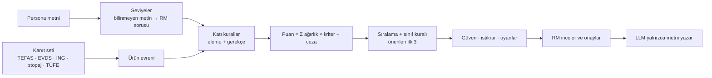

# Analitik çözüm

> Teslimat 3 · Taslak (2026-10-12) · Sayılar: dondurulmuş veri anlık görüntüsü
> `20261010-183835-6813`, karar yapılandırması `2534f798cc47`. Örnekler salt
> okunur `decide()` çalışmalarından alındı (P01 `Rc42670a01a`, P02
> `Rd1c6b9c98e`). **[VARSAYIM]** ile işaretli değerler mentorlarla teyit edilecek.

## 1. Kısa özet

Karar katmanı deterministik bir kural ve puanlama motorudur. Önce düzenleyici
kuralları ve müşterinin açık kısıtlarını **katı kural** olarak uygular; kalan
ürünleri, müşterinin seviyelerinden türetilen ağırlıklarla şeffaf biçimde
puanlar. Her puan parçalarına, her parça bir kanıt satırına (kaynak, tarih,
kimlik) bağlıdır. Büyük dil modeli (LLM) sıralamaya ve elemeye katılmaz;
yalnızca motorun sonucunu görüşme metnine döker, metin bir doğrulayıcıdan geçer
ve RM onayı olmadan müşteriye gitmez. Nedeni: etiketli veri yok, uygunluk
kuralları pazarlığa açık değil ve aynı girdi her zaman aynı sonucu vermeli.

## 2. Veri ve sinyaller

### 2.1 Ürün sinyalleri

Evren: 814 fon, ING Turuncu Hesap (vadesiz, karşılaştırma tabanı) ve ING
e-Vadeli Mevduat (32 gün). 1.292 Serbest fon (yalnızca nitelikli yatırımcı)
evrene girmez.

| Sinyal | Kullanım | Kaynak |
|---|---|---|
| Geçmiş getiri (1a, 3a, 6a, 1y, 3y, 5y) | ufka uygun dönem yıllıklandırılır; dönem yoksa bir kısa dönem | TEFAS fon getirileri sayfası |
| Stopaj ve TÜFE sonrası reel getiri | `return` kriteri, `real_loss` cezası | stopaj: CK 10041 / CK 11444 (RG 33286) oranları, elle girilen tablo; TÜFE: TÜİK, Eylül 2026 yıllık %29,73 |
| SPK risk değeri (1–7) | risk tavanı, `risk_fit`, anapara koruma | TEFAS fon getirileri ve fon detay sayfaları |
| Satış valörü (gün) | likidite değeri, `liquidity_need` kuralı | TEFAS fon detay sayfası |
| Giriş / çıkış komisyonu | net getiriden ufka yayılarak düşülür | TEFAS fon detay (anlık görüntüde yalnızca 1 fonda değer var) |
| Fon büyüklüğü, yatırımcı sayısı | `quality` kriteri, `fund_size` cezası | TEFAS fon detay |
| Alım durumu | `not_buyable` kuralı | TEFAS fon detay |
| Şemsiye türü, fon adı | ürün türü, döviz etiketi (ad içinde DÖVİZ, EUROBOND, DOLAR), varlık sınıfı | TEFAS fon getirileri sayfası |
| Mevduat oranları | Turuncu %23 (taban), e-Vadeli %35 | ing.com.tr, elle |
| Piyasa mevduat ortalaması %43,82 | `underperformance` ölçütü, ING uyarısı | TCMB EVDS |

Kalite işaretleri: TEFAS satırları `needs_check`, elle girilen satırlar
`manual_entry`; aralık dışı, eski ve çelişen değerler ayrıca işaretlenir. Aralık
dışı bir değer eksik sayılır.

### 2.2 Müşteri sinyalleri

Persona serbest Türkçe metindir. Motor metni normalleştirir (Türkçe küçük harf,
boşluk, noktalama) ve bir tablo anahtarıyla **tam** eşleştirir; bulanık eşleşme
yoktur.

| Alan | Seviye |
|---|---|
| `risk_profili` | tavan ve risk iştahı: Muhafazakâr 2 / 0, Temkinli 3 / ⅓, Dengeli 5 / ⅔, Agresif 7 / 1 |
| `yatirim_ufku` | "1-3 yıl" → 1y dönemi, "5+ yıl" → 3y dönemi |
| likidite, gelir, anapara | Düşük 0, Orta 0,5, Yüksek 1 |
| `doviz_maruz_kalma_tercihi` | Sınırlı → döviz yoğunluğu 1; Açık, Çeşitlendirilmiş → 0 |
| `oncelikler` | ifade → kriter ağırlığına +1 (ör. "düzenli gelir" → `income`) |
| `acik_kisitlar` | ifade → kural (ör. "yüksek riskli ürünlerden kaçınma" → tavan en fazla 4) |

Profil, yaş, durum, amaç ve RM notu puana girmez; yalnızca metinde kullanılır.
Tabloda olmayan bir metin için motor **tahmin etmez, sorar**: risk profili ve
açık kısıt bilinmiyorsa sıralama yapılmaz (`needs_rm_input`); diğer alanlarda
güvenli düzey kullanılır ve "Teyit edin" panelinde soru açılır. Örnek: P02'nin
"Mevcut döviz gelirini dikkate alarak kontrollü" metni tabloda yoktur; motor
"Sınırlı" düzeyini kullanır ve RM'e soru sorar.

## 3. Karar mantığı

### 3.1 Katı kurallar (eleme)

Sıra: `not_buyable`, `risk_ceiling`, açık kısıt kuralları, `short_history`.
Bir fon birden çok kurala takılabilir; tüm gerekçeler "Elenenler" listesinde
kanıt kimliğiyle görünür.

| Kural | Koşul |
|---|---|
| `not_buyable` | TEFAS'ta işlem görmüyor veya alıma kapalı |
| `risk_ceiling` | bilinen SPK risk değeri müşterinin tavanının üzerinde |
| `fx_limit` (P02) | döviz etiketli fon; RM kısıtı gerekçe yazarak kaldırabilir |
| `liquidity_need` (P05) | satış valörü 3 günden uzun veya vade 91 günden uzun |
| `short_history` | yalnızca 1 aylık getiri var (Agresif müşteride elenmez, ceza alır) |

Risk değeri olmayan bir fon elenmez: türündeki en yüksek risk varsayılır, ceza
ve düşük güven alır.

### 3.2 Puanlama

`puan = Σ ağırlık × kriter değeri − Σ ceza`. Ham ağırlıklar müşterinin
seviyelerinden gelir; eşleşen her öncelik +1 ekler; toplam 1'e normalleştirilir.

| Kriter | Değer (0–1) | Ham ağırlık |
|---|---|---|
| `return` | stopaj ve TÜFE sonrası reel getirinin adaylar içindeki yüzdelik sırası | 2 + 2 × iştah (3+ yıl ufukta +1) |
| `risk_fit` | risk bandı içinde 1; bandın altındaki her seviye için −0,5 | 2 |
| `liquidity` | satış valörü: 0 gün 1,0 · 1 gün 0,9 · 2 gün 0,8 · 3 gün 0,7; valör yoksa ürün türü | 2 × likidite (3+ yıl ufukta × 0,5) |
| `income` | ürün türü tablosu | 2 × gelir |
| `principal` | mevduat 1; fon max(0; 0,8 − 0,15 × (risk − 1)) | 2 × anapara |
| `simplicity` | ürün türü tablosu | 0 (+1 "sade ürün yapısı") |
| `quality` | büyüklük ve yatırımcı sayısı yüzdeliği; mevduat 0,5 | 0,5 |

Reel getiri: `N = R × (1 − stopaj) − komisyon / ufuk yılı`,
`r = (1 + N) / (1 + TÜFE) − 1`. Zararda stopaj yoktur; e-Vadeli 32 günde bir
yenilenir.

Ceza = üst sınır × müşteri yoğunluğu × ürün ihlali:

| Ceza | Üst | Yoğunluk | İhlal |
|---|---|---|---|
| `principal` | 0,3 | anapara | (risk − 2) / 3, 0–1 |
| `liquidity` | 0,3 | likidite | 1 − likidite değeri |
| `fx_exposure` | 0,3 | döviz | döviz fonu ise 1 |
| `risk_unknown` | 0,3 (tahmin tavanı aşarsa × 2) | 1 | risk değeri yoksa 1 |
| `track_record` | 0,2 | 1 | ufuk dönemi getirisi yoksa 1 |
| `real_loss` | 0,3 | anapara | −r / 0,10, 0–1 |
| `underperformance` | 0,3 | iştah | (B − N) / 0,20; B = piyasa ortalaması stopaj sonrası %36,2 |
| `fund_size` | 0,1 | 1 | 100 mn TL veya 100 yatırımcı altı |

**Risk bantları [VARSAYIM]:** Muhafazakâr 1–2, Temkinli 2–3, Dengeli 3–5,
Agresif 4–7. Bantlar yapılandırmada açıkça varsayım olarak işaretlidir.

### 3.3 Önerilen ilk 3 ve çeşitlendirme

Ürünler beş varlık sınıfına ayrılır: `nakit_benzeri`, `borclanma`, `dengeli`,
`hisse`, `altin_doviz` (şemsiye türünden ve ad sözcüklerinden; ör. "PARA
PİYASASI", "KISA VADELİ" → nakit benzeri). Müşteri Dengeli veya Agresif ise ya
da çeşitlendirme isterse, motor ilk 3'ü puan sırasıyla seçer: her sınıftan en
fazla bir, nakit benzeri en fazla bir seçenek. Bu kural, geçmiş 1 yıllık reel
getirisi negatif olan bir seçeneği seçmez (`min_real_return` 0). Üçten az sınıf
varsa kural adım adım gevşer. Muhafazakâr ve Temkinli müşteride, çeşitlendirme
önceliği yoksa, sade puan sırası kalır.

### 3.4 Çalışılmış örnek: P02 (Dengeli, 1–3 yıl, likidite / gelir / anapara Orta)

Ağırlıklar: `return` 0,339 · `risk_fit` 0,203 · `liquidity` 0,203 (Orta + "erişilebilir
likidite") · `income` 0,102 · `principal` 0,102 · `quality` 0,051.

| Seçenek | Sınıf, risk | return | risk_fit | liquidity | income | principal | quality | ceza | Puan |
|---|---|---|---|---|---|---|---|---|---|
| **BVF** BV Para Piyasası | nakit, 2 | 0,315 | 0,102 | 0,203 | 0,061 | 0,066 | 0,028 | 0 | **0,775** |
| **NJR** Nurol Borçlanma Araçları | borçlanma, 2 | 0,318 | 0,102 | 0,183 | 0,051 | 0,066 | 0,032 | −0,015 | **0,737** |
| KDE Kuveyt Türk Dengeli Katılım | borçlanma, 3 | 0,325 | 0,203 | 0,163 | 0,041 | 0,051 | 0,034 | −0,080 | 0,736 |
| **IRF** İstanbul Fon Sepeti | dengeli, 3 | 0,335 | 0,203 | 0,163 | 0,020 | 0,051 | 0,026 | −0,080 | **0,718** |
| Turuncu Hesap (taban) | nakit, 1 | 0,051 | 0 | 0,203 | 0,102 | 0,102 | 0,025 | −0,296 | 0,187 |

- **BVF birinci:** geçmiş 1 yıllık reel getirisi +%8,0 (adayların %93'ünden
  iyi) ve satış valörü 0 gün. Risk 2, Dengeli bandının altında; bu yüzden
  `risk_fit` yalnızca yarım puan alır.
- **EIL (Astra Para Piyasası, 0,774)** BVF'ye çok yakındır, ama ikinci nakit
  benzeri seçenek olduğu için ilk 3'e girmez; listede alternatif olarak kalır.
- **KDE**, IRF'den yüksek puan alır, ama borçlanma sınıfı NJR ile doludur.
- **IRF** dengeli sınıfının en iyisidir (reel +%12,8). Gerekçesinde
  "Çeşitlendirme: farklı varlık sınıfından en iyi seçenek." yazar.
- **Turuncu Hesap** reel −%8,3 verir: `real_loss` −0,124 ve `underperformance`
  −0,172 cezası alır. e-Vadeli (reel +%2,5) 0,431 puanla 146. sıradadır.

## 4. Neden bu yaklaşım?

| Ölçüt | Kural + şeffaf puan (seçilen) | ML sıralama | Yalnızca LLM |
|---|---|---|---|
| Veri ihtiyacı | etiket gerekmez | geçmiş RM kararları ve sonuçları gerekir; elimizde yok | etiket gerekmez |
| Denetlenebilirlik | her puan parçası ve gerekçesi kanıta bağlı | öznitelik önemi yaklaşık | gerekçe doğrulanamaz |
| Düzenleyici kurallar | katı kural; ihlal mümkün değil | yalnızca öğrenilmiş eğilim | istem ile; ihlal mümkün |
| Determinizm | aynı girdi → aynı `run_id`, aynı sonuç | eğitim sürümüne bağlı | aynı istem farklı çıktı verebilir |
| Değişiklik | yapılandırma dosyası; kod değişmez | yeniden eğitim | istem değişikliği, öngörülemez etki |

Problemin yapısı da bu seçimi destekler: yerindelik önce bir **kısıt
sağlama** problemidir (risk tavanı, alıma açıklık, açık kısıtlar), sonra çok
kriterli bir ödünleşimdir. MiFID II ve SPK yerindelik düzenlemesi sayısal
ağırlık vermez; ağırlıkları biz seçeriz ve açıkça gösteririz.

Ödünleşimler açıktır:

- Ağırlıklar ve bantlar bir yargıdır. Veride ayarlandılar ve her değişiklik
  kayda geçti: reel getiri ağırlığı D9'da yükseldi; bant adımı 0,25'ten 0,5'e
  çıktı, çünkü Dengeli öneriler risk 2'de kalıyordu.
- Getiri sinyali **geçmiş getiridir**; bir tahmin değildir. Yüzdelik sıra
  göreli bir ölçüdür.
- RM onayları biriktiğinde (`data/runs/`) ağırlıklar bir modelle ayarlanabilir.

## 5. Varsayımlar

Motorun P01–P05 sonuçlarına yazdığı varsayımlar:

- "Fon getirileri geçmiş getirilerdir; mevduat oranı bugünkü orandır."
- "Getiriler stopaj sonrası ve yıllık TÜFE'ye (%29.73, 2026-09-30) göre reel
  olarak hesaplandı."
- "Mevduat için 100.000-249.999 TL diliminin standart oranı kullanıldı (tutar
  bilinmiyor; hoş geldin oranı geçicidir)."
- "Hisse senedi yoğun fonlarda stopaj %0'dır; ihtiyatlı olmak için para
  piyasası dışındaki tüm fonlarda 'diğer fonlar' oranı kullanıldı."
- "Fonlarda likidite satış valöründen (valör yoksa ürün türünden), gelir
  uygunluğu ürün türünden türetildi."
- "32 günlük vade her ay yenilenir; oranlar değişebilir."
- Sınıf kuralı uygulandığında: "Öneriler varlık sınıflarına yayıldı: her
  sınıftan en fazla bir, nakit benzeri en fazla bir seçenek."
- Persona varsayımları, ör. P04: "\"kuşaklar arası planlama\" için kanıt yok;
  puana katılmadı."

Ek olarak: risk bantları **[VARSAYIM]**; varlık sınıfı şemsiye türünden ve fon
adından türetilen bir yaklaşık değerdir; stopaj oranları 31.12.2026'ya kadar
geçerlidir.

## 6. Belirsizlik yönetimi

**Güven (0–1)** = seçeneğin kullandığı en zayıf veri satırının katsayısı ×
her tahminin katsayısı. Katsayılar: işaretsiz 1,0; `needs_check` ve
`manual_entry` 0,9; `stale` 0,7; `conflict` 0,6; tahmini risk × 0,7; ufuktan
kısa getiri dönemi × 0,8; valör yerine ürün türü × 0,8. P01'de 141 seçeneğin
102'si 0,90, risk değeri tahmin edilen 27'si 0,63 güven taşır.

**İstikrar (0–1):** motor sıralamayı 30 kez yeniden hesaplar; her seferinde 7
ağırlıktan veya 8 ceza üst sınırından birini × 0,8 ya da × 1,2 yapar. İstikrar,
seçeneğin ilk 20'de kaldığı çalışmaların oranıdır. İlk 3'te 0,5'in altı
`low_stability` uyarısı verir. Bu çalışmada beş personanın tüm önerilerinde
istikrar 0,97 veya üzeridir.

**Eksik ve çelişen veri** "Olası sorunlar" panelinde not olur. P01 örnekleri:
TEFAS getiri sayfasından 847 değer `needs_check`; 6 fonun alım durumu yok (alıma açık sayıldı);
1 aralık dışı değer kullanılmadı. TÜFE yoksa stopaj sonrası nominal getiri
kullanılır ve not düşülür.

**Sorular:** engelleyici sorular (risk profili, bilinmeyen açık kısıt)
sıralamayı durdurur. Engelleyici olmayanlar güvenli düzeyle devam eder ve
"Teyit edin" panelinde komut olarak görünür; ör. tüm personalarda "Yatırım
tutarını sorun: 100.000-249.999 TL dilimi varsayıldı.", P02'de döviz düzeyi
sorusu.

**Uyarılar:** ör. "ING standart mevduat oranı (%23.00) piyasa ortalamasının
(%43.82) 20.8 puan altında."

## 7. Dışlanan seçenekler

| Persona | Puanlanan | Elenen | `risk_ceiling` | `not_buyable` | `short_history` | Açık kısıt | Birden çok kurala takılan |
|---|---|---|---|---|---|---|---|
| P01 Muhafazakâr | 141 | 675 | 573 | 189 | 69 | — | 128 |
| P02 Dengeli | 307 | 509 | 355 | 189 | 69 | `fx_limit` 14 | 97 |
| P03 Agresif | 627 | 189 | 0 | 189 | 0 | — | 0 |
| P04 Dengeli | 313 | 503 | 355 | 189 | 69 | — | 89 |
| P05 Temkinli | 179 | 637 | 521 | 189 | 69 | `liquidity_need` 2 | 118 |

Kural sayılarının toplamı elenen sayısından büyüktür, çünkü bir fon birden çok
kurala takılabilir. Örnek: P05'te TFF ve ZSF hem risk tavanını (6 > 3) hem
satış valörü sınırını (4 > 3 gün) aşar; iki gerekçe de listede görünür.

**Doğrulama:** değerlendirme paketi 34 senaryo ve 39 çalışmada risk tavanı
üzerinde, alıma kapalı veya kısıt ihlal eden **0** seçenek buldu; aynı girdi 5
tekrarın 5'inde aynı sonucu verdi. Hata analizi motoru değiştirdi: nominal
getiriyle P01'de Turuncu tabanı tüm fonların üzerindeydi (0,912; reel getiri
sonrası 0,568, en iyi fon 0,837); 5 personanın 4'ü yalnızca nakit benzeri, SPK risk 1 fonlar alıyordu
(sınıf kuralı sonrası 5 farklı set).

## Kaynak dosyalar

- `prototype/docs/decision.md` — karar katmanının tasarımı (bölüm 2–6, 10)
- `prototype/config/decision.yaml` — tüm tablolar, ağırlıklar, cezalar, metinler
- `prototype/src/rmprep/decision/` — motor (`scoring.py`, `recommend.py`, `confidence.py`)
- `prototype/docs/ingest.md` — veri kaynakları ve kalite işaretleri
- `prototype/data/inbox/manual/` — stopaj, TÜFE ve ING oranları (kaynak URL'leriyle)
- `prototype/data/eval/20261012-201431-full/report.md` — değerlendirme raporu
- `prototype/docs/teslim/01-problem-tanimi.md` — problem tanımı
