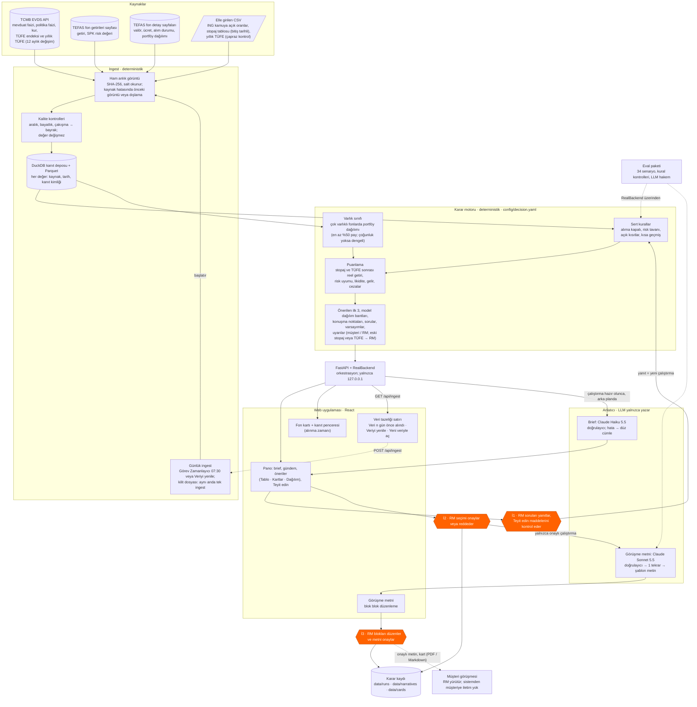

# Çözüm tasarımı

> Teslimat 4 · Taslak (2026-10-14) · Ölçümler: son değerlendirme raporu
> `data/eval/20261014-105720-full` (dondurulmuş anlık görüntü
> `20261014-102329-8fca`, karar yapılandırması `c5e83ccc4e4b`, anlatıcı
> istemi `n9`, hakem `j3`) ve maliyet defterleri `data/narratives/costs.jsonl`,
> `data/eval/narratives/costs.jsonl`.
> **[VARSAYIM]** ile işaretli noktalar mentorlarla teyit edilecek.

## 1. Mimari özeti

Sistem dört katmandan oluşur: veri toplama (ingest), deterministik karar
motoru, dil üreten anlatıcı (narrator) ve RM'in çalıştığı yerel web
uygulaması. Kararı kod verir, metni LLM yazar, metni yine kod denetler, son
sözü RM söyler. Turuncu altıgenler insan onay noktalarıdır.

Ingest yalnızca robots.txt'nin izin verdiği HTML sayfalarını okur (TEFAS
`/api/` yolu yapılandırmada reddedilir). ING oranları ve stopaj oranları,
kaynak adresi ve tarihiyle birlikte elle girilir; kodda vergi oranı yoktur.
Stopaj satırlarının bir bitiş tarihi vardır (31.12.2026); tarih geçince satır
"eski" bayrağı alır. Yıllık TÜFE artık EVDS'den de gelir
(`TP.TUKFIY2025.GENEL`, 12 aylık değişim %29,73); elle girilen satır çapraz
kontrol olarak kalır. Ingest her gün 07:30'da Windows Görev Zamanlayıcı ile
çalışır (kaçan başlangıç bilgisayar açılınca çalışır, konsol penceresi yok,
günlük `data/logs/ingest.log`).

## 2. Bileşenler

| Bileşen | Sorumluluk | Teknoloji | Tür | Dosya / modül |
|---|---|---|---|---|
| Kaynak adaptörleri | EVDS (yıllık TÜFE dahil), TEFAS sayfaları (fon başına portföy dağılımı dahil: 775 fonda 3.759 satır), elle CSV (stopaj satırında bitiş tarihi); bozuk satırı nedeniyle kaydeder | Python, httpx, openpyxl | Deterministik | `src/rmprep/ingest/adapters/` |
| Günlük ingest ve kilit | Her gün 07:30'da ingest (Windows Görev Zamanlayıcı, konsol penceresi yok); kilit dosyası ile aynı anda tek ingest (`IngestBusy`, CLI çıkış kodu 3); günlük dosyası | PowerShell, cmd, Python | Deterministik | `scripts/schedule_ingest.ps1`, `scripts/run_ingest.cmd`, `ingest/pipeline.py` |
| Anlık görüntü | Ham veriyi değişmez ve özetli (SHA-256) saklar | Dosya sistemi | Deterministik | `ingest/snapshot.py` |
| Kalite kontrolleri | Aralık dışı, bayat, çakışan, yinelenen değerlere bayrak | Saf fonksiyonlar | Deterministik | `ingest/quality.py` |
| Kanıt deposu | Her değeri kimliğiyle saklar, Parquet'e aktarır | DuckDB | Deterministik | `ingest/store.py`, `ingest/pipeline.py` |
| Karar motoru | Evren, sert kurallar, puan, güven ve kararlılık, önerilen 3, sorular, uyarılar; eksik risk değeri için varlık sınıfı tahmini (D21); eski stopaj veya TÜFE için RM uyarısı (D22); çok varlıklı fonlarda varlık sınıfı portföy dağılımından (D23); reel getiri hesaplanamazsa daha düşük güven (D24); önerilen seçeneğin kararlılığı (D25) | Python, YAML | Deterministik | `src/rmprep/decision/`, `config/decision.yaml` |
| Model dağılım bantları | Risk profiline göre sınıf başına stratejik bant (kaynak: Ata Yatırım, 28.04.2026), sınıfın en iyi seçeneği, not (`ceiling` / `none` / `negative_real`), persona metninden mevcut durum ipucu. Mevcut pay ve tutar yok (D20) | Python, YAML; React görünümü | Deterministik | `decision/allocation.py`, `config/decision.yaml` `allocation`, `web/src/components/OptionsAllocation.tsx` |
| Gruplama | Kısa liste grupları ve önerilen ilk 3'ün tek kuralı | Python | Deterministik | `src/rmprep/grouping.py` |
| Orkestrasyon | Çalıştırma, onay, arka plan işleri (2 iş parçacığı), kayıt | Python | Deterministik | `src/rmprep/backend.py` |
| JSON API | Görünüm modelleri (sıra, yıldız, uygunluk halkası); iş kuralı eklemez. `GET /api/ingest` veri yaşını ve ingest durumunu verir; `POST /api/ingest` arka planda ingest başlatır (başka bir ingest çalışıyorsa 409) | FastAPI, uvicorn | Deterministik | `src/rmprep/api/`, `api/ingest_job.py` |
| Web uygulaması | Pano, öneriler (Tablo, Kartlar, Dağılım), fon kartı, kanıt penceresi (değer, kaynak, tarih, alınma zamanı), görüşme metni, onay zamanları, yazdırma; veri tazeliği satırı ("Veri n gün önce alındı", "Veriyi yenile", "Yeni veriyle aç") | React, TypeScript, Tailwind, Vite | Arayüz + insan kararı | `web/`, `web/src/components/DataFreshness.tsx` |
| Onay zamanları | RM'in karar zamanı (`DecisionResult.rm_decided_at`) ve metin onay zamanı (`NarrativeDraft.approved_at`), Türkiye saatiyle; kartta ve ekranda (sözleşme v1.7) | Python | Deterministik | `contracts.py`, `backend.py`, `ui/card.py` |
| Brief | Pano için RM'e 1–2 cümle | Claude Haiku 5.5 | LLM + kod denetimi | `narrator/brief.py`, `rmprep/brief.py` |
| Görüşme metni | 8 bölümlü hazırlık metni ve konuşma metni | Claude Sonnet 5.5 | LLM + kod denetimi | `narrator/` (`facts`, `prompt`, `llm`, `validator`, `template`, `service`) |
| Blok düzenleme kontrolü | RM'in değiştirdiği bloğu yeniden denetler | Python | Deterministik | `src/rmprep/edits.py`, `narrator/blocks.py` |
| Eval paketi | Senaryolar, kural kontrolleri, rapor; dil kalitesi için hakem (`j3`: ekran bağlamını ve seçenek olgularını görür) | Python + Claude Haiku 5.5 | Deterministik + LLM hakem | `src/rmprep/eval/`, `config/eval.yaml` |

## 3. LLM'in rolü ve sınırları

LLM hiçbir ürünü seçmez, elemez veya puanlamaz; yalnızca karar motorunun
çıktısını Türkçe (veya İngilizce) metne çevirir.

- **Girdi: olgu paketi (kod).** Persona bağlamı, RM'in onayladığı seçim,
  her seçeneğin gerekçeleri ve kanıt kimlikli sayıları (reel 1 yıllık getiri
  dahil), grup alternatifleri, yalnızca müşteriye yönelik uyarılar,
  varsayımlar ve sorular. Her seçenek bir **risk satırı** da taşır: erişim
  (valör veya vade), varsa ücretler ve varlık sınıfına göre sabit bir risk
  notu (`config/narrator.yaml` `risk_notes`; ör. borçlanma: "Faizler
  yükselirse fonun değeri düşebilir; vade uzadıkça dalgalanma artar."). Elenen
  ürünler adla girmez; RM'e özel uyarılar pakete hiç girmez.
- **Çıktı: yapılandırılmış JSON.** API'nin `json_schema` biçimi kullanılır.
  Her cümle seçenek ve kanıt kimliklerini taşır; her öneri için müşteri
  önceliklerinden 1–3 ihtiyaç etiketi gelir. İstem `n9` öneriler bölümünü
  biçimler: her seçenek için fonun adıyla başlayan 3 cümle — (a) olgular,
  önce reel getiri; (b) bu müşteriye uyum, başka seçenekte kullanılmayan bir
  müşteri olgusuyla; (c) ana ödünleşim veya risk. "Geçmiş getiri" uyarısı
  yalnızca dikkat ve teklif metninde yer alır. Markdown ekran sırasını izler
  (özet, konuşma noktaları, teklif metni, öneriler, dikkat; sonra "Ek
  bilgiler").
- **Doğrulayıcı (kod).** Metin şu durumlarda reddedilir:
  - olgu paketinde olmayan bir sayı veya tarih; iç değer (puan, sayım,
    bayrak adı);
  - izin verilmeyen bir seçenek adı (elenen veya listede olmayan ürün;
    ekrandaki kısa adlar da yakalanır);
  - yasak ifade ("garanti", "risksiz", "kesin getiri" vb.; fon adları
    taramadan önce çıkarılır, "GARANTİ PORTFÖY" bu yüzden hata sayılmaz);
  - kaynaksız cümle veya var olmayan kimlik (konuşma noktaları, öneriler,
    alternatifler, dikkat);
  - ING ürün adının yanında ING'ye ait olmayan bir oran (etiket kuralı);
  - öneriler bölümünde fonun adıyla başlamayan cümle (`shape`);
  - öneriler bölümündeki bir cümleyi tekrar eden dikkat cümlesi (`repeat`:
    cümlenin sözcük köklerinin en az %80'i tek bir öneri cümlesinde);
  - öneriler dışında ING mevduatını piyasa mevduat ortalamasıyla
    karşılaştıran cümle (`compare`; bu karşılaştırma RM'e özel bir nottur);
  - müşteri önceliği olmayan ihtiyaç etiketi, eksik bölüm, eksik varsayım,
    eksik "yatırım tavsiyesi değildir" cümlesi.
- **Hata yolu.** Bulgularla bir kez yeniden denenir; ikinci hatada olgu
  paketinden kurulan şablon metin ve "Otomatik metin doğrulanamadı" bandı
  gösterilir. Brief için tekrar yoktur; hata veya API sorununda personanın
  düz cümlesi kalır. Her denemenin bulguları maliyet defterine yazılır; ilk
  denemedeki bulgular türe göre sayılır
  (`rmprep.narrator.service.findings_by_kind`). Son tam değerlendirmede 19
  yeni metnin 2'si ilk denemede kaldı (1 yasak ifade: kısaltılmış fon
  adındaki "Garanti Portföy"; 1 boş bölüm), ikisi de tekrarda geçti.
- **Önbellek ve maliyet.** Metin (çalıştırma, dil, istem sürümü, model, olgu
  paketinin özeti) anahtarıyla diske yazılır; aynı çalıştırma ve aynı seçim
  ikinci çağrı yapmaz, başka bir seçim yeni metin üretir (N12). Sistem
  istemi önbelleğe alınır. Günlük sınır **5 ABD doları**dır; aşılırsa şablon
  metin gelir. Her çağrı maliyet defterine yazılır.

| Çıktı | Model | Ölçülen maliyet | Ölçülen süre |
|---|---|---|---|
| Görüşme metni | Claude Sonnet 5.5 (`claude-sonnet-5-5`, effort medium, istem `n9`) | yeni metin başına ortalama **0,044 $** (eval, 25 metin); hız testinde 0,049 $ | ortalama 25 sn (en çok 48 sn) |
| Pano brief'i | Claude Haiku 5.5 (`claude-haiku-5-5`) | 49 çağrıda ortanca **0,0008 $** (0,0003–0,0013 $) | arka planda |
| Eval hakemi | Claude Haiku 5.5 (`j3`) | tam pakette 0,009 $ | — |

Tasarım belgesindeki brief tahmini (yaklaşık 0,003 $) ölçülen değerin
üstündedir; tabloda ölçülen değer kullanılmıştır.

## 4. İnsan onay noktaları

| # | RM kontrolü | Sistemin zorladığı kural |
|---|---|---|
| 1 | Veri eskiyse "Veriyi yenile" ile yeni ingest başlatır; bitince "Yeni veriyle aç" ile yeni anlık görüntüye geçer | Aynı anda tek ingest çalışır (kilit dosyası; ikinci istek 409 alır). Ekrandaki çalıştırma kendiliğinden değişmez; yeni veriye geçişi RM seçer |
| 2 | Belirsiz risk profili veya tanınmayan kısıt metnini yanıtlar | Engelleyici soru açıkken sıralama yapılmaz (`needs_rm_input`); yanıt yeni bir çalıştırmadır |
| 3 | "Teyit edin" maddelerini (ör. yatırım tutarı dilimi; stopaj satırının süresi geçmişse veya TÜFE eskiyse "Güncel stopaj oranını ve TÜFE'yi teyit edin.") müşteriyle veya kaynakla kontrol eder | Motor eksik değeri sessizce tahmin etmez; güvenli düzeyi seçer ve varsayım olarak yazar. Liste onayı engellemez, açık madde sayısını hatırlatır |
| 4 | Bir kaynağı dışlar veya personayı düzenler | Dışlanan kaynak notlarda görünür. Düzenlenmiş persona **test çalıştırmasıdır** ve onaylanamaz (arka uç reddeder) |
| 5 | Açık kısıtı gerekçeyle kaldırır (P02 döviz sınırı) | Kaldırma yalnızca RM yanıtıyla olur ve varsayım olarak kayda geçer |
| 6 | Önerilen ilk 3'ten seçimi yapar, not ekler, onaylar veya reddeder | Ret not ister. Karar zamanı kaydedilir ve onay çubuğunda görünür. Görüşme metni yalnızca onaylı çalıştırma için üretilir |
| 7 | Metni blok blok düzenler; "Orijinale dön" ile geri alır | Her blok yeniden denetlenir. Yasak ifade, izin dışı seçenek, iç bilgi ve ING etiket bulguları onayı **engeller**; olgu dışı sayı yalnızca uyarır |
| 8 | "Metni onayla" | Engelleyici bulgu açıkken onay reddedilir; onaydan sonra düzenleme kapanır. Onay zamanı kaydedilir. Kart ve PDF onaylı metni ve iki onay zamanını gösterir |
| 9 | "RM notu · yalnızca sizin için" bölümünü okur | RM'e özel uyarılar (ör. ING oranı ile piyasa farkı; eski stopaj veya TÜFE ile hesaplanan reel getiri, `stale_tax_input`) olgu paketine girmez, müşteri metninde yer almaz |

Sistemin müşteriye bir iletim kanalı yoktur: uygulama yerel çalışır ve
çıktıyı yalnızca RM görür. Karar kaydı şunları tutar: çalıştırma kimliği,
yapılandırma özeti, anlık görüntü, dışlanan kaynaklar, kullanılan persona,
RM durumu, seçim, notlar ve karar zamanı (`data/runs/`); onaylı metin, model,
istem sürümü, doğrulayıcı sonucu, maliyet ve onay zamanı (`data/narratives/`).
Zamanlar Türkiye saatiyledir (`Europe/Istanbul`, sözleşme v1.7).

## 5. Güvenilirlik

- **Kaynak hatası.** Her kaynak için yapılandırmada `on_failure` vardır:
  önceki anlık görüntüye dönülür (satırlar `fallback_snapshot` bayrağı
  taşır) veya kaynak dışlanır. RM de bir kaynağı ekrandan dışlayabilir;
  yalnızca o kaynaktan doğan çakışmalar kaybolur.
- **Günlük ingest.** Görev Zamanlayıcı ve "Veriyi yenile" düğmesi aynı
  kilit dosyasını kullanır; ikinci ingest başlamaz (`IngestBusy`, CLI çıkış
  kodu 3). 2 saatten eski bir kilit bayat sayılır ve değiştirilir. Görev
  konsol penceresi olmadan çalışır; günlük dosyası her çalışmanın başlangıç
  ve çıkış satırını tutar.
- **Eski veya eksik vergi ve enflasyon verisi.** Süresi geçmiş stopaj satırı
  veya eski TÜFE RM'e özel bir uyarı (`stale_tax_input`) ve bir "Teyit edin"
  maddesi verir (D22). Reel getiri hesaplanamazsa (TÜFE veya stopaj satırı
  yok) seçeneğin güveni 0,8 ile çarpılır (D24); eksik veri böylece ekranda
  görünür.
- **Tekrar ve belirlilik.** Anlık görüntüden sonraki her adım saf
  fonksiyondur: `rmprep replay <id>` ağa çıkmadan aynı Parquet dosyasını
  bayt bayt üretir; tekrar her zaman anlık görüntüde saklanan yapılandırmayı
  kullanır. Karar motoru saat ve rastgelelik kullanmaz; aynı girdi
  aynı `run_id`'yi ve aynı sonucu verir. Metin önbellekten aynen gelir
  (eval: 5/5 tekrar senaryosu).
- **Kararlılık.** Önerilen bir seçeneğin kararlılığı, ağırlıkların ve
  cezaların ±%20 değiştiği 30 çalıştırmada öneri kuralının onu yeniden önerme
  payıdır (D25). Son anlık görüntüde P01–P05'in tüm önerileri en az 0,83'tür.
- **İzlenebilirlik.** Her sayı bir kanıt kimliğine bağlıdır; ekrandaki "K"
  işareti değeri, kaynağı, tarihi, bayrakları ve değerin kaynaktan alınma
  zamanını ("Alındı: …") açar. Eval'de "her seçenek ve her cümle kanıt
  gösterir" kontrolü 39/39 çalıştırmada geçti.
- **Kalıcılık.** Onaylı ve reddedilmiş çalıştırmalar, blok düzenlemeleri ve
  onaylı metinler diske yazılır; sunucu yeniden başlarsa aynı girdi aynı
  kimliği verir ve kayıt geri yüklenir. RM'in karar zamanı ve metin onay
  zamanı kayıtla birlikte saklanır; denetçi kimin neyi ne zaman onayladığını
  karttan okur.
- **Testler.** `pytest` 97 dosyada 1.918 test toplar (2026-10-14 sayımı);
  hiçbir test ağa çıkmaz (LLM testleri sahte istemciyle çalışır). Web
  uygulamasının ayrıca Vitest testleri vardır.
- **Eval paketi.** 34 senaryo, 39 çalıştırma: temel personalar, jüri tarzı
  persona ve kısıt değişiklikleri, kaynak dışlama, bozuk veri ve 13 regresyon
  senaryosu. Son tam çalışmada (`20261014-105720-full`, yeni dondurulmuş
  anlık görüntü `20261014-102329-8fca`) kural kontrolleri %100, doğrulayıcı
  geçiş oranı %100 (25/25 LLM metni, şablona düşüş yok), yasak ifade 0.
  Hakemin dil puanları daha düşüktür ("müşteriye uyarlanmış" %50, "RM için
  açık" %57, "dengeli" %62; önceki tam çalışmada %52 / %50 / %60). Nesnel
  metin ölçüleri iyileşti, hakem puanı belirgin değişmedi; ayrıntı ve
  nedenleri Teslimat 5'tedir.

## 6. Neden bu tasarım?

1. **Deterministik çekirdek.** Uygunluk, eleme ve sıralama denetlenebilir,
   test edilebilir ve tekrar üretilebilir olmalıdır. SPK yerindelik kuralı
   ve "kısıt ihlali sıfır" hedefi olasılıklı bir modele bırakılamaz. Tüm
   ağırlıklar, eşikler ve metin kalıpları `config/decision.yaml` içindedir;
   ayar bir yapılandırma değişikliğidir ve yapılandırma özeti kayda girer.
2. **LLM yalnızca dilin gerektiği yerde.** Müşteriye uyarlanmış, akıcı bir
   metin kuralla iyi yazılamaz; LLM'in katkısı buradadır. Kod olgu paketini
   sınırlar ve çıktıyı denetler; bu yüzden bir LLM hatası yanlış bir öneriye
   dönüşemez, en kötü durumda şablon metne düşer.
3. **Çalışma anında çoklu ajan döngüsü yok.** Her metin tek çağrıdır (en çok
   bir tekrar). Bu yapı maliyeti (metin başına yaklaşık 0,05 $), süreyi ve
   davranışı öngörülebilir kılar; araç seçen bir ajan döngüsü bu işte
   doğruluk eklemez, denetimi zorlaştırır. Ajan sayısı bir hedef değildir.
4. **Yerel web uygulaması.** Sunucu yalnızca `127.0.0.1` adresine bağlanır;
   müşteriye iletim ve otomatik işlem yoktur. Arayüz RM'in onay adımlarını
   görünür kılar.

**Geliştirme süreci (çalışma zamanı değil).** Sistem bir lider ve modül
başına bir işçi Claude Code oturumuyla, ayrı git çalışma ağaçlarında
geliştirildi. Sözleşmeler (`contracts.py`) lider tarafından donduruldu; her
adım yeşil `pytest` ile kapandı (`docs/workflow.md`). Bu çoklu ajan yapısı
yalnızca yapım içindir; ürün çalışırken kullanılmaz.

**Ödünleşimler.**

- Veri kamuya açık kaynaklardan ve elle girilen satırlardan gelir. TEFAS
  değerleri 12 anlık görüntü boyunca kararlı kaldı; 2026-10-14'ten sonraki
  anlık görüntülerde "kontrol gerekli" bayrağı taşımaz (eski anlık
  görüntüler bayrağı korur). Stopaj oranları programın okuyabileceği bir
  kaynakta yayımlanmaz; bu yüzden elle girilir ve bitiş tarihinden sonra RM
  uyarılır.
- Çok varlıklı fonların varlık sınıfı tek günün portföy dağılımından gelir
  (D23); bu, yaklaşık 214 fonun sınıfını değiştirdi (çoğu Değişken fon,
  dengeli → hisse). Para piyasası, hisse, kıymetli maden ve TL borçlanma
  fonları türlerinin sınıfında kalır, çünkü tek günün dağılımı yanıltıcı
  olabilir.
- Kural tabloları ve risk bantları uzman görüşüyle değil, ilk değerlerle
  kuruldu **[VARSAYIM]**.
- Persona metni yalnızca tam eşleşmeyle okunur; tanınmayan ifade soru olur.
  Bu güvenlidir ama RM'e ek iş çıkarır.
- Çalıştırmalar bellekte tutulur; yalnızca onaylanmış veya reddedilmiş
  çalıştırmalar diske yazılır.

**Üretimde değiştireceklerimiz.**

- Banka sistemleri: müşteri portföyü ve tutarı, gerçek ürün raf listesi,
  ING oranlarının ve stopaj tablosunun resmî akışla gelmesi. Mevcut portföy
  girdisiyle Dağılım görünümü bantlarla bir boşluk analizi yapabilir; bugün
  yalnızca bantları ve sınıfın en iyi seçeneğini gösterir.
- Dağılım bantlarının bankanın kendi model portföyleriyle değişmesi
  **[VARSAYIM]**.
- Kimlik doğrulama, rol yetkisi ve kayıtların merkezi, değiştirilemez bir
  denetim deposuna yazılması.
- Günlük ingest'in bir dizüstü bilgisayar yerine izlenen bir sunucu işi
  olarak çalışması.
- KAP bildirimleri: KAP otomatik erişimi engellediği için prototipte yoktur;
  lisanslı bir veri akışıyla eklenmelidir **[VARSAYIM]**.
- Müşteri verisi bankadan çıkmadan önce KVKK değerlendirmesi ve banka
  onaylı bir model ortamı.
