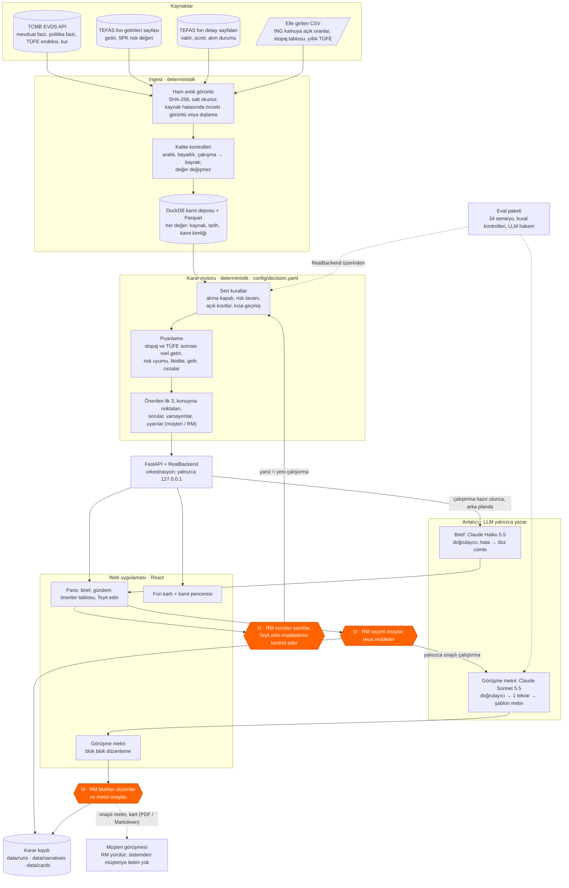

# Çözüm tasarımı

> Teslimat 4 · Taslak (2026-10-12) · Ölçümler: değerlendirme raporu
> `data/eval/20261012-185154-full` (dondurulmuş anlık görüntü
> `20261010-183835-6813`) ve maliyet defteri `data/narratives/costs.jsonl`.
> **[VARSAYIM]** ile işaretli noktalar mentorlarla teyit edilecek.

## 1. Mimari özeti

Sistem dört katmandan oluşur: veri toplama (ingest), deterministik karar
motoru, dil üreten anlatıcı (narrator) ve RM'in çalıştığı yerel web
uygulaması. Kararı kod verir, metni LLM yazar, metni yine kod denetler, son
sözü RM söyler. Turuncu altıgenler insan onay noktalarıdır.

Ingest yalnızca robots.txt'nin izin verdiği HTML sayfalarını okur (TEFAS
`/api/` yolu yapılandırmada reddedilir). ING oranları ve stopaj oranları,
kaynak adresi ve tarihiyle birlikte elle girilir; kodda vergi oranı yoktur.

## 2. Bileşenler

| Bileşen | Sorumluluk | Teknoloji | Tür | Dosya / modül |
|---|---|---|---|---|
| Kaynak adaptörleri | EVDS, TEFAS sayfaları, elle CSV; bozuk satırı nedeniyle kaydeder | Python, httpx, openpyxl | Deterministik | `src/rmprep/ingest/adapters/` |
| Anlık görüntü | Ham veriyi değişmez ve özetli (SHA-256) saklar | Dosya sistemi | Deterministik | `ingest/snapshot.py` |
| Kalite kontrolleri | Aralık dışı, bayat, çakışan, yinelenen değerlere bayrak | Saf fonksiyonlar | Deterministik | `ingest/quality.py` |
| Kanıt deposu | Her değeri kimliğiyle saklar, Parquet'e aktarır | DuckDB | Deterministik | `ingest/store.py`, `ingest/pipeline.py` |
| Karar motoru | Evren, sert kurallar, puan, güven ve kararlılık, önerilen 3, sorular, uyarılar | Python, YAML | Deterministik | `src/rmprep/decision/`, `config/decision.yaml` |
| Gruplama | Kısa liste grupları ve önerilen ilk 3'ün tek kuralı | Python | Deterministik | `src/rmprep/grouping.py` |
| Orkestrasyon | Çalıştırma, onay, arka plan işleri (2 iş parçacığı), kayıt | Python | Deterministik | `src/rmprep/backend.py` |
| JSON API | Görünüm modelleri (sıra, yıldız, uygunluk halkası); iş kuralı eklemez | FastAPI, uvicorn | Deterministik | `src/rmprep/api/` |
| Web uygulaması | Pano, fon kartı, kanıt penceresi, görüşme metni, yazdırma | React, TypeScript, Tailwind, Vite | Arayüz + insan kararı | `web/` |
| Brief | Pano için RM'e 1–2 cümle | Claude Haiku 5.5 | LLM + kod denetimi | `narrator/brief.py`, `rmprep/brief.py` |
| Görüşme metni | 8 bölümlü hazırlık metni ve konuşma metni | Claude Sonnet 5.5 | LLM + kod denetimi | `narrator/` (`facts`, `prompt`, `llm`, `validator`, `template`, `service`) |
| Blok düzenleme kontrolü | RM'in değiştirdiği bloğu yeniden denetler | Python | Deterministik | `src/rmprep/edits.py`, `narrator/blocks.py` |
| Eval paketi | Senaryolar, kural kontrolleri, rapor; dil kalitesi için hakem | Python + Claude Haiku 5.5 | Deterministik + LLM hakem | `src/rmprep/eval/`, `config/eval.yaml` |

## 3. LLM'in rolü ve sınırları

LLM hiçbir ürünü seçmez, elemez veya puanlamaz; yalnızca karar motorunun
çıktısını Türkçe (veya İngilizce) metne çevirir.

- **Girdi: olgu paketi (kod).** Persona bağlamı, RM'in onayladığı seçim,
  her seçeneğin gerekçeleri ve kanıt kimlikli sayıları, grup alternatifleri,
  yalnızca müşteriye yönelik uyarılar, varsayımlar ve sorular. Elenen
  ürünler adla girmez; RM'e özel uyarılar pakete hiç girmez.
- **Çıktı: yapılandırılmış JSON.** API'nin `json_schema` biçimi kullanılır.
  Her cümle seçenek ve kanıt kimliklerini taşır; her öneri için müşteri
  önceliklerinden 1–3 ihtiyaç etiketi gelir.
- **Doğrulayıcı (kod).** Metin şu durumlarda reddedilir:
  - olgu paketinde olmayan bir sayı veya tarih; iç değer (puan, sayım,
    bayrak adı);
  - izin verilmeyen bir seçenek adı (elenen veya listede olmayan ürün;
    ekrandaki kısa adlar da yakalanır);
  - yasak ifade ("garanti", "risksiz", "kesin getiri" vb.; fon adları
    taramadan önce çıkarılır, "GARANTİ PORTFÖY" bu yüzden hata sayılmaz);
  - kaynaksız cümle veya var olmayan kimlik (konuşma noktaları, öneriler,
    alternatifler, dikkat);
  - ING ürün adının yanında ING'ye ait olmayan bir oran (etiket kuralı);
  - müşteri önceliği olmayan ihtiyaç etiketi, eksik bölüm, eksik varsayım,
    eksik "yatırım tavsiyesi değildir" cümlesi.
- **Hata yolu.** Bulgularla bir kez yeniden denenir; ikinci hatada olgu
  paketinden kurulan şablon metin ve "Otomatik metin doğrulanamadı" bandı
  gösterilir. Brief için tekrar yoktur; hata veya API sorununda personanın
  düz cümlesi kalır.
- **Önbellek ve maliyet.** Metin (çalıştırma, dil, istem sürümü, model)
  anahtarıyla diske yazılır; aynı çalıştırma ikinci çağrı yapmaz. Sistem
  istemi önbelleğe alınır. Günlük sınır **5 ABD doları**dır; aşılırsa şablon
  metin gelir. Her çağrı maliyet defterine yazılır.

| Çıktı | Model | Ölçülen maliyet | Ölçülen süre |
|---|---|---|---|
| Görüşme metni | Claude Sonnet 5.5 (`claude-sonnet-5-5`, effort medium) | yeni metin başına ortalama **0,052 $** (eval, 25 metin); hız testinde 0,049 $ | ortalama 33 sn (en çok 82 sn) |
| Pano brief'i | Claude Haiku 5.5 (`claude-haiku-5-5`) | 49 çağrıda ortanca **0,0008 $** (0,0003–0,0013 $) | arka planda |
| Eval hakemi | Claude Haiku 5.5 | tam pakette 0,008 $ | — |

Tasarım belgesindeki brief tahmini (yaklaşık 0,003 $) ölçülen değerin
üstündedir; tabloda ölçülen değer kullanılmıştır.

## 4. İnsan onay noktaları

| # | RM kontrolü | Sistemin zorladığı kural |
|---|---|---|
| 1 | Belirsiz risk profili veya tanınmayan kısıt metnini yanıtlar | Engelleyici soru açıkken sıralama yapılmaz (`needs_rm_input`); yanıt yeni bir çalıştırmadır |
| 2 | "Teyit edin" maddelerini (ör. yatırım tutarı dilimi) müşteriyle kontrol eder | Motor eksik değeri sessizce tahmin etmez; güvenli düzeyi seçer ve varsayım olarak yazar. Liste onayı engellemez, açık madde sayısını hatırlatır |
| 3 | Bir kaynağı dışlar veya personayı düzenler | Dışlanan kaynak notlarda görünür. Düzenlenmiş persona **test çalıştırmasıdır** ve onaylanamaz (arka uç reddeder) |
| 4 | Açık kısıtı gerekçeyle kaldırır (P02 döviz sınırı) | Kaldırma yalnızca RM yanıtıyla olur ve varsayım olarak kayda geçer |
| 5 | Önerilen ilk 3'ten seçimi yapar, not ekler, onaylar veya reddeder | Ret not ister. Görüşme metni yalnızca onaylı çalıştırma için üretilir |
| 6 | Metni blok blok düzenler; "Orijinale dön" ile geri alır | Her blok yeniden denetlenir. Yasak ifade, izin dışı seçenek, iç bilgi ve ING etiket bulguları onayı **engeller**; olgu dışı sayı yalnızca uyarır |
| 7 | "Metni onayla" | Engelleyici bulgu açıkken onay reddedilir; onaydan sonra düzenleme kapanır. Kart ve PDF onaylı metni kullanır |
| 8 | "RM notu · yalnızca sizin için" bölümünü okur | RM'e özel uyarılar (ör. ING oranı ile piyasa farkı) olgu paketine girmez, müşteri metninde yer almaz |

Sistemin müşteriye bir iletim kanalı yoktur: uygulama yerel çalışır ve
çıktıyı yalnızca RM görür. Karar kaydı şunları tutar: çalıştırma kimliği,
yapılandırma özeti, anlık görüntü, dışlanan kaynaklar, kullanılan persona,
RM durumu, seçim ve notlar (`data/runs/`); onaylı metin, model, istem sürümü,
doğrulayıcı sonucu ve maliyet (`data/narratives/`).

## 5. Güvenilirlik

- **Kaynak hatası.** Her kaynak için yapılandırmada `on_failure` vardır:
  önceki anlık görüntüye dönülür (satırlar `fallback_snapshot` bayrağı
  taşır) veya kaynak dışlanır. RM de bir kaynağı ekrandan dışlayabilir;
  yalnızca o kaynaktan doğan çakışmalar kaybolur.
- **Tekrar ve belirlilik.** Anlık görüntüden sonraki her adım saf
  fonksiyondur: `rmprep replay <id>` ağa çıkmadan aynı Parquet dosyasını
  bayt bayt üretir. Karar motoru saat ve rastgelelik kullanmaz; aynı girdi
  aynı `run_id`'yi ve aynı sonucu verir. Metin önbellekten aynen gelir
  (eval: 5/5 tekrar senaryosu).
- **İzlenebilirlik.** Her sayı bir kanıt kimliğine bağlıdır; ekrandaki "K"
  işareti değeri, kaynağı, tarihi ve bayrakları açar. Eval'de "her seçenek
  ve her cümle kanıt gösterir" kontrolü 39/39 çalıştırmada geçti.
- **Kalıcılık.** Onaylı ve reddedilmiş çalıştırmalar, blok düzenlemeleri ve
  onaylı metinler diske yazılır; sunucu yeniden başlarsa aynı girdi aynı
  kimliği verir ve kayıt geri yüklenir.
- **Testler.** `pytest` 1.636 test toplar; hiçbir test ağa çıkmaz (LLM
  testleri sahte istemciyle çalışır). Web uygulamasının ayrıca Vitest
  testleri vardır.
- **Eval paketi.** 34 senaryo, 39 çalıştırma: temel personalar, jüri tarzı
  persona ve kısıt değişiklikleri, kaynak dışlama, bozuk veri ve 13 regresyon
  senaryosu. Kural kontrolleri %100, doğrulayıcı geçiş oranı %100 (25/25
  LLM metni, şablona düşüş yok), yasak ifade 0. Hakemin dil puanları daha
  düşüktür ("müşteriye uyarlanmış" %62, "RM için açık" %50); bu alan
  iyileştirme konusudur (bkz. Teslimat 5).

## 6. Neden bu tasarım?

1. **Deterministik çekirdek.** Uygunluk, eleme ve sıralama denetlenebilir,
   test edilebilir ve tekrar üretilebilir olmalıdır. SPK yerindelik kuralı
   ve "kısıt ihlali sıfır" hedefi olasılıklı bir modele bırakılamaz. Tüm
   ağırlıklar, eşikler ve metin kalıpları `config/decision.yaml` içindedir;
   ayar bir yapılandırma değişikliğidir ve yapılandırma özeti kayda girer.
2. **LLM yalnızca dilin gerektiği yerde.** Müşteriye uyarlanmış, akıcı bir
   metin kuralla iyi yazılamaz; LLM'in katkısı buradadır. Kod olgu paketini
   sınırlar ve çıktıyı denetler; bu yüzden bir LLM hatası yanlış bir öneriye
   dönüşemez, en kötü durumda şablon metne düşer.
3. **Çalışma anında çoklu ajan döngüsü yok.** Her metin tek çağrıdır (en çok
   bir tekrar). Bu yapı maliyeti (metin başına yaklaşık 0,05 $), süreyi ve
   davranışı öngörülebilir kılar; araç seçen bir ajan döngüsü bu işte
   doğruluk eklemez, denetimi zorlaştırır. Ajan sayısı bir hedef değildir.
4. **Yerel web uygulaması.** Sunucu yalnızca `127.0.0.1` adresine bağlanır;
   müşteriye iletim ve otomatik işlem yoktur. Arayüz RM'in onay adımlarını
   görünür kılar.

**Geliştirme süreci (çalışma zamanı değil).** Sistem bir lider ve modül
başına bir işçi Claude Code oturumuyla, ayrı git çalışma ağaçlarında
geliştirildi. Sözleşmeler (`contracts.py`) lider tarafından donduruldu; her
adım yeşil `pytest` ile kapandı (`docs/workflow.md`). Bu çoklu ajan yapısı
yalnızca yapım içindir; ürün çalışırken kullanılmaz.

**Ödünleşimler.**

- Veri kamuya açık kaynaklardan ve elle girilen satırlardan gelir; TEFAS
  değerleri "kontrol gerekli" bayrağı taşır, güven puanı bunu yansıtır.
- Kural tabloları ve risk bantları uzman görüşüyle değil, ilk değerlerle
  kuruldu **[VARSAYIM]**.
- Persona metni yalnızca tam eşleşmeyle okunur; tanınmayan ifade soru olur.
  Bu güvenlidir ama RM'e ek iş çıkarır.
- Çalıştırmalar bellekte tutulur; yalnızca onaylanmış veya reddedilmiş
  çalıştırmalar diske yazılır.

**Üretimde değiştireceklerimiz.**

- Banka sistemleri: müşteri portföyü ve tutarı, gerçek ürün raf listesi,
  ING oranlarının ve stopaj tablosunun resmî akışla gelmesi.
- Kimlik doğrulama, rol yetkisi ve kayıtların merkezi, değiştirilemez bir
  denetim deposuna yazılması.
- KAP bildirimleri: KAP otomatik erişimi engellediği için prototipte yoktur;
  lisanslı bir veri akışıyla eklenmelidir **[VARSAYIM]**.
- Müşteri verisi bankadan çıkmadan önce KVKK değerlendirmesi ve banka
  onaylı bir model ortamı.
