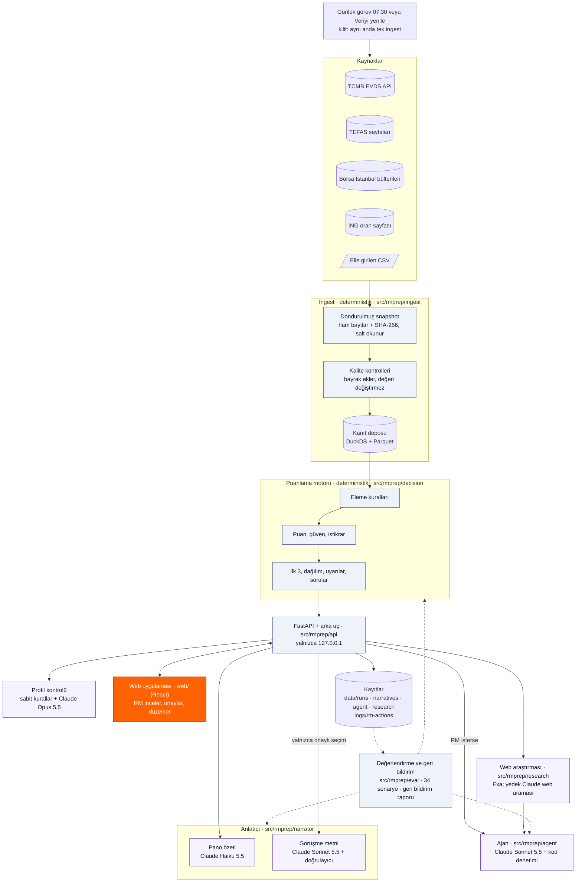
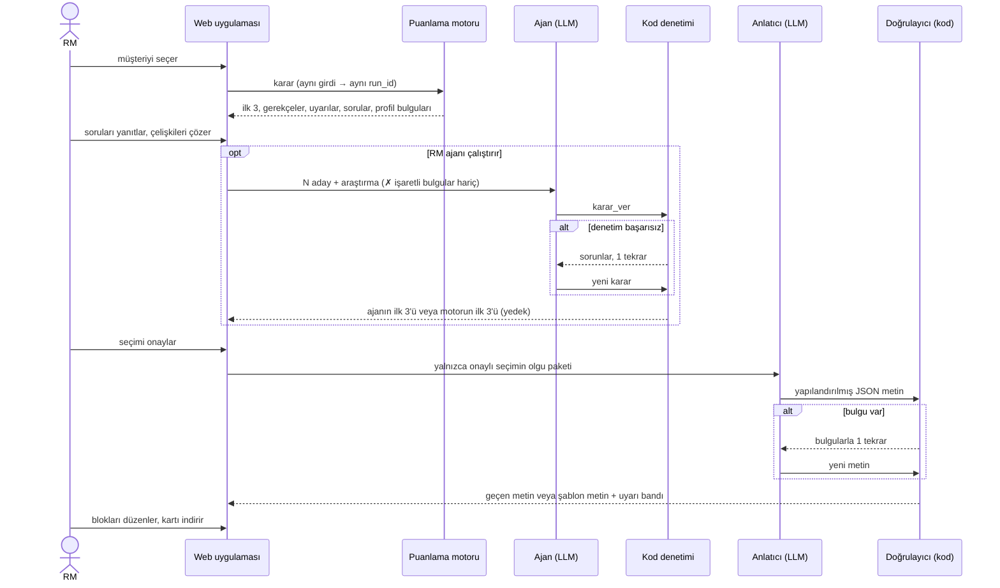
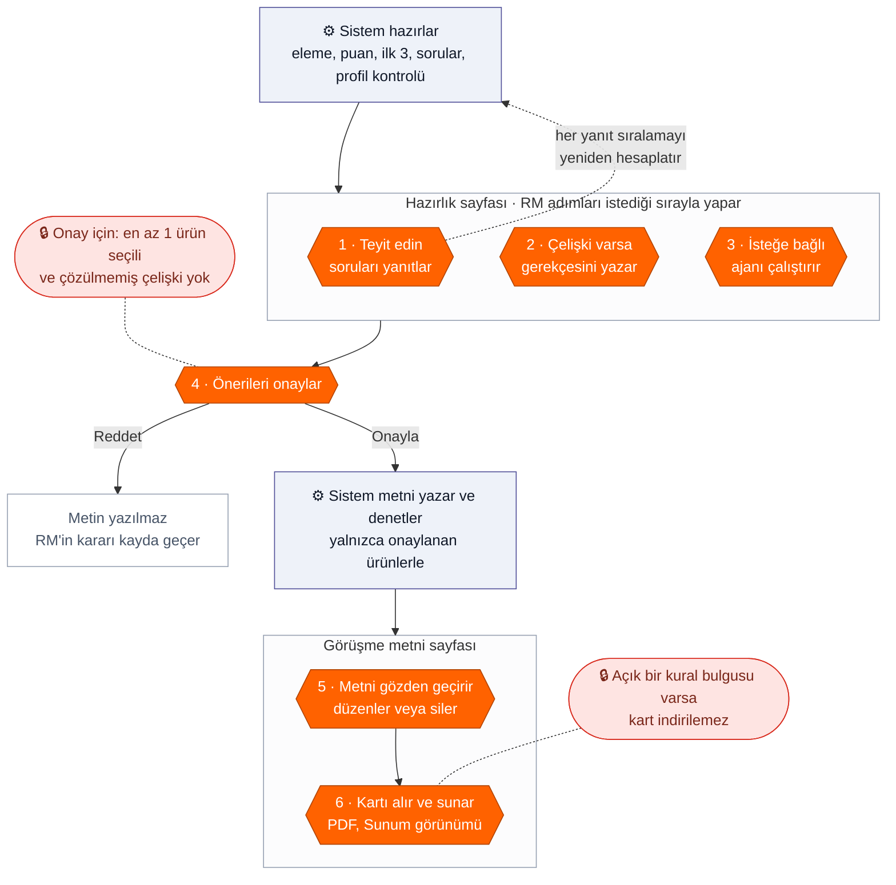

# Çözüm tasarımı

> Teslimat 4 · Agent 007 (Yusuf Ardahan Doğru, Öykü Irmak Hatipoğlu) · 2026-10-28.
> Ölçümler: son tam değerlendirme `data/eval/20261017-160939-n12-client-page`
> (dondurulmuş anlık görüntü `20261014-233110-1565`, karar yapılandırması
> `dda3ae095519`, anlatıcı `claude-sonnet-5-5` istem `n12`, hakem
> `claude-haiku-5-5`), ajan değerlendirmesi `20261015-182316` (8 karar) ve
> `docs/found-and-fixed.md`. Model, sınır ve maliyetler `config/*.yaml` ve
> README bölüm 5'ten alınmıştır. **[VARSAYIM]** ile işaretli noktalar
> ölçülmedi veya mentorlarla teyit edilecek.

## 1. Mimari özeti

Sistem beş katmandan oluşur: veri toplama (ingest), deterministik puanlama
motoru, motorun sınırları içinde çalışan yapay zekâ adımları (profil kontrolü,
web araştırması, ajan, anlatıcı), RM'in çalıştığı yerel web uygulaması ve
değerlendirme ile geri bildirim. Kararı kod verir; dil modeli yazar, araştırır
ve nitel karşılaştırma yapar; modelin her çıktısını kod denetler; son sözü RM
söyler. Şemada mavi kutular kodu, mor kutular yapay zekâyı, turuncu kutu RM'in
çalıştığı ekranı gösterir.

**Veri akışı.** Ingest her gün 07:30'da Windows Görev Zamanlayıcı ile çalışır
(kaçan başlangıç bilgisayar açılınca çalışır, konsol penceresi yok, günlük
`data/logs/ingest.log`); RM de *Veri* menüsündeki "Veriyi yenile" ile ingest
başlatabilir (yaklaşık 16 dk). Ingest yalnızca robots.txt'nin ve kullanım
koşullarının izin verdiği sayfaları okur: TEFAS `/api/` yolu yapılandırmada
reddedilir, `kap.org.tr` hiç okunmaz. Ham veri önce salt okunur bir anlık
görüntüye yazılır, kalite kontrollerinden geçer ve kanıt deposuna kanıt
kimliğiyle girer. Puanlama motoru yalnızca bu kanıtları okur; evren 1.444
seçenektir (815 fon, 37 BYF, 590 pay, 2 ING mevduatı). Stopaj oranları kaynak
adresi ve bitiş tarihiyle (31.12.2026) elle girilir; kodda vergi oranı yoktur.
Yıllık TÜFE EVDS'den gelir (%29,73), elle girilen satır çapraz kontrol olarak
kalır. ING oranları ING'nin kamuya açık oran sayfasından okunur; sayfa
açılmazsa önceki gün, o da yoksa elle girilen yedek CSV kullanılır.

**İstek akışı.** RM bir müşteriyi açınca API motoru çalıştırır (aynı girdi →
aynı `run_id`). Çalıştırma hazır olunca arka planda üç iş başlar: pano özeti,
profilin AI kontrolü ve ilk 3 için web araştırması. Ajan yalnızca RM "Ajanı
çalıştır" dediğinde başlar. Görüşme metni yalnızca RM'in onayladığı seçim için
yazılır. RM'in her işlemi kayda geçer; değerlendirme paketi ve `rmprep
feedback` bu kayıtları sonradan okur.

## 2. Bileşenler

| Bileşen | Sorumluluk | Teknoloji | Tür | Dosya / modül |
|---|---|---|---|---|
| Kaynak adaptörleri | TCMB EVDS (politika faizi, USD/TRY, fonlama maliyeti, mevduat faizi, TÜFE, BIST 100); TEFAS getiri ve detay sayfaları (~2.100 fon ve BYF; valör, ücret, alım durumu, portföy dağılımı); Borsa İstanbul gün sonu bültenleri (628 pay); ING oran sayfası; elle CSV (stopaj, TÜFE çapraz kontrolü, ING yedeği); bozuk satırı nedeniyle kaydeder | Python, httpx, openpyxl | Deterministik | `src/rmprep/ingest/adapters/` (`evds`, `tefas_web`, `tefas_detail`, `bist_bulletin`, `ing_web`, `manual`), `config/sources.yaml` |
| Günlük ingest ve kilit | 07:30'da ingest; kilit dosyası ile aynı anda tek ingest (`IngestBusy`, CLI çıkış kodu 3; 2 saatten eski kilit bayat sayılır); günlük dosyası | PowerShell, cmd, Python | Deterministik | `scripts/schedule_ingest.ps1`, `scripts/run_ingest.cmd`, `ingest/pipeline.py`, `api/ingest_job.py` |
| Anlık görüntü | Ham veriyi değişmez ve özetli (SHA-256) saklar; kullanılan yapılandırmanın kopyası | Dosya sistemi | Deterministik | `ingest/snapshot.py` |
| Kalite kontrolleri | Aralık dışı, bayat, çakışan, yinelenen, doğrulanmamış seri, yedek anlık görüntü → bayrak; değer değişmez | Saf fonksiyonlar | Deterministik | `ingest/quality.py` |
| Kanıt deposu | Her değeri kimliği, kaynağı, değer tarihi ve alınma zamanıyla saklar, Parquet'e aktarır | DuckDB | Deterministik | `ingest/store.py` |
| Puanlama motoru | Evren, 4 eleme kuralı, 8 ölçüt − 8 ceza, veri güveni, istikrar, ilk 3 (Dengeli/Agresif: sınıf başına en çok 1), sorular, "Teyit edin" maddeleri, uyarılar (müşteri / yalnızca RM) | Python, YAML | Deterministik | `src/rmprep/decision/`, `config/decision.yaml` |
| Dağılım ve mevcut portföy | Risk profiline göre sınıf başına model bant (Ata Yatırım, 28.04.2026); müşterinin mevcut dağılımı (müşteri dosyası, RM girişi, RM onaylı tahmin; yoksa meslek tablosu veya TCMB FİR 2026-I ortalaması ile tahmini senaryo); "Portföy açığı" ölçütü yalnızca RM'in girdiği, onayladığı veya dosyada olan dağılımla çalışır | Python, YAML; React | Deterministik | `decision/allocation.py`, `decision/holdings.py`, `web/src/components/OptionsAllocation.tsx` |
| Profil kontrolü | 8 sabit kural (`config/profile_checks.yaml`) ve profilin tamamında AI çelişki taraması; AI bulgusu iki tarafı da kelimesi kelimesine alıntılar, sunucu alıntıyı alanında bulamazsa bulguyu atar | Python + Claude Opus 5.5 | Kural + LLM + kod denetimi | `api/profile_checks.py`, `api/profile_ai.py` |
| Web araştırması | İlk 3 ve şirketleri için son 90 günün haberleri ve öne çıkanları; RM'in sorusu (en çok 300 karakter, soru kontrolü: müşteri bilgisi dışarı gitmez); her bulgu "web kaynağı, doğrulanmamış" etiketi taşır; RM'in ✓/✗ işaretleri | Exa `/search` (yedek: Claude Haiku 5.5 web araması) | LLM / arama + kod denetimi | `src/rmprep/research/`, `api/research.py`, `config/research.yaml` |
| Ajan | Motorun en iyi 10 adayı (RM 3–20 seçer) arasından kendi ilk 3'ünü önerir; araçlar `karsilastir`, `arastir`, `karar_ver`; kod denetimi, 1 tekrar, sonra motorun ilk 3'ü; beş adımlı süreç görünümü | Claude Sonnet 5.5 (araç kullanımı) | LLM + kod denetimi | `src/rmprep/agent/`, `config/agent.yaml` |
| Pano özeti | RM'e 1–2 cümle | Claude Haiku 5.5 | LLM + kod denetimi | `narrator/brief.py`, `rmprep/brief.py` |
| Görüşme metni | Onaylanan seçimden yapılandırılmış hazırlık ve konuşma metni; kodla yazılan piyasa notu | Claude Sonnet 5.5 | LLM + kod denetimi | `narrator/` (`facts`, `prompt`, `llm`, `validator`, `template`, `market`, `service`), `config/narrator.yaml` |
| Blok düzenleme kontrolü | RM'in değiştirdiği bloğu yeniden denetler; silinen blok `""` olarak saklanır; "yatırım tavsiyesi değildir" cümlesi her zaman kalır | Python | Deterministik | `src/rmprep/edits.py`, `narrator/blocks.py` |
| Orkestrasyon ve JSON API | Çalıştırma, onay, çelişki gerekçeleri, mevcut dağılım (`POST /holdings`), ingest durumu (`GET/POST /api/ingest`, çakışmada 409), müşteri yükleme, sıfırlama (arşive taşır), arka plan işleri; iş kuralı eklemez | FastAPI, uvicorn | Deterministik | `src/rmprep/backend.py`, `src/rmprep/api/` |
| RM işlem kaydı | RM'in her işlemi (açma, yanıt, dağılım, onay, ret, not, düzenleme, silme, ✓/✗, ajan başlatma, kart indirme, araştırma sorusu) sürüm bilgileriyle bir JSON satırı olarak | Python | Deterministik | `api/action_log.py`, `data/logs/rm-actions/<gün>.jsonl` |
| Web uygulaması | Yalnızca Türkçe ekran: pano (profil bulguları, Gündem, "Teyit edin", piyasa notu, ajan kutusu ve adımları, öneriler: Tablo · Kartlar · Dağılım), "Bu öneriler nasıl seçildi?", fon kartı ("Neden bu öneri?"), kanıt penceresi, araştırma paneli, görüşme metni (blok düzenleme, bölüm silme, geri alma), Sunum görünümü ve PDF, veri tazeliği satırı | React, TypeScript, Tailwind, Vite | Arayüz + insan kararı | `web/` |
| Değerlendirme ve geri bildirim | 34 senaryo, 15 kural kontrolü, LLM hakemi, ajan değerlendirmesi ve kör A/B hakemi; `rmprep feedback`: RM işlem kaydından beş ölçü ve eşiğe bağlı öneriler (ayarı kendiliğinden değiştirmez, LLM kullanmaz) | Python + Claude Haiku 5.5 (hakem) | Deterministik + LLM hakem | `src/rmprep/eval/`, `config/eval.yaml`, `config/feedback.yaml` |

Modüller `src/rmprep/contracts.py` dosyasındaki ortak veri tipleri
(sözleşmeler) üzerinden konuşur; her modülün kendi testleri ve tasarım belgesi
vardır (`docs/ingest.md`, `docs/decision.md`, `docs/agent.md`,
`docs/research.md`, `docs/narrator.md`, `docs/web-ui.md`, `docs/eval.md`).

## 3. Yapay zekânın rolü ve sınırları

Ana ilke her yapay zekâ adımında aynıdır: dil modeli hiçbir ürünü elemez ve
hiçbir eleme kuralını aşamaz, çünkü eleme ve puan kod ile belirlenir. Modelin
her çıktısını kod denetler; denetimden geçmeyen bir çıktının yerine her zaman
deterministik bir yedek gelir. Model hata yapsa da RM boş bir ekranla veya
uydurulmuş verilerle karşılaşmaz.

| Bileşen | Model | Ne yapar | Nasıl güvence altına aldık | Maliyet |
|---|---|---|---|---|
| Ajan ilk 3 | Claude Sonnet 5.5 | motorun en iyi 10 adayı (RM 20'ye kadar seçebilir) arasından kendi ilk 3'ünü seçer | kod denetimi (1 tekrar), sonra motorun ilk 3'ü | karar başına ~0,05-0,10 $ (günde en çok 3 $ ile sınırlandırıldı) |
| Web araştırması | Exa (yedek: Claude Haiku 5.5 web araması) | ilk 3 ve şirketleri için haberleri ve öne çıkanları toplar, RM'in sorularını yanıtlar | soru kontrolü (müşteri bilgisi dışarı gitmez), kaynağı olmayan bulgu atılır, "doğrulanmamış" etiketi eklenir | ürün başına ~0,02 $ (günde en çok 5 $ ile sınırlandırıldı) |
| Profil kontrolü | Claude Opus 5.5 | müşteri profilinin tamamında çelişki arar | var olan çelişkileri gösterir | profil başına ~0,015 $, sonuç kaydedilir, aynı profil için model yeniden çağrılmaz |
| Görüşme metni | Claude Sonnet 5.5 | onaylanan seçimleri metne çevirir | doğrulayıcı, 1 tekrar, sonra şablon metin | metin başına 0,034 $, ortalama 24,9 sn |
| Pano özeti | Claude Haiku 5.5 | RM'e 1-2 cümlelik bir özet yazar | doğrulayıcı, hata olursa düz bir cümle | ~0,003 $ |
| Değerlendirme hakemi | Claude Haiku 5.5 | metnin müşteriye uyarlanmış, açık ve dengeli olup olmadığını kontrol eder, ajan ile motor sonucunu karşılaştırır | yalnızca kodun tek başına ölçemediği şeyler için | paket başına < 0,01 $ |

Aşağıdaki şema baştan sona görev ve karar akışını gösterir:

### 3.1 Ajan

- **Başlangıç.** Ajan kendiliğinden başlamaz. RM *Ajan değerlendirmesi*
  kutusunda aday sayısını (3–20, varsayılan 10) seçer ve "Ajanı çalıştır" der.
  Aday listesi motorun ilk 3'üyle başlar ve ekran sırasıyla dolar; böylece
  ajan motorun seçimini her zaman görür.
- **Girdi: veri paketi (kod).** Müşteri profili, varlık sınıfı başına mevcut
  dağılım (kaynağıyla ve "tahmin" bayrağıyla), adayların puan parçaları,
  olguları, uyarıları, istikrarı ve güveni, araştırma bulguları (bulgu
  kimlikleriyle). Paket `<veri>…</veri>` içinde gider; sistem istemi
  araştırmanın talimat değil veri olduğunu söyler. ✗ işaretli bulgu pakete
  girmez; ✓ işaretli bulgu "(web, RM doğruladı)" etiketini alır.
- **Araçlar.** `karsilastir(a, b, amac)` iki adayı kodla karşılaştırır (en çok
  4 kez); `arastir(option_id, soru, amac)` bir aday için tek bir web sorusu
  sorar (en çok 2 kez); `karar_ver(secimler, cikanlar, ozet)` kararı önerir.
- **Kod denetimi.** 3 farklı aday; en çok 1 pay; varlık sınıfı kuralı; her
  gerekçe bir kanıt kimliğine (E…), bir bulgu kimliğine (F…), bir puan
  parçasına (`puan:<ölçüt>`) veya bir portföy satırına (`portfoy:<sınıf>`)
  atıf yapar; gerekçedeki her sayı ve tarih atıf yapılan veride vardır; yasak
  ifade yoktur; motorun listesinden çıkarılan her seçenek için bir gerekçe
  vardır. "(tahmini dağılıma göre)" ve "(web, doğrulanmamış)" etiketlerini kod
  ekler.
- **Yedek.** Denetim ikinci kez geçmezse, 90 saniye aşılırsa, bir araç
  sınırını aşarsa, günlük bütçe (3 $) dolarsa veya sağlayıcı hata verirse RM'in
  önüne motorun ilk 3'ü gelir ve nedeni yazılır. Maliyet defteri okunamazsa
  çağrı yapılmaz.
- **Görünürlük.** RM beş adımı (Adaylar, Ajan araştırması, Ajan analizi,
  Kontrol, Karar) süresi, maliyeti ve Türkçe notlarıyla izler. Notlar her araç
  çağrısının `amac` alanından ve denetim sonuçlarından gelir; modelin ham
  düşüncesi gösterilmez ve saklanmaz. RM motorun ilk 3'ünü her zaman ajanın
  önerisiyle yan yana görür.
- **Yeni çalıştırma.** RM ajanı çalıştırdıktan sonra bir dağılım girerse veya
  bir soruyu yanıtlarsa yeni bir çalıştırma oluşur; ajan aynı aday sayısıyla
  bu çalıştırmada kendiliğinden yeniden çalışır.

### 3.2 Web araştırması

Araştırma ürün başınadır, müşteri başına değildir. Dışarıya yalnızca ürün ve
şirket adı gider; persona hiçbir zaman gitmez. RM'in sorusu önce soru
kontrolünden geçer. Kaynağı olmayan bulgu atılır; her bulgu kaynak alanını,
tarihini ve "web kaynağı, doğrulanmamış" etiketini taşır. Sonuç (ürün, dil,
gün) anahtarıyla saklanır; aynı fon için aynı gün ikinci çağrı yapılmaz.
Araştırma puanı, kuralları, motorun önerisini ve görüşme metnini değiştirmez;
yalnızca RM'in bilgisi ve ajanın girdisidir. `EXA_API_KEY` yoksa Claude web
araması kullanılır.

### 3.3 Profil kontrolü

İki katman vardır. 8 sabit kural motorun okuduğu değerlere bakar (ör.
"Muhafazakâr" profil ile büyüme önceliği). AI kontrolü (Claude Opus 5.5)
profilin tamamını, serbest metin dahil, okur; her bulgu iki tarafı da
kelimesi kelimesine alıntılamalıdır ve sunucu alıntıyı adı geçen alanda
bulamazsa bulguyu atar. Sonuç profil içeriğiyle saklanır; günlük sınır 1
$'dır. Bitmemiş veya başarısız bir AI kontrolü onayı engellemez.

### 3.4 Görüşme metni ve pano özeti

- **Girdi: olgu paketi (kod).** Persona bağlamı, RM'in onayladığı seçim, her
  seçeneğin gerekçeleri ve kanıt kimlikli sayıları (reel 1 yıllık getiri
  dahil), erişim, ücretler ve varlık sınıfına göre sabit risk notu
  (`config/narrator.yaml` `risk_notes`), yalnızca müşteriye yönelik uyarılar,
  varsayımlar, sorular ve dağılım satırları. Tahmini dağılımın sayıları pakete
  girmez; elenen ürünler adla girmez; RM'e özel uyarılar pakete hiç girmez.
- **Çıktı: yapılandırılmış JSON (istem `n12`).** Her cümle seçenek ve kanıt
  kimliklerini taşır. Öneriler bölümünde her fon için 1–2 kısa cümle: bu
  müşteriye neden uyduğu ve varsa fonun kendi ödünleşimi. Ortak risk dikkat
  bölümünde bir kez yer alır; iki fikir tek cümlede birleştirilmez. Piyasa
  notunu (politika faizi, USD/TRY, fonlama maliyeti) dil modeli değil kod yazar.
- **Doğrulayıcı (kod).** Metin şu durumlarda reddedilir:
  - olgu paketinde olmayan bir sayı veya tarih; tahmini dağılımdan alınmış
    bir sayı; iç değer (puan, sayım, bayrak adı);
  - izin verilmeyen bir seçenek adı (elenen veya listede olmayan ürün);
  - yasak ifade ("garanti", "risksiz", "kesin getiri" vb.; fon adları ve
    kurucu adları taramadan önce çıkarılır, "Garanti Portföy GZP" bu yüzden
    hata sayılmaz);
  - kaynaksız cümle veya var olmayan kimlik;
  - ING ürün adının yanında ING'ye ait olmayan bir oran;
  - öneriler bölümündeki bir cümleyi tekrar eden dikkat cümlesi;
  - müşteri önceliği olmayan ihtiyaç etiketi, eksik bölüm, eksik varsayım,
    eksik "yatırım tavsiyesi değildir" cümlesi.
- **Hata yolu.** Bulgularla bir kez yeniden denenir; ikinci hatada olgu
  paketinden kurulan şablon metin ve "Otomatik metin doğrulanamadı" bandı
  gelir. Pano özeti için tekrar yoktur; hata veya API sorununda personanın düz
  cümlesi kalır.
- **Önbellek ve maliyet.** Metin (çalıştırma, dil, istem sürümü, model, olgu
  paketinin özeti) anahtarıyla diske yazılır; aynı seçim ikinci çağrı yapmaz.
  Sistem istemi önbelleğe alınır. Günlük sınır 5 $'dır; aşılırsa şablon metin
  gelir. Her çağrı maliyet defterine yazılır. Son tam değerlendirmede yeni
  metin başına maliyet 0,034 $, süre ortalama 24,9 sn (en çok 54,13 sn) oldu.

## 4. İnsan onay noktaları

Sistem öneriyi hazırlar, ama hiçbir şey RM görmeden ve onaylamadan sonraki
aşamaya geçmez. Turuncu altıgenler RM'in karar verdiği yerlerdir; mavi kutular
sistemin kendi başına yaptığı işlerdir; kırmızı kutular kilitlerdir: RM bir
şeyi tamamlamazsa sistem o noktadan ilerlemez.

| # | RM kontrolü | Sistemin zorladığı kural |
|---|---|---|
| 1 | Veriyi yeniler: "Veriyi yenile", bitince "Yeni veriyle aç" | Aynı anda tek ingest çalışır (kilit dosyası; ikinci istek 409 alır). Ekrandaki çalıştırma kendiliğinden değişmez; yeni veriye geçişi RM seçer |
| 2 | Belirsiz risk profili veya tanınmayan kısıt metnini yanıtlar | Engelleyici soru açıkken sıralama yapılmaz (`needs_rm_input`); her yanıt yeni bir çalıştırmadır |
| 3 | "Teyit edin" maddelerini (ör. yatırım tutarı dilimi; süresi geçmiş stopaj veya eski TÜFE) müşteriyle veya kaynakla kontrol eder | Motor eksik değeri sessizce tahmin etmez; güvenli düzeyi seçer ve varsayım olarak yazar. "Sorulacak" maddeleri onayı engellemez |
| 4 | Mevcut dağılımı "Tahmini onayla" ile kabul eder veya "Düzenle" ile girer | Tahmini dağılım RM onaylayana kadar puanı etkilemez ve metne sayı olarak girmez. Giriş beş sınıfın tümünü ister, toplam 100 ± 0,5 olmalıdır |
| 5 | Profil çelişkisini çözer: "Müşteriyle teyit edildi: …" gerekçesini yazar veya "Profili düzelt" der | Çözülmemiş çelişki varken onay reddedilir ("Çözülmemiş çelişki var"). Gerekçe çalıştırmanın yanına, işlem kaydına ve karta yazılır |
| 6 | Açık bir kısıtı gerekçeyle kaldırır (P02 döviz sınırı) | Kaldırma yalnızca RM yanıtıyla olur ve varsayım olarak kayda geçer |
| 7 | Profili düzenler veya yeni bir müşteri dosyası yükler | Düzenlenmiş profil onaylanabilir; kartta "Düzenlenmiş profil ile hazırlandı" ve değişiklikler yazar. Yükleme şemaya göre denetlenir; ekran "Gerçek müşteri verisi yüklemeyin" uyarısını verir |
| 8 | İsteğe bağlı: ajanı çalıştırır (3–20 aday), her web bulgusunu ✓ veya ✗ ile işaretler, kendi araştırma sorusunu sorar | Ajan kendiliğinden başlamaz. ✗ işaretli bulgu ajana verilmez. Müşteri bilgisi içeren soru reddedilir. Motorun ilk 3'ü her zaman ekranda kalır |
| 9 | Önerilerden seçimi yapar, not ekler, "Onayla ve metni hazırla" veya "Reddet" der | Onay için en az 1 ürün seçili olmalıdır. Karar zamanı Türkiye saatiyle kaydedilir. Görüşme metni yalnızca onaylı seçim için yazılır |
| 10 | Metni blok blok düzenler, blok veya bölüm siler; "Geri al" ile geri döner | Her blok yeniden denetlenir. "Riskler" bölümü silinemez; "yatırım tavsiyesi değildir" cümlesi her zaman kalır |
| 11 | Kartı (PDF veya Markdown) indirir; müşteriye Sunum görünümünü gösterir | Yasak ifade, izin dışı seçenek, iç bilgi veya ING etiket bulgusu açıkken kart indirilemez (olgu dışı sayı yalnızca uyarır). Sunum görünümü ve PDF sarı RM kutularını, notları ve kaynak numaralarını gizler |
| 12 | "RM notu · yalnızca sizin için" kutularını okur | RM'e özel uyarılar (ör. ING oranı ile piyasa farkı; eski stopaj veya TÜFE ile hesaplanan reel getiri, `stale_tax_input`) olgu paketine girmez, müşteri metninde yer almaz |

Sistemin müşteriye bir iletim kanalı yoktur: uygulama yalnızca RM'in
bilgisayarında (`127.0.0.1`) çalışır ve çıktıyı yalnızca RM görür (brief kuralı
4). Her adım (onay, ret, çelişki gerekçesi, ✓/✗ işareti, düzenleme, silme)
yapıldığı anda zamanıyla kayda geçer. Karar kaydı şunları tutar: çalıştırma
kimliği, yapılandırma özeti, anlık görüntü, dışlanan kaynaklar, kullanılan
persona ve değişiklikleri, RM durumu, seçim, notlar, çelişki çözümleri ve karar
zamanı (`data/runs/`); metin, model, istem sürümü, doğrulayıcı sonucu, RM
düzenlemeleri ve maliyet (`data/narratives/`); ajan kararı (`data/agent/`);
işlem kaydı (`data/logs/rm-actions/`). Zamanlar Türkiye saatiyledir
(`Europe/Istanbul`).

## 5. Güvenilirlik

- **Kaynak hatası.** Her kaynak için yapılandırmada `on_failure: previous`
  vardır: önceki anlık görüntüye dönülür ve satırlar `fallback_snapshot`
  bayrağı taşır. ING oran sayfası açılmazsa önceki gün, o da yoksa elle
  girilen yedek CSV kullanılır. Bir kaynak botları engelliyorsa engel aşılmaz.
  RM de bir kaynağı ekrandan dışlayabilir.
- **Günlük ingest.** Görev Zamanlayıcı ve "Veriyi yenile" aynı kilit dosyasını
  kullanır; ikinci ingest başlamaz (`IngestBusy`, CLI çıkış kodu 3). 2 saatten
  eski bir kilit bayat sayılır ve değiştirilir. Günlük dosyası her çalışmanın
  başlangıç, çıkış ve hata satırını tutar.
- **Eski veya eksik vergi ve enflasyon verisi.** Süresi geçmiş stopaj satırı
  veya eski TÜFE RM'e özel bir uyarı (`stale_tax_input`) ve bir "Teyit edin"
  maddesi verir. Reel getiri hesaplanamazsa seçeneğin veri güveni 0,8 ile
  çarpılır; eksik veri böylece ekranda görünür.
- **Yapay zekâ hatası.** Her model adımının deterministik bir yedeği vardır:
  ajan → motorun ilk 3'ü; Exa → Claude web araması, o da yoksa araştırma
  paneli kapanır; görüşme metni → şablon metin ve uyarı bandı; pano özeti →
  düz cümle; profil AI kontrolü → sabit kurallar ("AI kontrolü yapılamadı").
  Her adımın günlük maliyet sınırı vardır (ajan 3 $, araştırma 5 $, profil
  kontrolü 1 $, anlatıcı 5 $). Bir anahtar eksikse yalnızca o anahtara bağlı
  parçalar kapanır; puanlama motoru yine çalışır.
- **Tekrar ve belirlilik.** Anlık görüntüden sonraki her adım saf fonksiyondur:
  `rmprep replay <id>` ağa çıkmadan aynı çıktıyı yeniden üretir ve anlık
  görüntüde saklanan yapılandırmayı kullanır. Motor saat ve rastgelelik
  kullanmaz; aynı girdi aynı `run_id`'yi ve aynı sonucu verir; metin
  önbellekten aynen gelir (değerlendirme: 5/5 tekrar senaryosu). Ajan kararı
  ve araştırma sonucu da kaydedilir; aynı istek modeli yeniden çağırmaz.
- **İstikrar.** Her ağırlık ve cezanın üst sınırı ×0,8 ve ×1,2 ile
  değiştirilir ve sıralama 30–32 kez yeniden hesaplanır; önerilen seçenek için
  "öneri yine çıkıyor mu" oranı ekranda görünür.
- **İzlenebilirlik.** Her sayı bir kanıt kimliğine bağlıdır; ekrandaki "K"
  işareti değeri, kaynağı, değer tarihini, alınma zamanını ve bayrakları açar.
  Değerlendirmede "her seçenek ve her cümle kanıt gösterir" kontrolü 39/39
  çalıştırmada geçti.
- **Kalıcılık ve sıfırlama.** Onaylı ve reddedilmiş çalıştırmalar, çelişki
  çözümleri, blok düzenlemeleri, ajan kararları ve ✓/✗ işaretleri diske
  yazılır; sunucu yeniden başlarsa aynı girdi aynı kimliği verir ve kayıt geri
  yüklenir. "Sıfırla" kayıtları silmez, `data/reset-archive/` altına taşır;
  veriler, önbellekler ve işlem kaydı kalır.
- **Hız.** İlk sayfa ~33 sn, her müşteri geçişi ~6 sn sürüyordu. Kanıt
  sorgusunu varlığa göre dizdik, yapay zekâ kütüphanesini ilk kullanımda
  yükledik ve anlık görüntüyü arka planda okuduk. Karar süresi 2,86 sn'den
  1,18 sn'ye, sunucu açılışı 8,7 sn'den 2,3 sn'ye indi; ilk 3 aynı kaldı.
- **Testler.** `pytest` 150 dosyada 3.056 test toplar; web uygulamasının 458
  testi vardır. Hiçbir test ağa çıkmaz; dil modeli testleri sahte istemciyle
  çalışır.
- **Değerlendirme paketi.** 34 senaryo, 39 çalıştırma: temel personalar,
  persona ve kısıt değişiklikleri, erişilemeyen kaynak, hatalı veri ve 13
  regresyon senaryosu. Son tam çalışmada 15 kural kontrolü %100, kısıt ihlali
  ve risk tavanı aşımı 0 (37/37), uydurma veri yok 39/39, persona değişikliği
  beklenen yönde 21/21, doğrulayıcı 24/25 (%96; hedef ≥ %95), yasak ifade 0.
  Tek şablon metnin nedeni "Garanti Portföy GZP" adındaki "garanti"ydi;
  doğrulayıcı artık kurucu adını taramadan önce çıkarır. Hakemin dil puanları
  yön göstergesidir (uyarlanmış %50, açık %50, dengeli %58). Ajan
  değerlendirmesinde 8 kararın 8'i kod denetiminden geçti, hiçbiri yedeğe
  düşmedi. Ayrıntı Teslimat 5'tedir.

## 6. Neden bu tasarım?

1. **Deterministik çekirdek.** Uygunluk, eleme ve sıralama denetlenebilir,
   test edilebilir ve tekrar üretilebilir olmalıdır. Elimizde etiketli bir
   geçmiş veri yoktur; SPK yerindelik kuralı ve "kısıt ihlali sıfır" hedefi
   olasılıklı bir modele bırakılamaz. Tüm ağırlıklar, eşikler ve metin
   kalıpları `config/decision.yaml` içindedir; ayar bir yapılandırma
   değişikliğidir ve yapılandırma özeti kayda girer.
2. **Yapay zekâ yalnızca kuralın yetmediği yerde.** Müşteriye uyarlanmış bir
   metin, güncel haberler, iki adayın nitel farkı ve profilin serbest
   metnindeki çelişkiler kuralla iyi yakalanamaz; modelin katkısı buradadır.
   Kod her girdiyi sınırlar ve her çıktıyı denetler; bu yüzden bir model hatası
   yanlış bir öneriye dönüşemez, en kötü durumda deterministik yedeğe düşer.
3. **Sınırlı ve isteğe bağlı ajan.** Ajan, puanın gösteremediği sinyaller
   için vardır: güncel haberler, nitel karşılaştırma ve mevcut dağılım. Ajan
   motorun adayları içinde, üç araçla, araç ve süre sınırlarıyla ve kod
   denetimiyle çalışır. Kör A/B hakemi ajanın motordan daha iyi olduğunu
   göstermedi (adil karşılaştırmalarda ajan 3, motor 2, beraberlik 1); bu
   yüzden RM önce motorun önerisini görür, ajanı isterse çalıştırır ve iki
   listeyi yan yana karşılaştırır. Ajan sayısı bir hedef değildir.
4. **Görüşme metni tek çağrı.** Her metin tek çağrıdır (en çok bir tekrar).
   Bu yapı maliyeti (metin başına 0,034 $), süreyi ve davranışı öngörülebilir
   kılar.
5. **RM her adımda karar verir.** Sorular, çelişki gerekçesi, dağılım onayı,
   ✓/✗ işaretleri, seçim onayı ve metin düzenleme RM'indir. Kilitler (çözülmemiş
   çelişki, açık kural bulgusu) yanlış bir çıktının müşteriye ulaşmasını önler.
6. **Yerel web uygulaması.** Sunucu yalnızca `127.0.0.1` adresine bağlanır;
   müşteriye iletim ve otomatik işlem yoktur. Ekran yalnızca Türkçedir;
   İngilizce metinler kodda kalır ve API `?lang=` parametresini tutar.

**Geliştirme süreci (çalışma zamanı değil).** Sistem bir lider ve modül
başına bir işçi Claude Code oturumuyla, ayrı git çalışma ağaçlarında
geliştirildi. Sözleşmeler (`contracts.py`) lider tarafından donduruldu; her
adım yeşil `pytest` ile kapandı (`docs/workflow.md`). Bu çoklu ajan yapısı
yalnızca yapım içindir; ürün çalışırken kullanılmaz.

**Ödünleşimler.**

- Veri kamuya açık kaynaklardan ve elle girilen satırlardan gelir. Stopaj
  oranları programın okuyabileceği bir kaynakta yayımlanmaz; bu yüzden elle
  girilir ve bitiş tarihinden sonra RM uyarılır.
- KAP otomatik erişimi engellediği için kullanılmaz; fon belgeleri için fon
  yöneticisinin kendi sitesindeki izahnameye bağlantı verilir, şirket haberleri
  web araştırmasıyla toplanır. Web bulguları doğrulanmamıştır; RM'in ✓/✗
  işareti bu açığı kısmen kapatır.
- Çok varlıklı fonların varlık sınıfı tek günün portföy dağılımından gelir
  (portföyün en az %50'si; yoksa dengeli); bu, yaklaşık 214 fonun sınıfını
  değiştirdi. Para piyasası, hisse, kıymetli maden ve TL borçlanma fonları
  türlerinin sınıfında kalır, çünkü tek günün dağılımı yanıltıcı olabilir.
- Kural tabloları, risk bantları ve ağırlıklar uzman görüşüyle değil, bizim
  yargımızla kuruldu **[VARSAYIM]**; istikrar testi ve değerlendirme paketi
  etkilerini ölçer.
- Mevcut dağılım müşteri dosyasında yoksa meslek tablosundan veya ulusal
  ortalamadan tahmin edilir; tahmin RM onaylayana kadar puanı etkilemez.
- Persona metni yalnızca tam eşleşmeyle okunur; tanınmayan ifade soru olur.
  Bu güvenlidir ama RM'e ek iş çıkarır. AI profil kontrolü bu açığın bir
  kısmını kapatır.
- Ajan ve profil kontrolü model çağrısı yapar; aynı girdi önbellekten aynı
  sonucu verir, ama önbellek sıfırlanırsa ajanın ilk 3'ü değişebilir (yeniden
  çağrıda 24 önerinin 21'i korundu).

**Üretimde değiştireceklerimiz.**

- Banka sistemleri: müşterinin gerçek portföyü ve tutarı (tahmini dağılım
  yerine), gerçek ürün raf listesi, ING oranlarının ve stopaj tablosunun resmî
  akışla gelmesi.
- Dağılım bantlarının bankanın kendi model portföyleriyle değişmesi
  **[VARSAYIM]**.
- Kimlik doğrulama, rol yetkisi ve kayıtların (karar kaydı, RM işlem kaydı)
  merkezi, değiştirilemez bir denetim deposuna yazılması.
- Günlük ingest'in bir dizüstü bilgisayar yerine izlenen bir sunucu işi
  olarak çalışması.
- KAP bildirimleri: lisanslı bir veri akışıyla eklenmelidir **[VARSAYIM]**.
- Müşteri verisi bankadan çıkmadan önce KVKK değerlendirmesi ve banka onaylı
  bir model ortamı; bugün profil, AI özeti, metin ve ajan için Anthropic'e
  gider (bu yüzden ekran gerçek müşteri verisi yüklenmesine karşı uyarır).
- Geri bildirim döngüsünün otomatikleşmesi: `rmprep feedback` bugün yalnızca
  öneri verir ve ayarı değiştirmez; gerçek RM kullanımı ve daha çok müşteri
  ile değerlendirme döngüsü önerilen ayarları test edip uygulayabilir.
